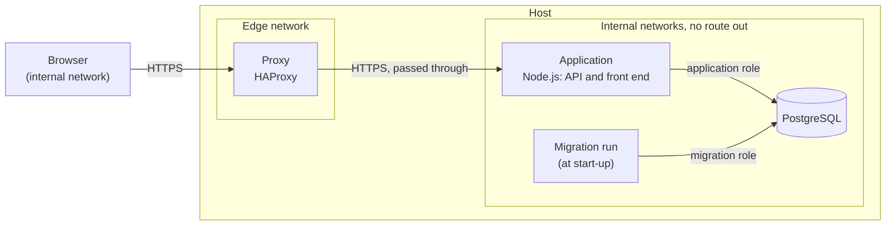

# Fathom: Architecture

**Status:** Proposal for the maintainer's review
**Last updated:** 2026-10-30

A high-level view of Fathom's parts and how they connect. It stays at the level of containers and networks; how each part is built is in the documents linked below.

## Overview

## Parts

- **Proxy:** The only container users reach. It passes encrypted connections through to the application unchanged, naming each user's address, and holds no certificate. Chosen in [ADR 0003](../adr/0003-edge-proxy.md).
- **Application:** One Node.js server that serves the React front end and the API over HTTPS. Every read and write of data goes through its data access layer, which applies access checks.
- **Database:** PostgreSQL, reachable only from the application and the migration run.
- **Migration run:** Applies database migrations as a separate role at start-up, then stops, so the application never holds that role's password.

## Networks

- **Edge network:** The proxy alone, with the HTTPS port published on the host.
- **Proxy to application:** An internal network with no route out.
- **Application to database:** An internal network with no route out, which the proxy is not on.

So no part except the proxy can reach the internet, and the proxy cannot reach the database.

## Related Documents

- [ADR 0001](../adr/0001-tech-stack.md) and [ADR 0002](../adr/0002-libraries.md): the technology and libraries.
- [Development Setup](development-setup.md): the repository layout and how to run Fathom locally.
- [Security Plan](../security/security-plan.md): threats and how each is mitigated.
- [Deployment](../operations/deployment.md): the first server Fathom runs on.
