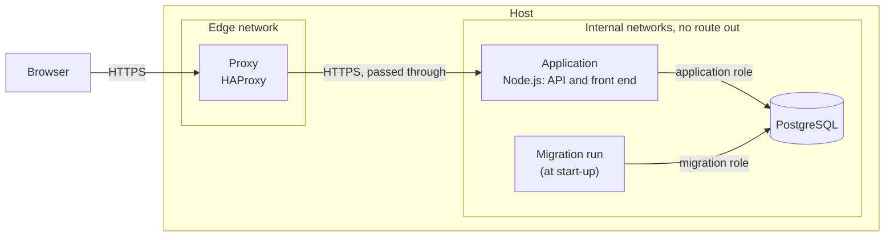
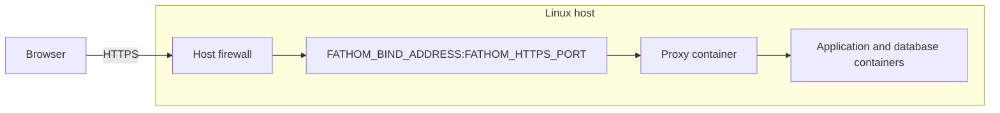
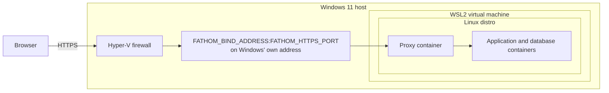

# Fathom: Architecture

**Last updated:** 2026-11-18

A high-level view of Fathom's parts and how they connect. It stays at the level of containers and networks; how each part is built is in the documents linked below.

## Overview

## Parts

- **Proxy:** The only container users reach. It passes encrypted connections through to the application unchanged, naming each user's address, and holds no certificate. Chosen in [ADR 0003](../adr/0003-edge-proxy.md).
- **Application:** One Node.js server that serves the React front end and the API over HTTPS. Help is built into the front end, so it always matches the build. Every read and write of data goes through its data access layer, which applies access checks.
- **Database:** PostgreSQL, reachable only from the application and the migration run.
- **Migration run:** Applies database migrations as a separate role at start-up, then stops, so the application never holds that role's password.

## Networks

- **Edge network:** The proxy alone, with the HTTPS port published on the host.
- **Proxy to application:** An internal network with no route out.
- **Application to database:** An internal network with no route out, which the proxy is not on.

So no part except the proxy can reach the internet, and the proxy cannot reach the database.

## Where Fathom Runs

The containers are the same everywhere; what differs is how a browser's connection reaches the proxy. [Supported Platforms](../operations/supported-platforms.md) lists the hosts.

### On a Linux Host

Docker Engine runs on the host itself, so the proxy's published port is the host's own port.

### On Windows 11 With WSL2

Docker Engine runs inside a Linux distro in WSL2's lightweight virtual machine, with WSL2's mirrored networking: the distro shares Windows' network interfaces, so users' own addresses reach the proxy, and the Hyper-V firewall decides which connections get through.

On Windows Server, Fathom runs in a Linux virtual machine, such as one under Hyper-V, which is a Linux host as above. WSL2 there has only its default NAT networking, whose port proxy would hide each user's address.

On macOS, used for development only, Colima or Docker Desktop also runs the containers in a Linux virtual machine, with `localhost` passed through as WSL2's NAT mode does.

## Related Documents

- [ADR 0001](../adr/0001-tech-stack.md) and [ADR 0002](../adr/0002-libraries.md): the technology and libraries.
- [Development Setup](development-setup.md): the repository layout and how to run Fathom locally.
- [Security Plan](../security/security-plan.md): threats and how each is mitigated.
- [Securing Your Environment](../operations/securing-your-environment.md): what whoever runs Fathom must secure.
