# Checks and CI

How Fathom's checks run, on a contributor's computer and on GitHub, from a change to its merge.

What to test, and the commands to run, are in [Testing Standards](../standards/testing.md#running-tests). Each command's options are in [Development Setup](development-setup.md#checks-and-tests).

## What a Change Runs

`pnpm test:changed` chooses the tests a change can affect. This chart is part of [The Changed Tests](#the-changed-tests), at the end.

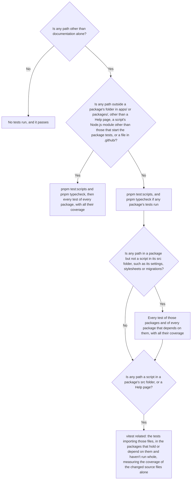

- **Imports:** a source file's tests are those that import it, directly or through other files, in its package and every package that depends on it.
- **A changed or removed test** counts as a change to the source file of the same name beside it. For a widely imported file, its importing tests can be most of a package's tests.
- **A Help page** in `docs/help/`, or a diagram in `docs/help/diagrams/`, isn't documentation alone, since Help is built into the web app. It stands for `apps/web/src/help-pages.ts`, which gathers the Help pages.
- **Not by import:** tests that reach code other than by importing it, such as building the web app, run in `pnpm check`.
- **The scripts' own code:** a change to the scripts' Node.js modules or a file in `.github/` runs the script tests alone, with no type check, since no package reads them and the type check covers the packages alone. Container tests run under `pnpm test:containers` instead.
- **Still every test:** a shell script, since the packages' tests run some, such as `scripts/lib.sh`, and the scripts that start the package tests, such as `scripts/package-tests.mjs`.

## Coverage of a Change

`pnpm test:changed` fails where GitHub's check would on coverage, without running every test. This chart is part of [The Changed Tests](#the-changed-tests).

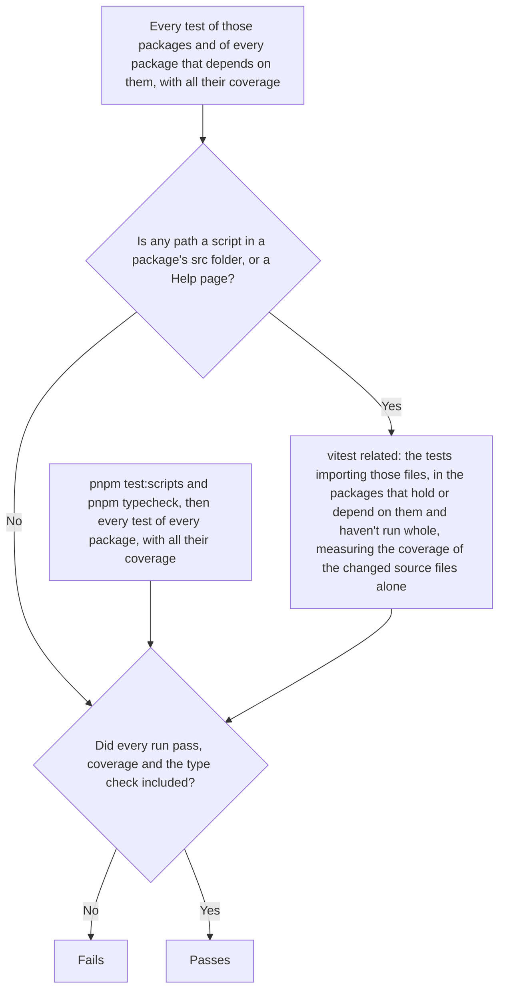

- **Whole packages:** settings, dependencies and files outside the source can change any file's coverage, so a package whose every test runs has all its coverage measured.
- **The changed files:** they're measured against their package's threshold, apart from those its coverage settings leave out.
- **The cost:** measuring coverage adds about a quarter to the time of the tests it measures.
- **The limits:** it can't tell which source a test of another name covers, nor see code a test reaches other than by importing it. So `pnpm check` and GitHub's check still enforce coverage in full.

## Before a Pull Request

While working, run `pnpm check:push`, as [Development Setup](development-setup.md#checks-and-tests) describes, or any one of its parts on its own for a quick answer. A check may wait its turn first; see [Sharing the Machine](#sharing-the-machine). This chart is part of [The Whole Path](#the-whole-path).

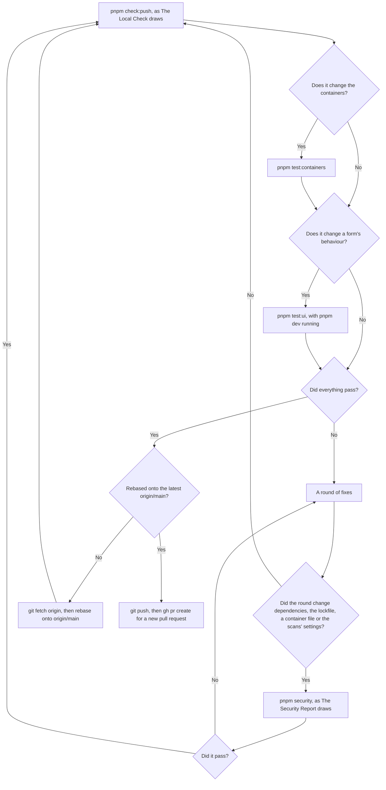

- **When:** these checks run before the code review, and again after each round of fixes, from a review or from the maintainer's feedback.
- **UI tests:** a change that alters a form's behaviour also runs `pnpm test:ui`. Neither `pnpm check:push` nor the Check workflow runs it, as [ADR 0013](../adr/0013-ui-tests.md) sets out.
- **Help pages:** a change to a Help page isn't documentation alone, since Help is built into Fathom, so it runs every check.

## The Check on GitHub

This chart is part of [The Whole Path](#the-whole-path); [The Check Workflow](#the-check-workflow) draws the workflow's jobs.

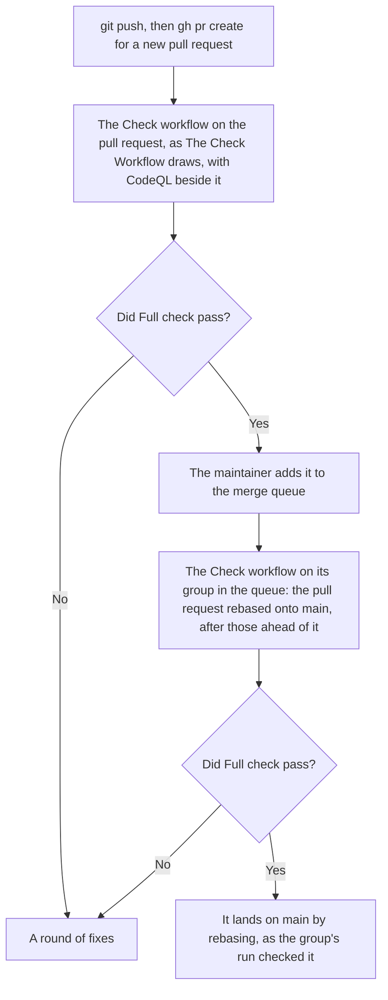

- **Every push** to a pull request, and every group in the merge queue, runs the full `pnpm check`, its package tests on runners of their own.
- **Documentation alone** means Markdown files, and files under `docs/` other than Help pages, which are built into Fathom. On a pull request or in the merge queue, it leaves out the package tests, the server's merged coverage and the container tests.
- **The security report** runs on every pull request, documentation alone included. It scans the container images whenever anything they're built from has changed, as the [Security Plan](../security/security-plan.md#vulnerability-scanning) sets out.
- **The full suite:** the green check on a pull request's latest push is the full suite's run, once for the whole branch of an [issue batch](../standards/issues.md#issue-batches) too.
- **Merging:** the merge queue checks each pull request on top of the `main` it lands on, and those ahead of it, so two changes that pass alone can't break `main` together. Its settings are in [Development Setup § Rulesets](development-setup.md#rulesets).
- **Failures:** follow the run with `gh pr checks --watch`, and read a failure or warning with `gh run view --log` (or `--log-failed`). Every warning it reports is fixed, as locally.
- **Locally:** running the full `pnpm check` is optional, for when the workflow can't run.

## Offline

`pnpm check --offline` and `pnpm check:push --offline` work without the internet, once `pnpm offline:prepare` has run while connected, as [Development Setup](development-setup.md#working-offline) describes. This chart is part of [The Local Check](#the-local-check).

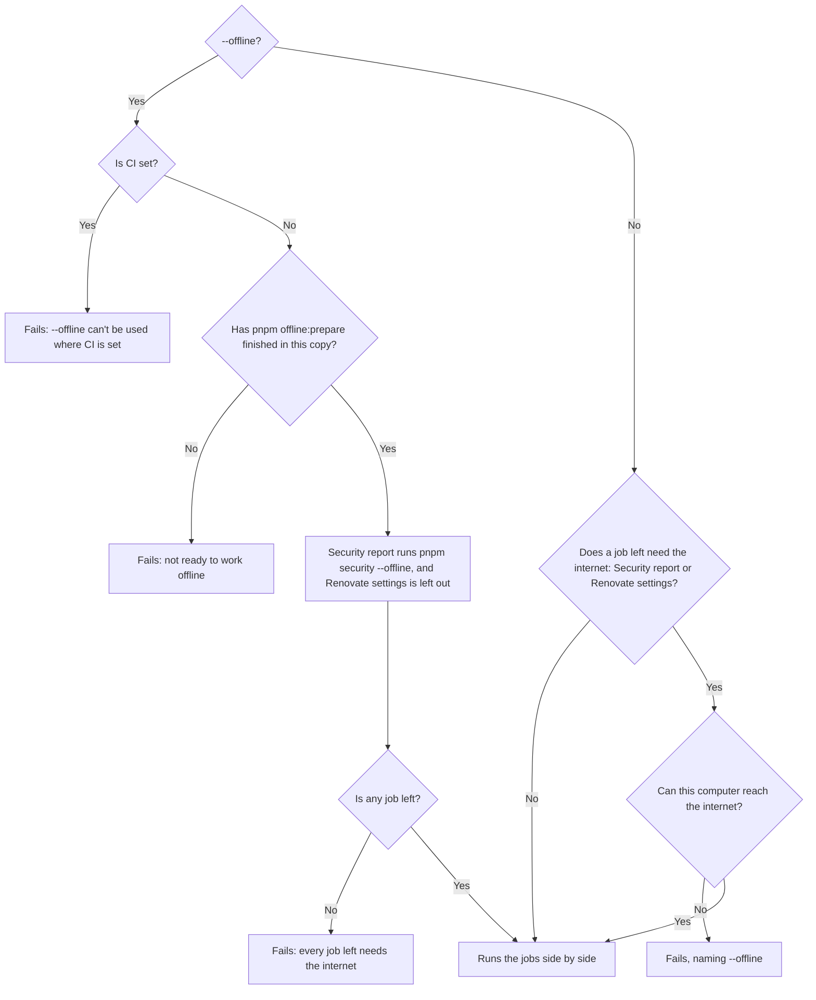

A branch checked offline still needs the Check workflow's full check to pass on its pull request.

## Sharing the Machine

A check runs many linters, type checks, scans and tests side by side, and can use every core of the computer. Several copies of the repository on one computer, each running a check, would slow each other until tests time out.

So checks take turns, two at a time, and stop a step that hangs. A check of documentation alone before a push is quick, so it takes no turn.

A turn is held as a slot file, and a check waiting for one leaves a ticket, so copies take their turns in the order they asked.

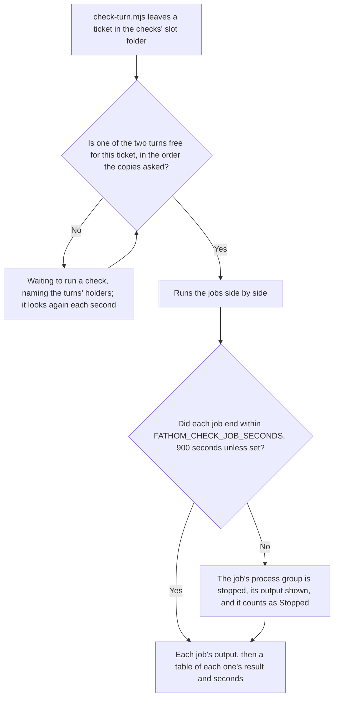

This chart is part of [The Local Check](#the-local-check), which also draws the checks a run makes before its turn.

- **Taking turns:** two copies may hold a turn at a time.
  - `pnpm check`, `pnpm check:push`, and `pnpm test:changed` when it runs tests, each take a turn before running their jobs, once their arguments and the connection are checked.
  - `pnpm test:ui` takes one once the development server answers, since the browser, the server and the database it loads slow a check beside it.
  - `pnpm test` takes one for its package tests only, after the script tests.
- **Waiting:** copies take their turns in the order they asked. A copy that has to wait says so straight away, naming the processes and folders that hold the turns, and how many copies asked first.
- **A check started by a check,** such as `pnpm test:changed` within `pnpm check:push`, uses the turn its check holds.
- **Cores:** each copy holding a turn sizes its workers for every core, as a check on GitHub does, and shares them with the other copy holding one.
- **Workers:** each package's tests use a share of the cores, leaving two free for the development servers. Four packages have long-running tests: the web app, the server, the database and the seed data. The cores are shared among those of the four a run tests, so on 18 cores the web app's tests alone get 16 workers, and each of the four gets 4 when all run. A package that starts test databases gets at most 12, the most measured. `VITEST_MAX_WORKERS` sets the number instead.
- **Side by side:** `pnpm test:changed` runs the script tests and the type check beside the package tests, and leaves them two more cores, so the web app's tests alone get 14 workers there.
- **Measured:**
  - **Workers:** the web app's tests took 106 seconds with 4 workers and 47 with 16. The server's took 224 seconds with 4 and 142 with 12, using about 2.5 cores at 4. The script tests took 29 seconds on about 1.3 cores, and the type check 5 on 1.7.
  - **Two at once:** the server's and the web app's tests alone, side by side, slowed each by about a third. A whole `pnpm test:changed` took 489 seconds beside the UI tests and other copies' checks, against 483 alone.
  - **Two turns:** both mean two copies finish sooner side by side than in turn, and three pairs of runs had no failures from load, so two copies hold turns at once.
- **Test databases:** no more than 8 test database servers start at once on one computer.
- **Time limit:** a check stops a job still running after 15 minutes, shows its output up to then, and fails it as Stopped, so a hung job never holds a turn for long. `FATHOM_CHECK_JOB_SECONDS` sets another limit.
  - `pnpm test:changed`, `pnpm test:packages` and `pnpm test`, run alone or within a check, stop each pnpm step they run past the same limit, naming the step, and fail.
  - A step stopped, by the limit or by the check stopping it, has every process it started killed if it hasn't ended two seconds later.
- **Slots and tickets:** they're files in a folder under the system's temporary folder, which only that account on the computer can use. A slot is held until the work is done.
- **Stale turns:** a slot or ticket whose process has ended is taken over or passed, as is a ticket its copy has stopped looking after for a minute.

## From a Change to a Merge

The whole picture: the charts below draw every step the checks take, from a change on its branch to its merge, and the daily scan of `main`, as the scripts and workflows run them. Diamonds are decisions, and each failure is an end of its own.

Other documents own what the charts only name:

- **The people's steps,** such as the screen check and the review: [How Fathom Is Built](../how-fathom-is-built.md#how-a-change-is-made)
- **The rules on `main`:** [Development Setup § Rulesets](development-setup.md#rulesets)

### The Whole Path

"Documentation alone" is as [The Check on GitHub](#the-check-on-github) defines it. No Git hook runs anything: each check runs when its command is run.

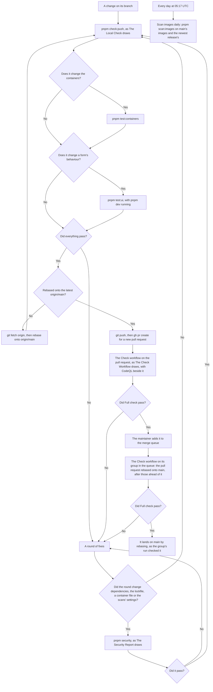

- **A new push to a pull request** starts a new run of the Check workflow, which cancels the pull request's older run. A run cancelled before it ends fails Full check rather than passing unchecked.
- **A rebase** onto `main` changes the code, so the local check runs again before the push, and the push runs the Check workflow again.
- **A merge** goes through the merge queue, which runs the Check workflow on the pull request rebased onto `main`, after those ahead of it, so a branch needn't be up to date, and `main` needs no run of its own.
- **A failed group** takes its pull request out of the queue. Those behind it are rebuilt without it and checked again.
- **The dependency cache:** `main` has no Check run of its own, so the Dependency cache workflow fills its pnpm cache each time the lockfile changes there, for pull requests and merge queue groups to restore.
- **Releases** start from `main` and build and scan their own images, as [Development Setup § Releases](development-setup.md#releases) sets out.

### The Local Check

`pnpm check` and `pnpm check:push` run `scripts/check.sh`. It checks its arguments, its readiness to work offline and the connection first, so a mistake fails at once.

Before a push, it runs only the jobs the change needs. Then, unless the change is documentation alone, it waits for a turn through `scripts/check-turn.mjs`, as [Sharing the Machine](#sharing-the-machine) explains, and runs the jobs.

```mermaid
flowchart TD
    Start["pnpm check or pnpm check:push"] --> Jobs{"--before-push?"}
    Jobs -- Yes --> BeforePush["pnpm test:changed --without-types, and the linters: pnpm lint --no-cache, pnpm format:check, pnpm typecheck, pnpm lint:md, pnpm lint:shell and pnpm lint:duplicates"]
    Jobs -- No --> FullCheck["pnpm test:packages, pnpm security, pnpm test:scripts, the same linters, pnpm lint:licences and pnpm lint:renovate"]
    BeforePush --> Skip{"Are the arguments known, and does each --skip name a job, leaving at least one?"}
    FullCheck --> Skip
    Skip -- No --> SkipFailed["Fails, giving the usage or naming the jobs left"]
    Skip -- Yes --> Scope{"--before-push, and could the changes since origin/main be listed?"}
    Scope -- No --> Offline{"--offline?"}
    Scope -- Yes --> DocsOnly{"Documentation alone?"}
    DocsOnly -- Yes --> DocsJobs["Only Markdown, without a turn"]
    DocsOnly -- No --> ShellChanged{"Did any shell script change?"}
    ShellChanged -- No --> NoShell["Shell scripts is left out"]
    ShellChanged -- Yes --> Offline
    NoShell --> AnyNeeded{"Is any job the change needs left, after --skip?"}
    DocsJobs --> AnyNeeded
    AnyNeeded -- No --> NoneNeeded["Fails: every job this change needs is skipped"]
    AnyNeeded -- Yes --> Offline
    Offline -- Yes --> OfflineInCi{"Is CI set?"}
    OfflineInCi -- Yes --> OfflineRefused["Fails: --offline can't be used where CI is set"]
    OfflineInCi -- No --> DocsOffline{"Documentation alone before a push?"}
    DocsOffline -- Yes --> Holds
    DocsOffline -- No --> Prepared{"Has pnpm offline:prepare finished in this copy?"}
    Prepared -- No --> NotPrepared["Fails: not ready to work offline"]
    Prepared -- Yes --> OfflineJobs["Security report runs pnpm security --offline, and Renovate settings is left out"]
    OfflineJobs --> AnyLeft{"Is any job left?"}
    AnyLeft -- No --> NothingLeft["Fails: every job left needs the internet"]
    Offline -- No --> NeedsInternet{"Does a job left need the internet: Security report or Renovate settings?"}
    NeedsInternet -- No --> Holds
    NeedsInternet -- Yes --> Connected{"Can this computer reach the internet?"}
    Connected -- No --> NoConnection["Fails, naming --offline"]
    Connected -- Yes --> Holds
    AnyLeft -- Yes --> Holds{"Started by a check that already holds a turn, or documentation alone before a push?"}
    Holds -- Yes --> Run
    Holds -- No --> Ticket["check-turn.mjs leaves a ticket in the checks' slot folder, then runs check.sh again in its turn"]
    Ticket --> Free{"Is one of the two turns free for this ticket, in the order the copies asked?"}
    Free -- No --> Wait["Waiting to run a check, naming the turns' holders; it looks again each second"]
    Wait --> Free
    Free -- Yes --> Run["Runs the jobs side by side"]
    Run --> Limit{"Did each job end within FATHOM_CHECK_JOB_SECONDS, 900 seconds unless set?"}
    Limit -- No --> Stopped["The job's process group is stopped, its output shown, and it counts as Stopped"]
    Limit -- Yes --> Results["Each job's output, then a table of each one's result and seconds"]
    Stopped --> Results
    Results --> AllPassed{"Did every job pass?"}
    AllPassed -- No --> ChecksFailed["Fails: these checks failed, naming them"]
    AllPassed -- Yes --> Passed["Passes; the turn's slot is freed either way"]
```

- **Package tests:** each package runs `vitest run --coverage`, which fails below the thresholds [Coverage Enforcement](../standards/testing.md#coverage-enforcement) sets; how many workers and test databases they use is in [Sharing the Machine](#sharing-the-machine).
- **Renovate settings:** passes at once unless `renovate.json` changed, as [Checks and Tests](development-setup.md#checks-and-tests) sets out.
- **A container runtime:** Package tests, Security report, Licences and Renovate settings each fail, naming it, when no container runtime is running.
- **Licences:** checks that every file states its copyright and licence, with the REUSE tool. The script tests check each header's layout.
- **Duplicates:** fails when the change copies a block of code, as [Checks and Tests](development-setup.md#checks-and-tests) sets out. Older copies, and edits inside them, don't fail it, so their number can only go down.

### The Changed Tests

`pnpm test:changed`, run by `pnpm check:push` or on its own, chooses the tests in `scripts/test-changed.mjs`, and checks the coverage of what the change touches, as [Coverage of a Change](#coverage-of-a-change) sets out. Whenever any package's tests run, it also runs `pnpm typecheck`, as GitHub's check does, since the tests compile without checking types; its build is incremental, so it checks again only what changed. `pnpm check:push` passes `--without-types`, since its own Types job checks them beside it.

The script tests, the type check and the package tests run side by side, so a run holds its turn only as long as the longest of them takes.

```mermaid
flowchart TD
    Start["pnpm test:changed"]
    Uncommitted{"--uncommitted?"}
    Uncommitted -- Yes --> SinceHead["The paths changed since HEAD, and new files git doesn't ignore"]
    Uncommitted -- No --> SinceBase["The paths changed since the branch left origin/main, committed or not, and new files git doesn't ignore"]
    Start --> Arguments{"Is every argument known?"}
    Arguments -- No --> UnknownArgument["Fails with exit status 2"]
    Arguments -- Yes --> Uncommitted
    SinceHead --> Listed{"Could git list the changes?"}
    SinceBase --> Listed
    Listed -- No --> NotListed["Fails, naming the git command"]
    Listed -- Yes --> AnyCode{"Is any path other than documentation alone?"}
    AnyCode -- No --> NoTests["No tests run, and it passes"]
    AnyCode -- Yes --> Turn["Takes a check's turn, unless the check that started it holds one"]
    Turn --> Outside{"Is any path outside a package's folder in apps/ or packages/, other than a Help page, a script's Node.js module other than those that start the package tests, or a file in .github/?"}
    Outside -- Yes --> Everything["pnpm test:scripts, beside every test of every package, with all their coverage"]
    Outside -- No --> Scripts["pnpm test:scripts, beside the package tests chosen below"]
    Scripts --> Whole{"Is any path in a package but not a script in its src folder, such as its settings, stylesheets or migrations?"}
    Whole -- Yes --> WholePackages["Every test of those packages and of every package that depends on them, with all their coverage"]
    Whole -- No --> Imported
    WholePackages --> Imported{"Is any path a script in a package's src folder, or a Help page?"}
    Imported -- Yes --> Related["vitest related: the tests importing those files, in the packages that hold or depend on them and haven't run whole, measuring the coverage of the changed source files alone"]
    Imported -- No --> InTime{"Did each pnpm step end within FATHOM_CHECK_JOB_SECONDS, 900 seconds unless set?"}
    Everything --> InTime
    Related --> InTime
    InTime -- No --> TooLong["The step and every process it started are stopped, naming it, and it fails"]
    TooLong --> Outcome
    InTime -- Yes --> Outcome{"Did every run pass, coverage and the type check included?"}
    Outcome -- No --> TestsFailed["Fails"]
    Outcome -- Yes --> TestsPassed["Passes"]
```

- **A removed file** runs nothing of its own, since whatever imported it changed too.

### The Security Report

`pnpm security` runs `scripts/security-report.sh`: the Security report job of `pnpm check`, and the scans the [Security Plan](../security/security-plan.md#vulnerability-scanning) requires.

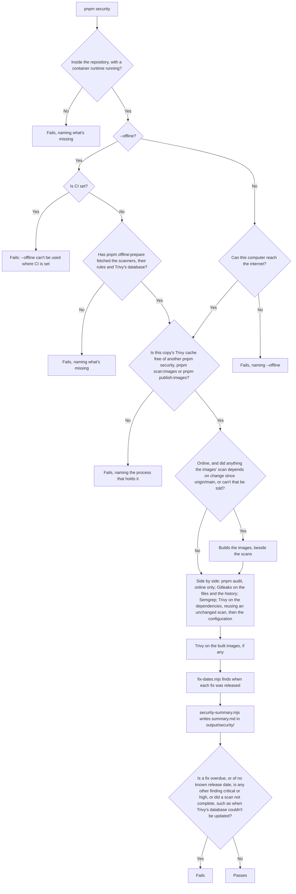

### The Check Workflow

`.github/workflows/check.yml` runs on each pull request's pushes and each group in the merge queue. **Full check** is the one check a merge needs; every other job feeds it. CodeQL's code scanning runs beside it, its results shown but never blocking a merge.

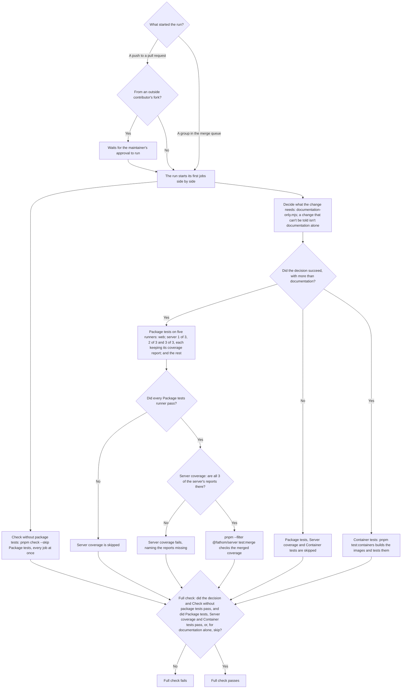

- **Time limits:** Check without package tests, each Package tests runner and Container tests stop after 60 minutes, Server coverage after 15, Decide what the change needs after 10 and Full check after 5, and each job of `pnpm check` after its own limit, as [The Local Check](#the-local-check) draws.
- **A failure in one part** fails Full check, though the other parts still run to the end, so a run reports every failure at once.
