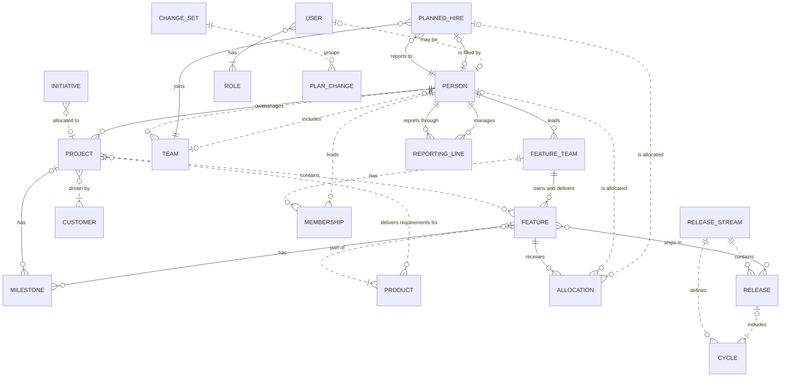

# Fathom — Domain Model

**Status:** Draft
**Last updated:** 2026-10-26

A first sketch of Fathom's core entities and how they relate. It describes structure only: terms are defined in [Domain Concepts](../product/domain.md), and rules and allowed values are in the [Decisions Log](../product/decisions.md). It describes concepts, not database tables. Items marked **proposal** are suggested modeling choices that have not been agreed.

## Overview

The diagram shows the core relationships only. Dashed lines are proposals or relationships whose cardinality is not yet confirmed. Access records and snapshots are described below but not drawn. Patches appear as release streams under the release streams proposal.

## Planning Entities

- **Project:** Has a number, name, owner, dates, and status. Contains features and milestones, and links to its customers.
- **Feature:** Has a name, dates, and status. Has no owner of its own; ownership comes from its feature team (see the Decisions Log). Belongs to a project (a working assumption, see the open questions in Domain Concepts), to one or more products, and to the feature team that owns and delivers it. Links to the releases it ships in.
- **Milestone:** A dated point in a project or a feature.
- **Allocation:** Links one person or planned hire to one feature for one month, with a percentage.
- **Customer:** Has a name and a type (external or internal).
- **Product:** Has a name.
- **Initiative:** Has a name, and may link to a project.

**Proposal:** Model direct allocation to a project as a general feature owned by the project, so allocations always target one kind of entity.

## Release Entities

- **Cycle:** A period of development, with a start and end date.
- **Release:** Links to the cycles it includes and the features that ship in it.
- **Release stream (proposal):** Defines a cycle length and groups releases.

**Proposal:** Model patches and major releases the same way, as separate release streams, each with its own cycle length. Each release belongs to one stream.

## Workforce Entities

- **Person:** An employee, current or former, with their employee details and an active flag.
- **Team:** Can be named. Links a manager to their direct reports.
- **Feature team:** Can be named. Links a set of features to its members and its feature lead. Membership is separate from reporting lines.
- **Feature team membership:** Links a person to a feature team from a given date. Future-dated memberships represent planned changes.
- **Reporting line:** Links a person to their manager from a given date. Future-dated lines represent planned changes.
- **Planned hire:** A role to be filled, with the details listed in the Decisions Log. Links to its team and manager and, when filled, to the new person.

**Proposal:** Measure team composition from people's positions and their team or feature team membership, and compare it with configurable composition targets.

**Proposal:** Give each person a monthly capacity, defaulting to a full month, so variable capacity such as part-time work can be supported later without changing the model. Whether v1 needs it is an open question in the Product Brief.

**Proposal:** Model allocations so they point to either a person or a planned hire, and transfer them to the new person when the hire is filled. The alternative is to treat a planned hire as a person record in a "planned" state, which is simpler for allocations but mixes real and hypothetical people.

## Access Entities

- **User:** A local account with one or more roles.
- **Role:** Grants view or edit access to data tiers, and permissions such as approving plan changes.
- **Access record:** Records an access to sensitive data, without the values.

Fields are assigned to tiers as set in the Decisions Log, and tier checks happen in the data access layer, as set in [ADR 0001](../adr/0001-tech-stack.md).

**Proposal:** Allow a user account to be linked to the person record for the same employee, so Fathom can tell who a user is in the org chart. Not every user needs one.

## Change and History Entities

- **Snapshot:** A point-in-time copy of part of the plan. Its contents are set in the Decisions Log.

**Proposal:** Group draft changes into a change set. Each plan change is one draft edit, such as a new allocation or moved dates. An editor submits a change set for approval, and approving it applies its changes to the live plan. A change set can be compared with the approved plan or with another change set, which also supports what-if scenarios if they turn out to be the same feature.

## Not Yet Modeled

Roadmap themes and priorities depend on the open question below. How projects relate to products depends on an open question in Domain Concepts. Dotted-line reporting relationships and licenses are out of scope for v1, as listed in the [Product Brief](../product/brief.md).

## Open Questions

1. **Roadmap themes and priorities:** Do themes and priorities apply to initiatives or to features? What does an initiative contain?
