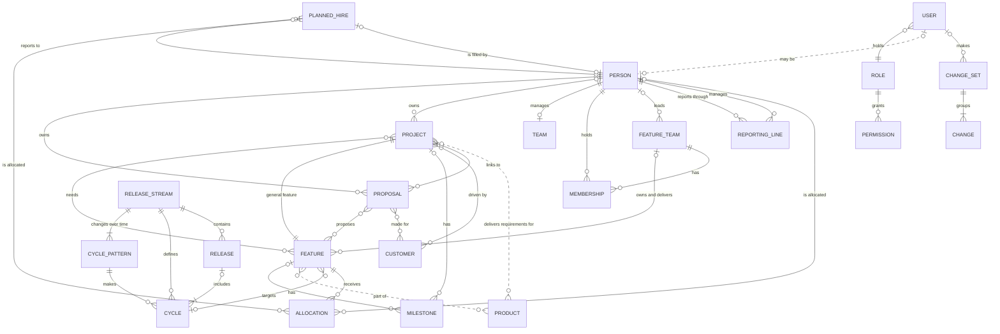
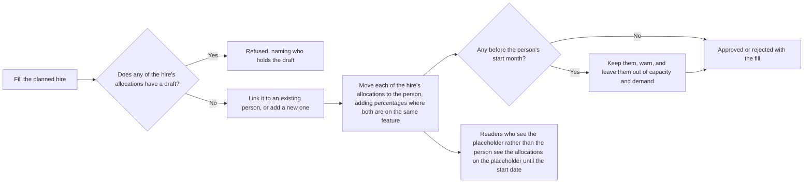

# Fathom — Domain Model

**Status:** Draft
**Last updated:** 2026-11-08

A first sketch of Fathom's core entities and how they relate. It describes structure only: terms are defined in [Domain Concepts](../product/domain.md), and rules and allowed values are in the [Decisions Log](../product/decisions.md). It describes concepts, not database tables. Items marked **proposal** are suggested modeling choices that have not been agreed.

## Overview

The diagram shows the core relationships only. Dashed lines are proposals or relationships whose cardinality is not yet confirmed. Access records and snapshots are described below but not drawn. Each release stream has its own cycles.

## Planning Entities

- **Project:** Has a name, and optionally a Project ID, an owner, who is a person, and customers. Has milestones, which give it its dates, and links to the features it needs, which its draft holds whichever side they are edited from. Has one general feature, which takes allocations made to the project directly. Links to one or more proposals; nothing else ties them.
- **Proposal:** Work offered or requested that may become a project, such as a bid or a customer request. Has a name, a status, and optionally a Proposal ID, a web link, an owner, who is a person, and customers. Links to the features it proposes. Projects link to proposals; a proposal is not made into a project.
- **Feature:** Has a name, a status, and optionally a description, a target cycle, an estimate, and the feature team that owns and delivers it. Has no owner of its own; ownership comes from its feature team. A project's general feature has no name of its own and shows its project's. Can be needed by several projects. Ships in the release that includes its target cycle, and its start and end months follow from its allocations. A month and year it is needed by, customers, and a note are decided but not built yet, as the [Decisions Log](../product/decisions.md#configuration) sets out.
- **Milestone:** A dated point in one project or one feature, with a name, which says whether it is a customer delivery date. Milestones are kept in a table of their own. Proposal milestones are decided but not built, as the [Decisions Log](../product/decisions.md#planning) records.
- **Allocation:** Puts one person or planned hire on one feature from a month, with a percentage, or with none when it stops the allocation. It is in force until the next allocation for the same person or planned hire and feature, as reporting lines are kept from a date. It points to a person or a planned hire, never both. Filling a planned hire moves its allocations to the person, as set out below.
- **Estimate:** A feature's one estimate, its total effort, kept as one value in hours and shown in the unit the reader picks.
- **Customer:** A row of the built-in Customers table, with a name, picked directly by projects and proposals.
- **Product:** A built-in table with a name. Features are part of products through a column users add.

The values of every built-in field are set out in the [Decisions Log](../product/decisions.md).

## Release Entities

- **Release stream:** Has a name, its place in the order of streams, whether it is retired, and the date its cycles are made until. Groups its cycles and releases.
- **Cycle pattern:** A release stream's cycle length, in weeks or months, and its naming pattern, from a given date until the stream's next pattern starts. A stream has one or more, so a change of length leaves the cycles made before it as they are.
- **Cycle:** A planning period in one release stream, with a name, a start date, and an end date, made ahead from the pattern in force. It is in at most one release. Cycles are worked out from the patterns rather than stored, so a cycle is known by its stream and start date, as [ADR 0010](../adr/0010-cycles-from-patterns.md) sets out.
- **Release:** A named delivery in one release stream, which includes one or more of its cycles, consecutive in the stream. Its date is its Ships on date, the end of its last cycle unless set earlier or later, and its contents are the features that target those cycles. It can have a colour from the palette; one with none has the default colour. It can have a note, as a Note column holds.

## Workforce Entities

- **Person:** An employee, current or former, with their preferred name, Employee ID, position, start and end dates, whether they are flagged as a manager, whom others can report to, values for the columns added to People, and their work email address if the link to user accounts proposed below is adopted. Whether they are active follows from their start and end dates.
- **Team:** One manager's direct reports, with an optional name, and, once its name is approved, an optional colour from the palette, held by name so the palette can change without a migration. The colour is set directly, never drafted. Its members follow from their reporting lines. A team is known by its manager, and stored only once named, so a link to a team points to its manager.
- **Feature team:** Has a name, unique ignoring letter case, optionally a feature lead, who is one of its current members, and optionally a colour from the palette, for the feature team chart. Links a set of features to its members. Membership is separate from reporting lines.
- **Feature team membership:** Records that a person joins or leaves a feature team from a given date, in force until their next record for that team, so past memberships are kept, as reporting lines are. Future-dated records represent planned changes.
- **Reporting line:** Links a person to their manager, or records that they have none, from a given date until the person's next line starts. Past lines are kept. Future-dated lines represent planned changes.
- **Planned hire:** A role to be filled, kept as a record apart from people but shown beside them as a row of the People table, with an optional name, its requisition, or a temporary ID until it has one, a position, a state, and optionally a target date, its manager, a person or a planned hire flagged as a manager, whose team it joins, whether it is flagged as a manager itself, and values for the columns it shares with people. Its manager is held as a person or a planned hire, never both, and never itself, and its managers never loop. When filled, it links to the person who fills it and leaves People, and a person may fill several over time; the planned hires reporting to a planned manager move to the person who fills it.
- **Hiring state:** A choice in the built-in list of hiring states, a list with meanings, each meaning Proposed, Open, Hired, or Left. The organization names its own states, as many as it uses. A planned hire is in one meaning Proposed or Open. A person keeps a state of their own meaning Hired, or Left once their end date has passed, starting on the first choice of that meaning, which no planned hire has.
- **Composition target:** The range of direct reports each manager is compared with, held in planning configuration.

**Proposal:** Measure team composition from people's positions and their team or feature team membership, and compare it with configurable composition targets.

**Proposal:** When variable capacity is added after v1, as the Decisions Log allows, give each person a monthly capacity, defaulting to a full month, so existing data needs no change.

Filling a planned hire is one draft, approved or rejected whole. What it does to the hire's allocations is set out in the [Decisions Log](../product/decisions.md#workforce):

## Access Entities

- **User:** A local account holding one or more roles, one of them its default, and acting as one at a time, identified by its name and email address, which is also its user name, and signing in with a password. It is marked while its password is one Fathom generated, which its user must change before doing anything else.
- **Session:** A signed-in user's visit, which records the network address and browser it started from, for investigating security problems, and ends as set in [ADR 0002](../adr/0002-libraries.md).
- **Role:** A named set of permissions, kept in the database so it can be edited and copied, which grants view or edit access to data tiers, and permissions such as approving plan changes. The roles Fathom starts with keep a key, so setup and seed data find them whatever they are renamed, and a role held by any account cannot be deleted.
- **Access record:** Records who did what, when, and to whom, without the values: a change to a user account, or a view or change of sensitive data. Records can only be added, never changed or removed.

Fields are assigned to tiers as set in the Decisions Log, and tier checks happen in the data access layer, as set in [ADR 0001](../adr/0001-tech-stack.md).

**Proposal:** Allow a user account to be linked to the person record for the same employee, so Fathom can tell who a user is in the org chart and give them access to their own record and their reports, as proposed in [Roles](../product/roles.md), which also sets out how links are made. Not every user needs one.

## Configuration Entities

Built-in tables and custom fields and tables are set out in the [Decisions Log](../product/decisions.md#configuration), and how they are stored is proposed in [ADR 0005](../adr/0005-flexible-data-model.md).

- **Field definition:** A custom field on a built-in or custom table, with a name, field type, sensitivity tier, and whether it must be filled in or be unique. A Person or Link field also names the table it links to. A "Choice from a list" field, the first built, names its list, takes its tier from the list's visibility, and says whether it takes one choice or several. A "Web link" field holds one link for each record, an address and the text shown for it, and has a visibility of its own as its tier. A "Note" field holds one rich-text note for each record, and has a visibility of its own as its tier too. A field on People also says whether planned hires have it too.
- **Column order:** The order of a table's columns, built-in and custom alike, the same for every user.
- **Saved view:** A table's search, filters, sort, what its Draft menu shows, and the columns its metrics break down by, saved under a name unique within the table, with the user who saved it. Its sensitivity is that of the most sensitive column it filters, sorts, or breaks down by; a People view may also filter on drafts, which is General, since each user is sent only the drafts they may see.
- **Custom table:** A table users define, with a name, a sensitivity tier, and its field definitions.
- **Custom record:** One row of a custom table, holding values for its fields.
- **Custom value:** The value of one custom field for one record, built-in or custom.
- **List:** A list of choices, with a name, a description, a visibility, and whether it is retired. Most are defined by people; a few are built in, drawn on by built-in columns, such as Positions and the lists with meanings, and cannot be removed. Columns elsewhere draw on lists.
- **Choice:** One entry in a list, with a name, a description, its place in the list's order, and whether it is retired, and, in a list with meanings, the meaning it is tied to.

## Change and History Entities

- **Change set:** Changes saved together, with who made them and when, and what they did: saved changes, or approved, rejected, or discarded drafts.
- **Change:** One field of one record changed in a change set, with its sensitivity tier, its old and new values, and whether it changed the record's draft or the live record.
- **Draft row:** The values a record is to have once approved: all of them for a record to be added, those that differ from the live record for a change, or none for a removal. Each record has at most one, waiting or rejected with a reason. People, lists, choices, and People's columns have drafts, and so do the order of each list's choices and the order of People's columns, each held whole, as [ADR 0007](../adr/0007-draft-rows.md) sets out.
- **Snapshot:** A point-in-time copy of part of the plan. Its contents are set in the Decisions Log.

Approving drafts, whether one or several at once, applies them all to the live records as one change set, or none of them. Approving a draft applies the drafts it uses with it, such as a choice added to a list that is itself drafted to be added, or a column drafted to be added that a draft of the column order places, and, **proposal**, a person given a choice that is itself a draft, once columns and people can use drafts.

## Not Yet Modeled

Initiatives, themes, and priorities are not built in: an organization that uses them adds them as columns. Links between the features that are increments of the same work are not built in either; such a column groups them, as the [Decisions Log](../product/decisions.md#planning) sets out. How projects relate to products, if at all, is not yet decided. Physical resources are a future possibility in the [Product Brief](../product/brief.md#future-possibilities). Dotted-line reporting relationships and licenses are out of scope for v1, as listed in the [Product Brief](../product/brief.md).

## Open Questions

1. **Allocations with variable capacity:** Once a person can have less than a full month, does a 50% allocation mean half a month, or half of that person's capacity?
