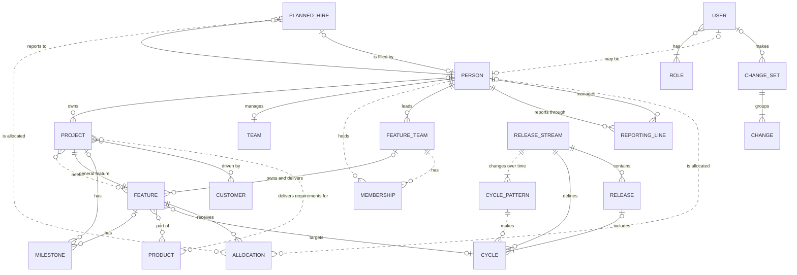

# Fathom — Domain Model

**Status:** Draft
**Last updated:** 2026-11-03

A first sketch of Fathom's core entities and how they relate. It describes structure only: terms are defined in [Domain Concepts](../product/domain.md), and rules and allowed values are in the [Decisions Log](../product/decisions.md). It describes concepts, not database tables. Items marked **proposal** are suggested modeling choices that have not been agreed.

## Overview

The diagram shows the core relationships only. Dashed lines are proposals or relationships whose cardinality is not yet confirmed. Access records and snapshots are described below but not drawn. Each release stream has its own cycles.

## Planning Entities

- **Project:** Has a number, a name, and optionally an owner and customers. Has milestones, which give it its dates, and links to the features it needs. Has one general feature, which takes allocations made to the project directly.
- **Feature:** Has a name, a status, and optionally a description, a target cycle, an estimate, and the feature team that owns and delivers it. Has no owner of its own; ownership comes from its feature team. Can be needed by several projects. Ships in the release that includes its target cycle, and its start and end months follow from its allocations.
- **Milestone:** A dated point in a project or a feature, which says whether it is a customer delivery date.
- **Allocation:** Links one person or planned hire to one feature for one month, with a percentage.
- **Estimate:** A feature's one estimate, kept in one unit of effort and shown in the unit the reader picks.
- **Customer:** A built-in table with a name.
- **Product:** A built-in table with a name. Features are part of products through a column users add.

The values of every built-in field are set out in the [Decisions Log](../product/decisions.md).

## Release Entities

- **Release stream:** Has a name, its place in the order of streams, and whether it is retired. Groups its cycles and releases.
- **Cycle pattern:** **Proposal:** a release stream's cycle length, in weeks or months, and its naming pattern, from a given date until the stream's next pattern starts. A stream has one or more, so a change of length leaves the cycles made before it as they are.
- **Cycle:** A planning period in one release stream, with a name, a start date, and an end date, made ahead from the pattern in force. It is in at most one release.
- **Release:** A named delivery in one release stream, which includes one or more of its cycles, consecutive in the stream. Its date is the end of its last cycle, and its contents are the features that target those cycles.

## Workforce Entities

- **Person:** An employee, current or former, with their preferred name, Employee ID, start and end dates, values for the columns added to People, and their work email address if the link to user accounts proposed below is adopted. Whether they are active follows from their start and end dates.
- **Team:** One manager's direct reports, with an optional name. Its members follow from their reporting lines.
- **Feature team:** Can be named. Links a set of features to its members and its feature lead. Membership is separate from reporting lines.
- **Feature team membership:** Links a person to a feature team from a given date. Future-dated memberships represent planned changes.
- **Reporting line:** Links a person to their manager, or records that they have none, from a given date until the person's next line starts. Past lines are kept. Future-dated lines represent planned changes.
- **Planned hire:** A role to be filled, with the details listed in the Decisions Log. Links to its manager, whose team it joins, and, when filled, to the new person.
- **Composition target:** The range of direct reports each manager is compared with, held in planning configuration.

**Proposal:** Measure team composition from people's positions and their team or feature team membership, and compare it with configurable composition targets.

**Proposal:** When variable capacity is added after v1, as the Decisions Log allows, give each person a monthly capacity, defaulting to a full month, so existing data needs no change.

**Proposal:** Model allocations so they point to either a person or a planned hire, and transfer them to the new person when the hire is filled. The alternative is to treat a planned hire as a person record in a "planned" state, which is simpler for allocations but mixes real and hypothetical people.

## Access Entities

- **User:** A local account with one or more roles, identified by its name and email address, which is also its user name, and signing in with a password.
- **Session:** A signed-in user's visit, which records the network address and browser it started from, for investigating security problems, and ends as set in [ADR 0002](../adr/0002-libraries.md).
- **Role:** Grants view or edit access to data tiers, and permissions such as approving plan changes.
- **Access record:** Records who did what, when, and to whom, without the values: a change to a user account, or a view or change of sensitive data. Records can only be added, never changed or removed.

Fields are assigned to tiers as set in the Decisions Log, and tier checks happen in the data access layer, as set in [ADR 0001](../adr/0001-tech-stack.md).

**Proposal:** Allow a user account to be linked to the person record for the same employee, so Fathom can tell who a user is in the org chart and give them access to their own record and their reports, as proposed in [Roles](../product/roles.md), which also sets out how links are made. Not every user needs one.

## Configuration Entities

Built-in tables and custom fields and tables are set out in the [Decisions Log](../product/decisions.md#configuration), and how they are stored is proposed in [ADR 0005](../adr/0005-flexible-data-model.md).

- **Field definition:** A custom field on a built-in or custom table, with a name, field type, sensitivity tier, and whether it must be filled in or be unique. A Person or Link field also names the table it links to. A "Choice from a list" field, the first built, names its list, takes its tier from the list's visibility, and says whether it takes one choice or several.
- **Column order:** The order of a table's columns, built-in and custom alike, the same for every user.
- **Saved view:** A table's search, filters, sort, what its Draft menu shows, and the columns its metrics break down by, saved under a name unique within the table, with the user who saved it. Its sensitivity is that of the most sensitive column it filters, sorts, or breaks down by; a People view may also filter on drafts, which is General, since each user is sent only the drafts they may see.
- **Custom table:** A table users define, with a name, a sensitivity tier, and its field definitions.
- **Custom record:** One row of a custom table, holding values for its fields.
- **Custom value:** The value of one custom field for one record, built-in or custom.
- **List:** A list of choices that people define, with a name, a description, a visibility, and whether it is retired. Columns elsewhere draw on lists.
- **Choice:** One entry in a list, with a name, a description, its place in the list's order, and whether it is retired.

## Change and History Entities

- **Change set:** Changes saved together, with who made them and when, and what they did: saved changes, or approved, rejected, or discarded drafts.
- **Change:** One field of one record changed in a change set, with its sensitivity tier, its old and new values, and whether it changed the record's draft or the live record.
- **Draft row:** The values a record is to have once approved: all of them for a record to be added, those that differ from the live record for a change, or none for a removal. Each record has at most one, waiting or rejected with a reason. People, lists, choices, and People's columns have drafts, and so do the order of each list's choices and the order of People's columns, each held whole, as [ADR 0007](../adr/0007-draft-rows.md) sets out.
- **Snapshot:** A point-in-time copy of part of the plan. Its contents are set in the Decisions Log.

Approving drafts, whether one or several at once, applies them all to the live records as one change set, or none of them. Approving a draft applies the drafts it uses with it, such as a choice added to a list that is itself drafted to be added, or a column drafted to be added that a draft of the column order places, and, **proposal**, a person given a choice that is itself a draft, once columns and people can use drafts.

## Not Yet Modeled

Initiatives, themes, and priorities are not built in: an organization that uses them adds them as columns. Links between the features that are increments of the same work are not built in either; such a column groups them, as the [Decisions Log](../product/decisions.md#planning) sets out. How projects relate to products, if at all, is not yet decided. Physical resources are a future possibility in the [Product Brief](../product/brief.md#future-possibilities). Dotted-line reporting relationships and licenses are out of scope for v1, as listed in the [Product Brief](../product/brief.md).

## Open Questions

1. **Allocations with variable capacity:** Once a person can have less than a full month, does a 50% allocation mean half a month, or half of that person's capacity?
