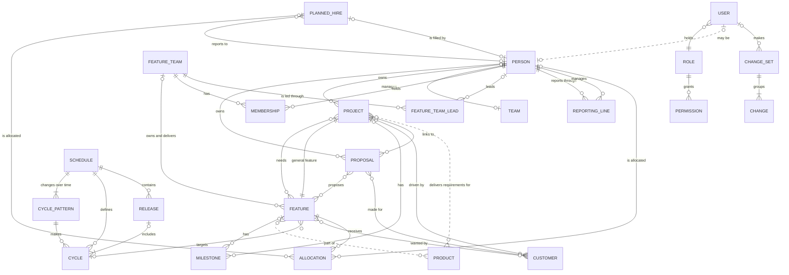

# Fathom: Domain Model

**Last updated:** 2026-11-18

Fathom's core entities, how they relate, and the rules that always hold for them. Terms are defined in [Domain Concepts](../product/domain.md), who may do what is in [Roles](../product/roles.md), and how each page shows the data is in its [page design](pages/). It describes concepts, not database tables. Items marked **proposal** are suggested modelling choices that have not been agreed.

## Overview

The diagram shows the core relationships only. Dashed lines are proposals or relationships whose cardinality is not yet confirmed. Access records and snapshots are described below but not drawn. Each schedule has its own cycles.

A feature needs none of these links: one with no project or proposal is an idea not yet committed to anything.

## Planning Entities

### Project

- **Fields:** a name, required and unique ignoring letter case. Optionally a Project ID, unique ignoring letter case when entered, an owner, who is a person, customers, and the proposals it links to.
- **Dates:** from its milestones, never entered: its first and last milestone and its next customer delivery.
- **Scope:** the features it needs, held in the project's draft whichever side they are edited from. Linking a feature is enough to show the project funds it, since people are allocated to features, never to projects.
- **General feature:** each project has one, which takes allocations made to the project directly, so every allocation is to a feature. It shows its project's name and follows a rename, has the first status meaning In progress, so its time counts toward over-allocation, has no draft of its own, and is on no roadmap. Approving the project adds it, and approving the project's removal removes it. The change history records its project and leaves it out.
- **Removing:** removes its milestones in the same draft, and is refused while its general feature has allocations.

**Proposal:** Generalize the general feature into project activities, features linked to exactly one project for work that isn't a product feature, as [issue #207](https://github.com/ribbitworks/fathom/issues/207) sets out.

### Proposal

- **What it is:** work offered or requested that may become a project, such as a bid or a customer request. Projects link to proposals; a proposal is never made into a project, and nothing marks it Won.
- **Fields:** a name, required and unique ignoring letter case, and a status, required, starting as the first status offered, Open to start. Optionally a Proposal ID, unique ignoring letter case when entered, a web link, an owner, who is a person, and customers, picked directly from Customers.
- **Status:** a choice of the built-in Proposal statuses, with no rules tied to them, so any status may follow any other.
- **Scope:** the features it proposes, which count toward the forecast by their own status. Each change, from either side, is a draft of the proposal. It keeps the reason given for each feature removed from it while that feature is not in it.

### Feature

- **Fields:** a name, required and unique ignoring letter case, and a status, required. Optionally a description, plain text up to 200 characters, its Needed by month, customers likely to want it, a note, a target cycle, an estimate, a size, a priority, a risk, a feature team, and the projects and proposals that name it. Its values in the columns added to Features are part of its draft. Kind, product, initiative, theme and complexity are columns users add.
- **General feature:** a project's general feature is the one exception to unique names, since it shows its project's.
- **Status:** a choice of the built-in feature statuses, a list with meanings, because Fathom acts on the meaning while each organization names and divides its statuses its own way. A new feature starts in the first status meaning Possible. A possible feature is the same record a planned one is, so it is planned, staffed and released without being copied. Possible features count toward the forecast but not toward over-allocation, and Done or Cancelled ones raise no warnings.
- **Needed by:** a month and year, the Product Manager's rough wish. It is kept apart from the target cycle, the commitment made in planning, so a rough wish never reads as one.
- **Timing:** it targets a cycle, or none, and is then in Later. It ships in the release that includes its target cycle. Its start and end months follow from its allocations, and one with no allocations is placed only by its target cycle. Only milestones have dates to the day.
- **Ownership:** it has no owner of its own: its owner is its feature team's lead. A feature whose status means Planned or In progress and has no feature team is warned about.
- **Not staffed:** a feature whose status means Planned or In progress and has no allocations. A planned hire's allocation staffs a feature as a person's does. Whether a feature has allocations is a fact about the feature, not about anyone allocated, so [Roles](../product/roles.md#who-sees-which-people) shows it to everyone who sees features.
- **Size, Priority and Risk:** each optional, and each a choice of a [built-in list](#built-in-lists). Size has no unit and is never converted to effort. Priority is how much the feature matters to the organization, not within a cycle, and is kept apart from status, so a Long shot can be Critical.
- **Removing:** refused while a project or proposal names it, as for any record another links to, and while it has allocations, since allocations are time spent; it is cancelled instead.

### Milestone

- A dated point in one project or one feature, with a name, which says whether it is a customer delivery date. Milestones are kept in a table of their own.
- Other kinds of milestone are a column users add. A feature's milestones are not linked to its projects' milestones.
- Only project milestones are built.

### Allocation

- **What it is:** one person or planned hire on one feature, never both, at a percentage of their month: 10%, 25%, 50%, 75%, 90% or 100%, starting at 100%. Each has at most one allocation to a feature.
- **Records:** one for each month it changes: the percentage from that month, or none when it stops, each in force until the next, as reporting lines are kept. It may run with no end. A range, such as 50% from January to June, saves a record for January and one stopping it in July. Changing one month within a range saves up to two records, so the months around it keep their percentage.
- **One draft:** every change to an allocation, of any of its records, is one draft, approved or rejected whole, so an Approver never approves a range's start without its stop. A change that leaves no months drafts its removal, and allocating again changes that draft.
- **Drafted features:** a feature only drafted to be added cannot be allocated until it is approved, so an allocation's draft never waits on a draft of the plan.
- **Employment dates:** a person cannot be allocated before their start month or after their end month, nor a planned hire before its first month that can be allocated. Past months can be allocated, as corrections. When a date moves later, allocations left outside employment are kept rather than removed, so whoever allocates decides, and count in neither capacity nor demand.
- **Capacity:** a full month for everyone, including the months a person starts and ends in, and none before the start month or after the end month. A planned hire has none before its first month that can be allocated.
- **Removing:** removing a person or planned hire removes their allocations in the same draft, refused while any of those allocations has a draft. A feature with allocations, or a project whose general feature has any, is never removed.
- **Planned hires:** a planned hire with allocations cannot be filled yet, and a filled one is not allocated.

**Proposal:** When variable capacity is added after v1, give each person a monthly capacity, defaulting to a full month, so existing data needs no change, and mark it wherever the person appears, to discourage it.

### Estimate

- **What it is:** a feature's one estimate, its total effort, kept as one value in hours and shown in the unit the reader picks, so the unit is not part of the data.
- **Units:** hours, the default, person-days, person-weeks, person-months, and person-quarters, always three person-months. There are no person-cycles, since cycle lengths differ between schedules and change over time.
- **Conversions:** the [planning settings](#planning-settings) convert between units. A changed conversion keeps each estimate's hours, so what it shows in other units changes.
- **Apart from Size:** a feature's Size is a rough size, never converted to effort. Marking an estimate as a ROM or a SWAG is a column users add.

### Planning Settings

One record for the whole of Fathom, which capacity and forecasts are worked out with. A change is a draft of the whole record, approved with Approve Configuration, and recorded in the change history. A draft changes no estimate's units until it is approved. How they are shown and changed is in [Capacity § Settings](pages/capacity.md#settings).

| Setting | Starting value | Allowed |
| --- | --- | --- |
| Hours a day | 8 | 0.5 to 24, in whole or half hours |
| Working days a week | 5 | 1 to 7 whole days |
| Working days a month | 20 | 1 to 31 whole days |
| Default focus | 80% | 1% to 100% |
| Default buffer | 0% | 0% to 100% |
| Ramp-up | 50%, then 75% | Up to 12 months, each 1% to 100%, then full output |

Percentages are whole.

### Customers and Products

- **Customer:** a row of the built-in Customers table, with a name, required and unique, picked directly by projects, proposals, and features.
- **Product:** a built-in table with a name, required and unique. Features are part of products through a column users add. Not built yet.

## Release Entities

- **Schedule:** `ReleaseStream` in the code. Has a name, its place in the order of schedules, whether it is retired, and, for a schedule that ends, its last day, which cuts its last cycle short. Groups its cycles and releases. Its cycles are worked out whenever they are read, never stored, two years ahead of today, or to its last day, or as far as a release or feature on them reaches. Fathom starts with none, and what a release is for, such as a patch, is up to the organization. Gaps between cycles, such as freezes, are not modelled.
  - **Ending:** a schedule's last day may move later freely, and earlier only while no release includes, and no feature targets, a cycle that would start after it, and never before its first cycle starts. Once the day has passed, the schedule is Ended, but not retired, since its releases and features are still worth seeing.
  - **Retired:** a retired schedule's cycles take no new features: a feature's draft onto one is refused unless the feature's live record already targets a cycle of that schedule, so a feature already there keeps its place and moves with its cycle.
- **Cycle pattern:** A schedule's cycle length, in weeks or months, and its naming pattern, from a given date until the schedule's next pattern starts. A schedule has one or more, so a change of length leaves the cycles made before it as they are. A naming pattern numbers cycles within the year they end in, or counts them from the schedule's first cycle without restarting, as in Sprint 1, 2, 3.
  - **One cycle's length:** changing it, the person chooses whether the cycles after it move by the same amount or the next cycle keeps its end date, and Fathom writes the patterns that give that result. Releases on cycles that move, and features targeting them, move with them. The new patterns and the moved releases and features are drafts approved, rejected and discarded only together, and only someone who may change cycles can discard them. A release's Ships on date stays as set, and a change that would put the release's first cycle after it is refused.
- **Cycle:** A planning period in one schedule, with a name, a start date, and an end date, made ahead from the pattern in force. It is in at most one release, and one in no release is simply not released yet, with no separate candidate state. Cycles are worked out from the patterns rather than stored, so a cycle is known by its schedule and start date, as [ADR 0010](../adr/0010-cycles-from-patterns.md) sets out. A month in more than one cycle counts toward each in proportion to its days in it, for allocations, capacity and demand alone.
- **Release:** A named delivery in one schedule, its name unique within the schedule, which includes one or more of its cycles, consecutive in the schedule. Its date is its Ships on date, the end of its last cycle unless set earlier or later, and its contents are the features that target those cycles. It can have a colour from the palette, chosen by whoever makes or changes it, never given automatically, and drafted and approved with the release; one with none has the default colour. It can have a note, as a Note column holds.

## Workforce Entities

### People

- **Person:** An employee, current or former, with their preferred name, ID, and position, all required, start and end dates, both optional, whether they are flagged as a manager, values for the columns added to People, and their work email address if the link to user accounts proposed below is adopted.
- **Active:** from their start date until their end date passes, with no separate flag; a person with no start date counts as current. People who leave are kept, with their end date.
- **ID:** the Employee ID the organization uses, free text up to 40 characters. No two rows of the ID column, people or planned hires, have the same one, ignoring letter case.
- **Position:** a choice of the built-in Positions list, required for people and planned hires alike.
- **Gender:** not built in. An organization that records it adds a column of its own on People, in the Personal class.
- **Manager flag:** General. Only people flagged as managers can be named as a manager, of a person or of a planned hire. The flag cannot be cleared while anyone reports to its person, now or from a later date, or while a planned hire not yet filled names them. It is not the Engineering Manager role.
- **Removing:** a person entered by mistake is removed as a draft, approved like any other, with their allocations, as [Allocation](#allocation) sets out. Removing is refused, when drafted and again when approved, for anyone who:
  - is or was anyone's manager, live or in a draft, since past lines are kept
  - leads a feature team, today, later or in a draft, or is named as a member in a team's draft
  - is named by a planned hire, live or in a draft, as its manager or as the person who filled it
  - is named by any record, live or in a draft

### Reporting Teams

- **Reporting line:** Links a person to their manager, or records that they have none, from a given date until the person's next line starts. A person has at most one manager at a time. Past lines are kept, so past managers are, and future-dated lines represent planned changes.
  - **Rules:** a manager is optional, for the top of the organization and for anyone whose manager is not in Fathom. Loops are refused, so nobody reports to themselves or to anyone who reports to them. A line's date is on or after the person's start date, and its manager is active on that date. A manager whose end date passes while people still report to them is warned about, not blocked.
  - **Dates:** a change takes effect from today unless an earlier date is given, such as for a change already made in the HR system, and approving it does not move that date. Until planned reporting changes are built, a line's date is today or earlier, except a new employee's first line, which starts on their start date.
  - **People report to people:** a person's manager is never a planned hire.
- **Team:** One manager's direct reports, with an optional name, up to 60 characters and unique ignoring letter case, which stays with the manager when reports move, and, once its name is approved, an optional colour from the palette, held by name so the palette can change without a migration. The colour is set directly, never drafted. Its members follow from their reporting lines. A team is known by its manager, and stored only once named, so a link to a team points to its manager.

### Feature Teams

- **Feature team:** Has a name, required, up to 60 characters and unique ignoring letter case, since one person may lead several teams and leads change, and optionally a colour from the palette, for the feature team chart. Its name and colour each keep one value, not dated. Links a set of features to its members. Membership is separate from reporting lines.
  - **Disbanded:** from the first month with none of its members from then on, worked out from its membership records and not stored. A team that has never had a member has not disbanded, and one that disbanded comes back if someone joins it.
- **Feature team lead:** Records who leads a feature team, or that no one does, from a given date, in force until the team's next record, so past and planned leads are kept. The lead is optional, and is one of the team's members on that date, so their time counts in its capacity; on a day they are not, the team has no lead. A lead chosen who is not a member joins the team in the same draft. A team with no lead is marked, since its features then have no owner.
- **Feature team membership:** Records that a person joins or leaves a feature team from a given date, in force until their next record for that team, so past memberships are kept, as reporting lines are. Future-dated records represent planned changes. A person may be on several feature teams at once. Once someone's end date has passed, they are off every feature team from the next day: they no longer count as a member, a team they led has no lead, and their past membership is kept.

### Planned Hires

- **Planned hire:** A role to be filled, kept as a record apart from people, so plans never mix with HR facts and are filled rather than converted, but shown beside them as a row of the People table. It has an optional name, its requisition, or a temporary ID until it has one, a position, a state, and optionally a target date, its manager, whether it is flagged as a manager itself, and values for the columns it shares with people.
  - **ID:** its requisition, free text up to 40 characters, shares the ID column with people's Employee IDs. Until it has one, it has a temporary ID, TBD- and the next number, never reused. An ID typed in cannot start with TBD-, and clearing a requisition gives the hire a new temporary ID.
  - **Target date:** the day the new hire starts work. Its first month that can be allocated, its Expected month, is the month of its target date, or of its person's start date once filled; a hire with no target date is expected from the current month.
  - **Manager:** a person or a planned hire flagged as a manager, a planned manager, whose team it joins, never both and never itself, and its managers never loop. A planned manager's flag cannot be cleared, nor the hire removed, while a planned hire not yet filled, live or in a draft, reports to it. A planned team has no name until its planned manager is filled.
  - **Columns:** it has values for the columns it shares with people. Every column added to People is offered on planned hires unless switched off for them, as a draft of the column, and every value is optional on a hire, even where People requires it. People's End column is not offered. A column cannot be switched off for planned hires while any hire not yet filled, live or in a draft, has a value in it; those values are cleared first.
  - **Removing:** a hire is cancelled by removing it, which removes its allocations in the same draft. The change history keeps it.
  - **Filling:** links the hire to the person who fills it, a new person or one already in Fathom, as one draft, approved or rejected whole. Only a hire in a state meaning Open, with no rejected draft, can be filled. Once filled, it leaves People. A person may fill several over time, but not a second while the hire they filled before has not started.
    - **A new person:** takes the hire's position, the manager chosen and the hire's values in the shared columns, and is asked for any value People requires that the hire has none for.
    - **Someone already in Fathom:** changes only their position, to the hire's, and their manager, from the day given. Given no manager, they keep their own, and one already reporting to the manager chosen keeps their line.
    - **The manager chosen:** becomes the hire's too when the fill is approved.
    - **Managers:** a hire whose manager is still a planned hire needs a person chosen as manager. Filling a planned manager moves the planned hires that report to it to the person who fills it, in the same draft, and flags that person as a manager.
    - **Approving:** a fill that changes a person names who fills the hire, so it needs an Approver who sees Personal details. Approving, rejecting or resending any part of a fill does so for all of it.
    - **Discarding:** discarding one record's part of a fill takes the fill out of its other drafts, keeping their other changes. Discarding on the Drafts page discards the whole fill.
  - **While a fill waits:** what it sets is held, so a hire with a fill waiting cannot be named as another hire's manager, and a hire it moves cannot be removed. Approving refuses a fill whose person has left by then.
- **Hiring state:** A choice in the built-in list of hiring states, a list with meanings, each meaning Proposed, Open, Hired, or Left. A planned hire is in one meaning Proposed or Open, starts in the first choice meaning Proposed unless another is given, and moves between them in any order. A person keeps a state of their own meaning Hired, or Left once their end date has passed, starting on the first choice of that meaning; a choice that comes to have the other meaning shows them the first choice of the meaning their end date gives. A choice cannot be given the meaning Hired or Left while a planned hire is in it. There is no state for someone who has not yet started.

**Proposal:** Measure team composition from people's positions and their team or feature team membership, and compare it with configurable composition targets, starting with reports per manager, as [issue #208](https://github.com/ribbitworks/fathom/issues/208) sets out.

## Access Entities

- **User:** A local account holding one or more roles, one of them its default, and acting as one at a time, identified by its name and email address, which is also its user name, and signing in with a password. Its name is plain text up to 100 characters, unique ignoring letter case. It is marked while its password is one Fathom generated, which its user must change before doing anything else.
- **Session:** A signed-in user's visit, which records the network address and browser it started from, for investigating security problems, and ends as set in [ADR 0002](../adr/0002-libraries.md).
- **Role:** A named set of permissions, kept in the database so it can be edited and copied, which grants view or edit access to data classes, and permissions such as approving plan changes. The roles Fathom starts with keep a key, so setup and seed data find them whatever they are renamed, and a role held by any account cannot be deleted.
- **Access record:** Records who did what, when, and to whom, without the values: a change to a user account, or a view or change of sensitive data. Records can only be added, never changed or removed.
- **Data class:** The class, General, Personal or Confidential, the organization keeps one of Fathom's built-in details in, stored once moved from its default. Lists and columns hold their own class as their visibility. Class checks happen in the data access layer, as set in [ADR 0001](../adr/0001-tech-stack.md).

**Proposal:** Allow a user account to be linked to the person record for the same employee, so Fathom can tell who a user is in the org chart and give them access to their own record and their reports, as [issue #219](https://github.com/ribbitworks/fathom/issues/219) sets out. Not every user needs one.

### Data Classes

Each built-in detail starts in a class, and those that can move are kept in whichever class the organization moves them to:

| Class | Built-in details it starts with |
| --- | --- |
| General | Name, ID, today's position, current manager, team, feature teams, and assignments |
| Personal | Start and end dates, so people not yet started and people who have left; past managers and the dates reporting lines changed; the dates people join and leave feature teams |
| Confidential | Future-dated reorganizations, and the hiring plan |

- **Can move:** start date, end date, past managers with their dates, the dates people join and leave feature teams, future-dated reorganizations, and the hiring plan. Position and Hiring state move with their lists.
- **Never move:** name, ID, current manager, team, feature teams and assignments stay General, since every page finds its rows by them.
- **Stay General:** which feature teams someone was on, month by month, and past counts of reports by manager.
- **Confidential runs out:** a future-dated reorganization becomes the org chart on its date, and a planned hire becomes a person once filled.
- **New lists and columns:** start General unless another class is given when they are made.

## Configuration Entities

Fathom has a fixed core of built-in tables, such as people, teams, projects, features, and allocations, with fixed key fields that its views and access rules rely on. A built-in table has only the columns Fathom itself acts on, and the fewest of them required, so each organization shapes the rest with columns it adds. How custom fields and tables are stored is proposed in [ADR 0005](../adr/0005-flexible-data-model.md).

### Tables and Columns

- **Field definition:** A custom field on a built-in or custom table, with a name, [field type](#field-types), sensitivity tier, and whether it must be filled in or be unique. A Person or Link field also names the table it links to. Columns are built on People and Features only, with the field types below; unique columns, Person and Link fields are not built yet. A "Choice from a list" field names its list, takes its tier from the list's visibility, and says whether it takes one choice or several. A Web link, Note or Number field has a visibility of its own as its tier. A field on People also says whether planned hires have it too, as [Planned Hires](#planned-hires) sets out.
  - **Changing:** its type is fixed once it is added. It can be made required only once every record has a value, and single-choice only once none has several. Its list cannot change while it has values.
- **Column order:** A table's own order of its columns, built-in and custom alike, which every view starts from. A view may hold an order of its own.
- **Saved view:** A table's search, filters, sort, what its Draft menu shows, the columns its metrics break down by, its grouping, the columns it hides, and its page's own choices, such as the schedule the Features Board shows, saved under a name, with the table it belongs to, one of a fixed set, the user who saved it, and whether it is personal to them or shared. A name is unique, ignoring letter case, among the table's shared views and among each user's personal views on it. Its sensitivity is that of the most sensitive column it filters, sorts, breaks down, or groups by, and of the data its grouping needs; a People view may also filter on drafts, which is General, since each user is sent only the drafts they may see.
- **Last view:** The view an account last showed on a page with a Views menu, one for each account and page: the table shown, which on Projects and Releases is its tab, the view as a saved view holds it, the saved view it started from, if any, and the page's mode, such as Features' Board. It is the account's own setting: never a draft, with no change history, and removed only if the account is. Deleting the saved view it started from keeps the rest of it.
- **Custom table:** A table users define, with a name, a sensitivity tier, and its field definitions. Not built yet.
- **Custom record:** One row of a custom table, holding values for its fields.
- **Custom value:** The value of one custom field for one record, built-in or custom.

### Field Types

| Type | Holds | Limits |
| --- | --- | --- |
| Choice from a list | One choice, or several | Choices of its list only |
| Web link | An address, and optionally text shown in its place | Address up to 2,000 characters, text up to 200 |
| Note | Rich text, as GitHub-flavoured Markdown | Up to 10,000 characters |
| Number | A whole or decimal number, positive or negative | Up to 15 digits, at most 6 after the point; 0 is a value |

- **Web link:** only http and https addresses, on the internet or a local network, by name or IP address. An address typed without a scheme is taken as https only when its host has a dot. What else is refused, and why, is in the [Security Plan](../security/security-plan.md#tampering).
- **Note:** what a note may hold, including the one HTML tag it may hold for text colour, is in [Visual Design](visual-design.md#components) under Notes.
- **Plain text:** built-in text, such as names and a feature's description, holds no control characters or marks that change which way text runs.

### Lists

- **List:** A list of choices, with a name, up to 40 characters and unique, an optional description, a visibility, the class of the values chosen from it, General unless set otherwise, and whether it is retired. Most are defined by people; the [built-in lists](#built-in-lists) are drawn on by built-in columns and cannot be removed or retired. A fresh Fathom starts with only the built-in lists. Columns elsewhere draw on lists, and the column, not the list, says whether one choice or several are picked, whether a value is required, and what it is called.
- **Choice:** One entry in a list, with a name, up to 60 characters and unique within its list, an optional description, its place in the list's order, and whether it is retired, and, in a list with meanings, the meaning it is tied to, and, in the list of feature sizes, its weight, how many of the size S it counts as.
- **Retiring and removing:** choices and lists are retired and restored. Only choices and lists nothing uses are removed. A list cannot be retired or removed while a column draws on it.
- **Lists with meanings:** the last choice offered for a meaning cannot be retired, removed, or given another meaning.
- **Lowering a list's visibility:** allowed while columns draw on it, which shows the values already chosen to more people. It is a move to another class, recorded, and moved back rather than undone.

### Built-in Lists

Each organization renames, adds to, reorders and retires these lists' choices. Choices are kept in the order shown. Each list keeps a choice offered: its last choice offered, or in a list with meanings the last for each meaning, cannot be retired or removed.

| List | Choices Fathom starts with | Rules |
| --- | --- | --- |
| Positions | Employee, Manager | No meanings. The last position offered cannot be retired or removed, so everyone can be given one. |
| Hiring states | Request to hire, Approved to hire, Hired, Left | Meanings Proposed, Open, Hired and Left, one choice each to start. |
| Feature statuses | Possible, Planned, In progress, Done, Cancelled | Meanings Possible, Planned, In progress, Done and Cancelled, one choice each to start. |
| Proposal statuses | Open, Won, Lost, Withdrawn | No meanings, since no rules are tied to them. |
| Feature sizes | XS, S, M, L, XL | Each with a weight relative to S, starting at 0.5, 1, 2, 3 and 4: more than 0 and at most 9,999.99, to two decimal places. A changed weight is a draft of its choice. |
| Feature priorities | Critical, High, Medium, Low | Ordered, no meanings. |
| Feature risks | Low, Medium, High | Ordered, no meanings. |

## Change and History Entities

- **Change set:** Changes saved together, with who made them and when, and what they did: saved changes, or approved, rejected, or discarded drafts.
- **Change:** One field of one record changed in a change set, with its sensitivity tier, its old and new values, and whether it changed the record's draft or the live record.
- **Draft row:** The values a record is to have once approved: all of them for a record to be added, those that differ from the live record for a change, or none for a removal. Each record has at most one, waiting or rejected with a reason. People, planned hires, feature teams, lists, choices, columns, schedules, cycle patterns, releases, features, customers, proposals, projects, milestones, allocations and the planning settings have drafts, and so does the order of each list's choices, held whole, as [ADR 0007](../adr/0007-draft-rows.md) sets out.
- **Record key:** A record's number within its kind, such as 123 for #FEATURE-123, shown after a # so it isn't taken for another tool's key, held apart from the record, so a record drafted to be added has one, and a removed record's key still names it. Numbers count up from 1 for each kind and are never reused, even when a draft is discarded. Each kind keeps the last number it gave.
  - **Kinds:** FEATURE, PROJECT, PROPOSAL, CUSTOMER, MILESTONE, RELEASE, SCHEDULE, PERSON, HIRE, TEAM (a feature team), LIST, COLUMN, ACCOUNT and ROLE, each whole, never shortened. Cycles have none, since they are named with their schedule.
  - **Reading:** a key is read in any letter case, with or without the #. It is General data, telling nothing about its record, and stands beside an organization's own IDs rather than replacing them.
- **Snapshot:** A point-in-time copy of the plan, taken by hand or on a schedule, holding projects, features, and allocations only, with their custom field values. Not built yet.

### Drafts and Approval

- **What needs approval:** everything users change, except saved views, last views, team colours, and what an Administrator manages: accounts, roles, data classes and Fathom's settings.
- **Approving:** approving drafts, whether one or several at once, applies them all to the live records as one change set, or none of them.
- **Drafts that use drafts:** a draft uses another only when the other adds a record: a choice added to a list drafted to be added, an order placing a choice drafted to be added, a column drawing on a list drafted to be added, a person or planned hire given a value in a column, or a choice, drafted to be added, or a record of the plan, such as a project, linking to one drafted to be added. A schedule's cycles are one exception, as [ADR 0010](../adr/0010-cycles-from-patterns.md) sets out, and a project's removal, which uses the removals of its milestones, is another.
  - Approving a draft approves the drafts it uses with it.
  - A draft that others use is rejected only together with them, or once they no longer use it.
  - It cannot be discarded, nor its adding undone, while others use it, except that discarding a list drafted to be added discards its choices' drafts, and discarding a schedule drafted to be added discards its cycles' and releases' drafts, whoever made them.
- **Feature teams:** a team's name, lead and member changes make one draft, approved or rejected together.
- **Lists:** a list cannot be drafted to be removed while its choices or their order have drafts, and the choices of a list drafted to be removed cannot be changed. A restored choice keeps its place in the order.
- **Undo:** takes back an edit to a draft. Approving and rejecting are not undone: an approved change is changed by a new draft, and a rejected draft by changing it.
- **Change history:** records every edit to a draft, and every approval and rejection. It cannot stop a change, so it does not replace approval.

## Not Yet Modelled

What the model leaves out, and where each stands:

- **Initiatives and themes:** not built in. An organization that uses them adds them as columns.
- **Increments of the same work:** links between such features are not built in either; such a column groups them.
- **Projects and products:** how they relate, if at all, is not yet decided.
- **Dependencies between features:** not recorded. If they are added, Fathom warns when a feature is planned before one it depends on, rather than moving dates.
- **Physical resources:** a future possibility in the [Product Brief](../product/brief.md#future-possibilities).
- **Dotted-line reporting and licences:** out of scope for v1, as listed in the [Product Brief](../product/brief.md).
