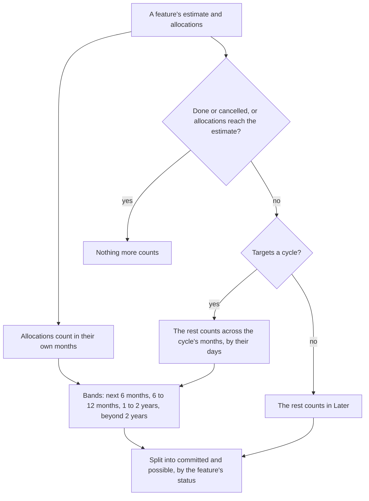

# Fathom: Implementation Plan

**Status:** Proposal for the maintainer's review
**Last updated:** 2026-11-14

A proposed way to build the first stage of the [Roadmap](../product/roadmap.md): groundwork first, then a sequence of thin vertical slices. Each slice goes through every layer (browser, server, database, deployment), follows the roadmap's [Guiding Principles](../product/roadmap.md#guiding-principles), the [Agent Workflow](../standards/shared/agent-workflow.md), and the [Data](../../AGENTS.md#data) rules.

## Groundwork

These come before the first line of application code:

- **Library choices:** Recorded in [ADR 0002](../adr/0002-libraries.md).
- **Testing standard:** Recorded in the [Testing Standards](../standards/testing.md).
- **Code review standard for source code:** Recorded in the [Code Review Standards](../standards/code-review.md).
- **Build process:** Where builds and scans run. Until it is decided, builds and scans run locally.
- **Development setup:** The repository layout, local development, and fictional seed data, as described in [Development Setup](development-setup.md).
- **Remote repository:** Once the repository has a remote, the branching rules in [agent-workflow.md](../standards/shared/agent-workflow.md) apply.

## Definition of Done for Each Slice

Beyond the workflow, each slice:

- Adds the [access control tests](../standards/testing.md#access-control-tests) for the data it introduces.
- Records access history for any Personal or Confidential data it introduces.
- Makes changes to the data it introduces drafts that need approval, once Draft and Approval is built.
- Updates the Security Plan's threats and mitigations as the [Code Review Standards](../standards/code-review.md) require.

## Slices

The slices are built in this order, which may change as work progresses; the slices approved on 2026-11-14 are built in the order the [Roadmap](../product/roadmap.md#coming-next) gives, and their sections below are grouped by topic. The table shows the slices that are done or next; the rest are still to come.

| Slice | Progress |
| --- | --- |
| Hello Fathom | Done, on macOS; server platforms are tested as in [Deployment Testing](#deployment-testing) |
| Component Evaluation | Done, in [ADR 0004](../adr/0004-ui-components.md) |
| Accounts and Access Control | Done |
| Visual Design | Done |
| People | Done: user-defined lists and people |
| Seed Accounts | Done |
| Change History | Done |
| Draft and Approval | Done |
| Web Link Columns | Done |
| Note Columns | Done |
| Number Columns | Done |
| Teams and Reporting Lines | In progress: schema, server, seed, Drafts, People's columns, the Manager flag, the org chart, and manual tests |
| People Over Time | In progress: People on a date, sharing the Org chart's date row and its rules for other dates; next columns that change over time, then availability as a dated value |
| Org Chart Additions | In progress: team colours, drafts on the chart, and person details; next chart fields, filters, and sort |
| Projects and Feature Teams | In progress: feature teams on the org chart, with the feature team chart, a team's panel, its members and lead as drafts, a person's feature teams in their details, and the Feature assignments page, showing feature team drafts, with its cells edited one at a time, and the Org chart's date setting when feature team changes take effect; projects next |
| General Features | Done |
| Allocations and Capacity | In progress: allocations on the server, each person's or planned hire's allocation to a feature one draft, approved with Approve allocations, with the employment and removal rules, the change history, and the seed's fictional allocations; a planned hire with allocations can't be filled, and a filled one can't be allocated, until filling moves its allocations; the allocations grid, read only, with planned hires as rows, each month's features and total, the over- and under-allocation marks, and allocation drafts, marked live only too; capacity total rows for each group and the whole organization, in person-months, with rows under each manager over time; and the grid moved from Feature assignments to the Capacity page's People mode, beside Settings; next [allocating from a cell](#allocations-and-capacity) as drafts |
| Features and the Roadmap | In progress: schema, and features on the server as drafts approved with Approve Plan, following their cycles when those move, with the seed's fictional features; Edit Features is built; the Features page, grouped by cycle, with feature drafts on the Drafts page and in the change-length dialog; a feature's status as a list with meanings, the month it is needed by, customers, a note, and grouping by that month; columns added to Features, with their values in a feature's draft; the conversions between units of effort on the server; the Effort column, shown in the unit and decimal places the view names; the features projects and proposals name, on the server and in Features columns on Projects and Proposals, each feature a link from their details; the Projects and Proposals columns on Features, changed as drafts of each project and proposal, filtered, and each a link to its details beside Features, with Show features in a project's and a proposal's menu; grouping Features by release, with a Release column; a feature's details in sections of their own; each project's and proposal's scope history, with the reason for removing a feature from a proposal; and the planning settings, the conversions among them, on the Capacity page's Settings tab, changed as drafts approved with Approve Configuration; and the shared timeline and its strip of quarters, with the Releases timeline the first view on it; and a read-only Staffed column on Features |
| Cycles and Releases | In progress: schema, server, seed, the Releases page and its timeline, a colour for each release, and changing one cycle's length |
| Hiring Plan | In progress: schema and server, with Position and the hiring states built in and hires known by requisition or temporary ID; lists with meanings edited on the Lists page, which marks built-in lists; planned hires as rows of People, with optional names, the Hired state for people, the seed's planned hires, and a manual test; planned hires' values in People's added columns, each offered on them unless switched off; the Left state, with each person's own state of the meaning their end date gives, and those who have left listed for everyone who sees people; planned managers, with planned hires reporting to them on People and drawn as placeholders on the org chart; filling a planned hire as one draft, from its details panel |
| Editable Roles | In progress: schema, the server reading roles from the database, the Roles page, several roles for each account, chosen from every role on the Accounts page, with a default, acting as one at a time and switching from the account menu, each change recording the role it was made as, the Hiring plan permission area, with viewing and editing, approving split by area, the starting roles rewritten for the personas, and viewing accounts, roles, and settings apart from changing them |
| Exports | In progress: the CSV and TSV file of what a view shows, drafts and Live rows included, from an Export icon in the page's heading on People, Features and each Projects tab, the question asked before exporting Personal or Confidential data, and recording such an export in the access history; next the remaining tables, then the grids and the Org chart |
| Views on Every Page | In progress: what opens each page in shared code, saved views for every table on the server, the Views menu from one shared hook, hiding columns, and saved views on People, Releases, Features and the Projects tabs; next Group by on People |
| Group by Several Values | Approved, not started |
| Demand Forecasting | Approved, not started: Capacity's Demand and Work modes |
| Added Columns and Metrics | Approved, not started |

### Hello Fathom

The smallest version of Fathom: a single page that proves the foundation works end to end.

- A React page served by the application server over HTTPS.
- The page calls the server, which reads from PostgreSQL through the migrations and data access chosen in the groundwork, and shows the result.
- The containers run with Docker Compose, as shown in the [Architecture](architecture.md). The database is reachable only from the application, and neither the application nor the database can reach the internet.
- Unit and integration tests, type checking, linting, and the build-time scans from the Security Plan all run with one command.
- Tests prove that outbound internet access from the application and database containers fails.

### Component Evaluation

The evaluation in the roadmap's [After Hello Fathom](../product/roadmap.md#after-hello-fathom) section. It is not a vertical slice, so the definition of done for slices does not apply to it.

### Accounts and Access Control

Local accounts, sign-in, sessions, and the proposed [Roles](../product/roles.md), enforced through the shared data access layer, with the access history. Every later slice builds on this. Roles are built so they are cheap to change, and are agreed before going live, as the roadmap requires.

### Visual Design

The visual design in the roadmap's [After Hello Fathom](../product/roadmap.md#after-hello-fathom) section, agreed with the maintainer and applied to the screens that exist: navigation and layout, type, colour, spacing, and how tables, forms, dialogs, and messages look, using the components chosen in ADR 0004. Every later slice is built in this design, as [Visual Design](visual-design.md) sets out. It is not a vertical slice, so the definition of done for slices does not apply to it.

### People

People with the employee details the roadmap's [first stage](../product/roadmap.md#stage-who-is-working-on-what) allows.

It is built in two steps: user-defined lists of choices, as set out in the [Decisions Log](../product/decisions.md#configuration), and people, with fictional seed data and commands to load and remove it, whose details such as site or position are columns drawing on lists. Teams with their managers and direct reports come in the Teams and Reporting Lines slice. The lists step adds the change history the Decisions Log requires, which every later slice records its changes in. The people step adds columns on People that draw on lists, held in the values table [ADR 0005](../adr/0005-flexible-data-model.md) proposes, and undo in one step for lists and people. Text, Date and Record columns come with [Added Columns and Metrics](#added-columns-and-metrics); the other field types, apart from Web link, Note and Number, and custom tables wait for the custom fields stage.

### Seed Accounts

Fictional accounts for development, one for each persona in the [Product Brief](../product/brief.md#users), with addresses on the reserved `fathom.test` domain, named after their persona, and holding that persona's role from [Roles](../product/roles.md#roles-by-persona), so each role can be tried by signing in as it.

- **Password:** They share a random password in the git-ignored `.dev/secrets/dev_account_password`, made if missing and printed when the accounts are seeded. `pnpm dev:reset` seeds them, replacing the single account it made before.
- **Adding and removing:** They are added and removed with the rest of the seed data. Accounts are never deleted, since the change history refers to them and can only be added to, so removing the seed data deactivates them, and seeding again reactivates them.
- **Development only:** They exist only in development databases, since the seed package is never part of the runtime image. The threat model gains a row for them, with the check that keeps them out of production.

### Change History

A page showing the change history the lists step built: who changed what, and when, limited to the changes each user may see, as set out in the [Decisions Log](../product/decisions.md#configuration). Draft and approval builds on it to show what a draft changes.

### Draft and Approval

Plan approval, built on lists and people first, as the maintainer intends approval to cover them too, so the pattern every later table follows is set once: each changed row is a draft, seen with the live data, until an Approver approves or rejects it, as set out in the [Decisions Log](../product/decisions.md#planning) and [ADR 0007](../adr/0007-draft-rows.md). The seed data gains drafts made by the personas who edit, covering each case: a row added, changed, and removed, a rejected draft with its reason, and a draft that uses another, such as a person given a choice that is itself a draft.

It is built in two steps. The first gives people drafts: shown in place on the People table, approved and rejected there and on a Drafts page, explained on Help's Drafts page, undone like other changes, and recorded in the change history, with seed drafts of people added, changed, and removed, and rejected. The second gives drafts to lists, choices, the order of a list's choices, and columns, with drafts that use other drafts approved together, which Help's Drafts page then explains, and adds the seed draft that uses another. A third makes drafts private until published, as [ADR 0008](../adr/0008-unpublished-drafts.md) sets out, with seed data holding unpublished changes and a record someone else holds.

### Web Link Columns

A second type of column on People, Web link: each person's value is one web address, http or https only, intranet hosts included, never a file or folder, with an optional name shown in its place. A Web link column sets its own visibility, since it has no list to take one from.

### Note Columns

A third type of column on People, Note: each person's value is one rich-text note, kept as Markdown holding only the formats the [Decisions Log](../product/decisions.md#configuration) allows, and written in a side panel in an editor or as Markdown. A Note column sets its own visibility, as a Web link column does. The note format is shared, so each release also has one note of its own, written in the same side panel from the Releases page, with fictional notes on two seeded releases.

### Number Columns

A fourth type of column on People and planned hires, Number: each value is one number, typed in one form and shown as the reader's language writes it, as the [Decisions Log](../product/decisions.md#configuration) sets out, with its own visibility, and sorting, filtering, and Metrics. The rules for what a number is are shared, for later columns that hold a number with more to it, such as an estimate.

### Teams and Reporting Lines

People managers and their current direct reports: each person's reporting line, with the date it takes effect from, shown as Manager and Team columns on People, the Manager flag that decides who can be a manager, teams' optional names, and the rules, drafts, and warnings in the [Decisions Log](../product/decisions.md#workforce). The seed data gains managers, reports, named and unnamed teams, a person with no manager, and a manager whose end date has passed while people still report to them. Reporting lines set the pattern for records that link to other records, which features, feature teams, and planned hires reuse, and for records in force from a date until the next one starts, which feature team membership and allocations reuse. The Org chart page draws today's approved reporting lines with React Flow, as [ADR 0004](../adr/0004-ui-components.md) chooses, and as the [Decisions Log](../product/decisions.md#workforce) describes, with a [manual test](../testing/org-chart-manual-test.md). Planned hires join the chart as placeholders, with planned managers heading their planned teams, as the [Hiring Plan](#hiring-plan) slice builds. The [Org Chart Additions](#org-chart-additions) slice builds on it. Future dates come with planned reporting changes in [The Organization](../product/roadmap.md#stage-the-organization) stage, which also shows the chart on a chosen date.

### People Over Time

People read as of a date, and columns that keep their history, as [People over time](../product/decisions.md#workforce) sets out, built in this order, each step its own pull request:

1. **People on a date:** the Org chart's date row on People, with the same rules on both pages for who is listed, which drafts show, and what can be changed on another date.
2. **Columns that change over time:** Position and the added columns set to change over time, and a person's changes in one list.
3. **Availability:** each person's and planned hire's availability by month, kept as a dated value.

### Org Chart Additions

The additions to the org chart that the [Decisions Log](../product/decisions.md#workforce) records, built in this order, each step its own pull request:

1. **Team colours:** each team's colour, from the palette releases use, chosen on the org chart and changed at once rather than drafted, with a Team colours permission, which needs a migration; with it, naming teams on the chart as drafts, a Teams panel, and teams in the finder.
2. **Drafts on the chart:** the Draft menu tables have, on the org chart: people drafted to a new manager drawn under them with a Live copy under their current one, drafted positions and team names, Drafts applied and Live only, as the [Decisions Log](../product/decisions.md#workforce) sets out.
3. **Person details:** one person's details in a side panel, which the org chart's cards and People's rows open, as the [Decisions Log](../product/decisions.md#workforce) sets out. Personal details shown there are recorded in the access history, as on People. Those who may change people change the person's details there, as on People.
4. **Chart fields, filters, and sort:** cards show fields chosen from People's columns, at the tiers the reader may see, kept apart from the card's own details, with filters and sort saved as People's views are.

The [Projects and Feature Teams](#projects-and-feature-teams) slice adds a second chart, of feature teams, with their own colours, as the [Decisions Log](../product/decisions.md#workforce) records; its dotted lines to members' managers follow, as [issue #343](https://github.com/jlarue26/fathom/issues/343) records.

### Hiring Plan

Planned hires as rows of the People table beside people, as the [Decisions Log](../product/decisions.md#workforce) sets out: an optional name, shown as the hire's position and ID while it has none; requisitions in the ID column, with temporary IDs until the official one is known; position as a built-in column, required for people and planned hires alike; the State column, the first list with meanings, which the slice builds; the Expected column; People's added columns offered on planned hires unless switched off for them; drafts, with removing a hire removing its allocations; and placeholders for those who do not see planned hires' other details. The server's planned hires, built apart from People, are read and changed through People's table. Fathom holds no real data yet, so the migration carries the development data over simply: each hire's title is dropped, its state becomes the Proposed or Open choice it maps to, and cancelled or filled hires are removed; the Positions list and the column drawing on it become the built-in ones, and a person without a position is given one before Position is required. Planned managers, planned hires marked as managers, have other planned hires report to them, on People and on the org chart, where every planned hire is drawn as a placeholder. Filling a planned hire links it to an existing person or adds a new one, and new employees can be added before they start; filling a planned manager moves its planned hires to the person who fills it. Placeholders show with their manager's team, and count toward its reports once the Team Composition slice compares them with the range. The seed data gains planned hires in each state, with values in the columns they share with people, some with requisitions and some with temporary IDs, one filled by a new employee who has not started, and one filled by an internal transfer. Planned hires are allocated with the [Allocations and Capacity](#allocations-and-capacity) slice.

### Editable Roles

Roles kept in the database as sets of permissions, as the [Decisions Log](../product/decisions.md#people-and-privacy) sets out, built in this order, each step its own pull request:

1. **Schema:** roles, and the permissions each grants. Accounts hold roles by reference, and the migration makes today's eight roles with exactly what they grant now, so nobody's access changes. The application cannot change a starting role's key, and a role it adds cannot take one.
2. **Server:** what a user may do is read from their role in the database, on every request. Each permission gains its plain-English descriptions, naming the permissions it does nothing without any of.
3. **Roles page:** an Administrator who may edit roles sees each role's permissions as a grid of areas and actions, with the plain-English result beside it, copies and edits roles, and sees which accounts a change affects before saving it. Roles' names and descriptions are then read from the database, replacing the copies in the web app and [Roles](../product/roles.md), which already differ slightly. Which pages a role does not open is worked out from the permission each sidebar page names. Before roles can be edited, the last-Administrator guard moves from the Administrator role to the permissions to manage accounts and to edit roles. The Roles page comes first; then each account holds exactly one role, as the [Decisions Log](../product/decisions.md#people-and-privacy) sets out: one starting role for each persona replaces the eight, granting what each persona's roles granted together, and the account dialog chooses one role from every role, made later or starting, by its ID, with each role's description, so no combined result is needed. The Accounts page reads roles' names and descriptions from the database, and its controls follow the permissions rather than the Administrator role. Help lists the starting roles as Fathom gives them, with the user's own role, read from the database. The access history marks every change to a role as worth checking; a second person confirming Confidential grants is deferred in [issue #232](https://github.com/jlarue26/fathom/issues/232) until HR asks for it.
4. **Finer permissions:** split by area, one area at a time, starting with approving, so Approvers approve only the kinds of drafts their role names. Approving is split, each kind of draft mapped to one area's Approve permission in `approvePermissions` in `packages/shared/src/drafts.ts`, decided by the maintainer on 2026-11-07; approving the plan's customers, projects, proposals, and milestones is built, with Approve Plan no longer marked not built yet, and approving features is built with them; approving the roadmap is built with the roadmap. Planned hires are an area of their own, Hiring plan, with viewing and editing, in place of the Confidential tier's hold on them, decided by the maintainer on 2026-11-07, as the [Decisions Log](../product/decisions.md#people-and-privacy) sets out; drafting and approving them come with the split of approving. The starting roles are then rewritten for the personas, with Product Manager and Feature Lead in place of Planner, Edit Features apart from Edit Plan, and View Accounts, View Roles, and View Settings, which open those pages read only, decided by the maintainer on 2026-11-07, as the [Decisions Log](../product/decisions.md#people-and-privacy) sets out. Releases are an area of their own, apart from the rest of the plan, so approving draft releases, which Project Managers and the Engineering Director generally do, can be granted on its own, decided by the maintainer on 2026-11-04.

Scope, such as one's own reporting line, follows later, once it is designed.

### Importing People

Importing people from a CSV or TSV file, as the [Decisions Log](../product/decisions.md#people-and-privacy) sets out, after Teams and Reporting Lines and the People table that also holds planned hires. It is no longer part of the first stage, as the [Roadmap](../product/roadmap.md#not-yet-placed) records. The browser reads the file, with an open-source parser chosen as [ADR 0002](../adr/0002-libraries.md) sets out, which handles quoted cells, Excel's UTF-8 files, and either separator, and sends its rows as the edits pasting them would make, so the server's checks are those of any edit and it parses no files. The server checks the whole import in one request, so problems only it finds are listed with the others. The preview lists problems in a table that can be copied, for fixing the file. Planned hires, and other tables, may take imports later in the same way.

### Cycles and Releases

Release streams, as many as an organization uses, each with a configurable cycle length and cycle names that can change from a chosen date, and releases with typed names that include consecutive cycles, as set out in the [Decisions Log](../product/decisions.md#planning). Each cycle knows its share of the months it spans, as the Decisions Log sets out, which capacity and the timeline use.

### Projects and Feature Teams

Built: customers, projects, proposals, and project milestones as draftable records, approved with Approve Plan, with the seed's fictional customers, projects, and proposals, and the Projects page that shows and edits them, as [Visual Design](visual-design.md#layout) sets out. Projects with their customers, from a built-in Customers table. Milestones of projects, in a Milestones table of their own, as the [Decisions Log](../product/decisions.md#planning) sets out. Feature teams with their names, members and feature leads, with membership and leads kept from a date as reporting lines are, including planned changes, and read as of a chosen day with the Org chart's date control, as the [Decisions Log](../product/decisions.md#workforce) sets out; the screens for planning ahead are still to come. The Feature assignments page shows them month by month on the shared table, where those who edit feature teams change a month's teams, as [Visual Design](visual-design.md#components) sets out, and its second mode, Allocations, came with the [Allocations and Capacity](#allocations-and-capacity) slice and has moved to the Capacity page. Engineering Managers propose them as drafts, which an Approver approves, as set out in [Roles](../product/roles.md). They are kept on the org chart, as the [Decisions Log](../product/decisions.md#workforce) sets out, which draws them as a second chart. The seed data gains fictional projects with customers and milestones, and fictional feature teams.

This slice and Proposals come before Features and the Roadmap, as the [Decisions Log](../product/decisions.md#planning) sets out, so what links them to features is built with that slice.

### Proposals

Built with Projects: proposals, with their statuses from the built-in Proposal statuses list and the projects linking to them, with no rules between a proposal and a project, as the [Decisions Log](../product/decisions.md#planning) sets out. They reuse the patterns Projects and Feature Teams sets, so they come straight after it.

### Features and the Roadmap

The Product Manager's roadmap: features with the built-in columns in the Decisions Log, each targeting a cycle, shown as a table that can be grouped by cycle, with Later for features that target none. Products become a built-in table, and lists drawn from a table let a Product column on Features pick from it. Fathom offers to add suggested columns, such as kind and product, which the maintainer will judge once seen. Features have a built-in description, and their increments are not linked, as the [Decisions Log](../product/decisions.md#planning) sets out, which also says where a feature's effort falls in time, for the Demand Forecasting slice. The seed data gains fictional features across the cycles of a release stream, with some in Later. The slice also links features to what was built before them: the features a project needs, edited from either Projects or Features; milestones of features and the release warnings; the features a feature team owns; and the features a proposal proposes, as the [Decisions Log](../product/decisions.md#planning) sets out. After the Features page, one step makes a feature's status a [list with meanings](../product/decisions.md#configuration) and adds what a Product Manager enters first, Needed by, customers, and a note, with the description limited, as the [Decisions Log](../product/decisions.md#planning) sets out, and the table able to group by Needed by; another adds columns users add to Features, starting with Complexity, decided by the maintainer on 2026-11-08. Feature milestones and the release warnings follow the links to projects and proposals, as their own step, decided by the maintainer on 2026-11-08: a milestone's record then holds its feature and no longer assumes a project. General features come with [General Features](#general-features). Changing one cycle's length moves the features on cycles that move, and a change that would leave a feature's target no longer a cycle is refused, as the Decisions Log's Cycles and Cycle length changes set out, built with the server's features.

Features take saved views, personal and shared, as People's table does, with [Views on Every Page](#views-on-every-page), done on 2026-11-14.

[The Roadmap and the Plan](../product/decisions.md#planning), as [Visual Design](visual-design.md#components) and [UI Conventions](conventions.md#timelines) set out, start once three pull requests of [Demand Forecasting](#demand-forecasting) have merged, each step its own pull request, decided by the maintainer on 2026-11-11:

1. **Size, Priority, and Risk:** built-in columns on Features, with the seed's Complexity becoming Kind. Done.
2. **The shared timeline:** the timeline and its strip taken out of the Releases timeline, changing what Releases shows only by the strip and the page's layout, which puts the timeline above the table, each scrolling on its own. A wide change. Done, brought forward on 2026-11-11.
3. **The Features Board:** in four pull requests: the board, read only, with cycles as its columns, done on 2026-11-13; months needed by as its columns, the default; moving cards; and Needed by as a year alone, decided by the maintainer on 2026-11-13.
4. **Capacity's Work mode:** the Plan, with the allocations grid moved in as the People mode, built with [Demand Forecasting](#demand-forecasting).
5. **The project timeline.**
6. **The Releases timeline's changes:** its Ships on diamonds under the bars, drafts by the draft marks following the page's Draft view, and bars that name the release alone, brought forward to follow the shared timeline. Done on 2026-11-11.
7. **A realistic release seed:** the seed's release drafts become a realistic plan: Harbor 3's draft ends a cycle later rather than moving, Harbor 4 follows straight after it, and the retirement is drafted on a stream that has finished. Decided by the maintainer on 2026-11-11, as its own pull request after step 6 to keep each pull request under its size, which the maintainer accepted in advance on 2026-11-11, to be confirmed.
8. **The Releases page on the shared table:** the streams table moves onto the shared table, as every other page's is, with its search, details button, column menus, Group by, Metrics and saved views, and the page is brought in line with the conventions, taking the Releases items in issues [#219](https://github.com/jlarue26/fathom/issues/219), [#438](https://github.com/jlarue26/fathom/issues/438), [#440](https://github.com/jlarue26/fathom/issues/440), [#441](https://github.com/jlarue26/fathom/issues/441) and [#443](https://github.com/jlarue26/fathom/issues/443) and the retired streams in [issue #277](https://github.com/jlarue26/fathom/issues/277). Decided by the maintainer on 2026-11-11, as its own pull request in the same way. Done on 2026-11-13, and its saved views on 2026-11-14, with the timeline following the table's view.
9. **The Lists page on the shared table:** the lists table moved onto the shared table in the same way, taking sorting, filtering and saved views of lists in [issue #317](https://github.com/jlarue26/fathom/issues/317). Decided by the maintainer on 2026-11-11, and built with [Views on Every Page](#views-on-every-page).

### General Features

Each project's general feature, which a future allocation names for work on the project itself, as the [Decisions Log](../product/decisions.md#planning) sets out, built before [Allocations and Capacity](#allocations-and-capacity). Whatever names a feature handles a general feature, which has no name of its own, as allocations will. The slice began as Workstreams, which the [Decisions Log](../product/decisions.md#planning) records as dropped.

### Allocations and Capacity

Allocations kept from a month, as reporting lines are, for people and planned hires; capacity by person, by manager, by feature team, and for the whole organization; and the warnings and rules in the [Decisions Log](../product/decisions.md#planning), including over- and under-allocation and allocations a date change leaves outside someone's employment. They are shown in the monthly resource grid, grouped by manager or feature team, with the cycle and release lines of one release stream at a time from the Cycles and Releases slice, as [Visual Design](visual-design.md#components) sets out. Filling a planned hire moves its allocations to the person who fills it, as the [Decisions Log](../product/decisions.md#workforce) sets out. The seed data gains fictional allocations for people and planned hires across several months, including an over-allocated person, an under-allocated one, a project's general feature, and a filled planned hire whose person starts after its target date. A manual test in [Manual Tests](../testing/) walks through the grid. Building allocations adds Approve allocations.

Allocating from the grid ([issue #493](https://github.com/jlarue26/fathom/issues/493)), approved by the maintainer on 2026-11-14, follows People Over Time's second and third steps, each step its own pull request:

1. **The server:** several allocation changes in one request, the features that can be allocated, the access history for changes, and each month's warnings.
2. **Changing a month from its cell** on Capacity's People mode, as drafts, with Undo and the server's refusals.
3. **The row's menu:** allocating over many months from the side panel, and allocation drafts on the Drafts page.
4. **Copying and pasting months** across a row.
5. **The warnings in cells, and the Warnings filter** in the Views menu, after the Views menu on any page in [Views on Every Page](#views-on-every-page).

### Team Composition

Reports per manager, including planned hires, compared with a range, in a Teams table with a row for each manager, counted as at a month the reader picks, as the [Decisions Log](../product/decisions.md#workforce) sets out. It builds on the People table's [metrics](../product/decisions.md#configuration), which count people by a column's values: reports per manager groups the same counts by manager, with a target beside each, and later ratios, such as test to development, compare two of a column's counts.

### Demand Forecasting

One estimate per feature, entered in a unit of effort, with configurable conversions between units, and compared with the capacity from [Allocations and Capacity](#allocations-and-capacity) over the forecasting horizons in the [Product Brief](../product/brief.md), worked out from features' allocations and target cycles, as the [Decisions Log](../product/decisions.md#planning) sets out. A Demand page shows the forecast as a table and a simple bar chart, for the whole organization and for each feature team, and Features gain Allocated and Remaining columns beside the estimate. Demand and its settings become modes of the Capacity page, as [The Capacity page](../product/decisions.md#planning) sets out.

Capacity's Demand mode ([issue #496](https://github.com/jlarue26/fathom/issues/496)) and Work mode, the Plan in [issue #491](https://github.com/jlarue26/fathom/issues/491), approved by the maintainer on 2026-11-14, follow allocating from the grid, each step its own pull request, with no migration:

1. **One shared forecast:** demand and its horizons worked out once, for both modes, and the forecast's settings read by the roles that see the forecast.
2. **Demand mode's table,** with Group by, units and drafts, and the mode in the Capacity page's switch.
3. **Demand mode's bar chart,** with the chart library [ADR 0004](../adr/0004-ui-components.md) chose.
4. **Work mode's timeline:** the capacity row, feature rows with staffed bars and Needed by, and the release layer, on the shared timeline.
5. **Work mode's marks and filters,** Late and Not staffed among them, and links between the People and Work modes, after On track or Late on the Features Board's cards, for the Late mark, and after the Views menu on any page in [Views on Every Page](#views-on-every-page).

Where a feature's effort counts in the forecast, as [Feature effort over time](../product/decisions.md#planning) and the Demand forecast set out:

### Views on Every Page

Saved views, personal and shared, on every page with a table, and on the pages that aren't plain tables where they fit, served by one shared Views menu and one server for every table, approved by the maintainer on 2026-11-14. Each step is its own pull request, with no migration:

1. **What opens each page,** moved to shared code with no change in behaviour. Done on 2026-11-14.
2. **Saved views for any table on the server,** with grouping and hidden columns kept, the change history and undo for each table, and access control tests for every starting role. Done on 2026-11-14.
3. **The Views menu on any page,** with a page's own choices kept in its views, People moved onto it, and saved views on Releases. Done on 2026-11-14.
4. **Hiding columns** ([issue #517](https://github.com/jlarue26/fathom/issues/517)). Done on 2026-11-14.
5. **Saved views on Features,** the Features Board included, and on each Projects tab. Done on 2026-11-14.
6. **Group by on People** ([issue #553](https://github.com/jlarue26/fathom/issues/553)). Done on 2026-11-14.
7. **Saved views on Feature assignments and Capacity's People mode.**
8. **The Lists page on the shared table** ([issue #317](https://github.com/jlarue26/fathom/issues/317)).
9. **Saved views on Lists,** with its All, Built in or Custom choice in the Views menu.
10. **Saved views on the Org chart** ([issue #351](https://github.com/jlarue26/fathom/issues/351)).
11. **Accounts on the shared table,** with saved views and its All, Active or Deactivated choice in the Views menu, closing [issue #318](https://github.com/jlarue26/fathom/issues/318).
12. **Filters and saved views on the Drafts page.**

Steps 1, 2 and 3 come in order, and 4 follows 3; steps 5 to 12 follow in any order. Pinned views ([issue #516](https://github.com/jlarue26/fathom/issues/516)) come later.

### Group by Several Values

Grouping by a column holding several values, with a record shown under each of its values, approved by the maintainer on 2026-11-14, after step 6 of [Views on Every Page](#views-on-every-page) and before its step 7. Each step is its own pull request, with no migration:

1. **The shared table** groups a record under several values, counting it once. Done on 2026-11-14.
2. **Features' Group by** offers Customers, Projects, Proposals and other columns holding several values, on the table and the Features Board ([issue #594](https://github.com/jlarue26/fathom/issues/594)).
3. **People's Feature teams column,** and grouping People by it.

Step 1 comes first, and lands before step 4 of Demand Forecasting's Work mode where it can, so the Plan's grouping by project is built on it; steps 2 and 3 follow in either order.

### Added Columns and Metrics

New types of added column, and totals in Metrics, approved by the maintainer on 2026-11-14, after [Demand Forecasting](#demand-forecasting). Each step is its own pull request:

1. **The schema,** alone, in the only migration of this slice.
2. **Text columns** on People and Features ([issue #504](https://github.com/jlarue26/fathom/issues/504)).
3. **Date columns** on People and Features ([issue #504](https://github.com/jlarue26/fathom/issues/504)).
4. **Who adds Features' columns** ([issue #240](https://github.com/jlarue26/fathom/issues/240)).
5. **Values in a Features column only drafted to be added** ([issue #296](https://github.com/jlarue26/fathom/issues/296)).
6. **Record columns on the server:** a column whose values are records of another table, such as a person or a feature.
7. **Record columns on screen.**
8. **Totals in Metrics** for numbers and effort ([issue #367](https://github.com/jlarue26/fathom/issues/367), [issue #295](https://github.com/jlarue26/fathom/issues/295)), after step 3 of [Views on Every Page](#views-on-every-page).
9. **Dates in Metrics** ([issue #291](https://github.com/jlarue26/fathom/issues/291)).

Step 1 comes first. Steps 2 and 3 follow it, step 4 comes before step 5, step 7 follows steps 2, 3 and 6, and step 9 follows step 8. Lookup columns, which follow a link, and Duration columns come in v1.1.

### Overview

The Overview page as a page of links to what needs attention, as [The Overview page](../product/decisions.md#planning) sets out, built after the steps of [The Roadmap and the Plan](#features-and-the-roadmap), since it shows which features are Late, Not staffed or Critical, and how much capacity is used. Its v1, the header, the drafts that need the reader's approval, This cycle and Needs attention, was chosen by the owner on 2026-11-14 and is built in two pull requests: first the pieces it shares, the Drafts page's entries, a stream's current cycle, a cycle's features by status meaning and the Staffed column, which are built; then the page.

### Exports

Exporting what a view shows as a CSV or TSV file, as the [Decisions Log](../product/decisions.md#platform-and-operations) sets out, brought forward from the [Snapshots, Exports, and Hiring](../product/roadmap.md#stage-snapshots-exports-and-hiring) stage by the maintainer on 2026-11-11. It is built in this order, each step its own pull request: first recording an export holding Personal or Confidential data in the access history; then the file, the Export icon in the page's heading, which the shared table offers on People, Features and each Projects tab, and the question asked before exporting Personal or Confidential data; then the remaining tables; then the table forms of the grids, Feature assignments and the allocations, and the Org chart.

### Project Manager Input

The input Project Managers give on whether teams are in place. Its form is still to be decided, so this slice is scheduled once it is.

## Deployment Testing

Testing on the server platforms in [Supported Platforms](../operations/supported-platforms.md) may be some time away. Until then, slices are proven on development platforms. Each server platform is tested once its host setup below is written and a suitable machine is available. Deploying to company infrastructure, including for testing, first needs IT approval.

## Host Setup

Scripts that set up a production host cover the host firewall, blocking the proxy's outbound traffic where possible, and creating the first Administrator, the Fathom Administrator account, by running `apps/server/src/create-administrator.ts` in the application's container, as `pnpm stack:create-administrator` does. Until they exist, [Securing Your Environment](../operations/securing-your-environment.md) lists what a host needs.

## Going Live

When the slices are complete, Fathom is deployed to the production host and the steps in the roadmap's [Before Going Live](../product/roadmap.md#before-going-live) section are completed.
