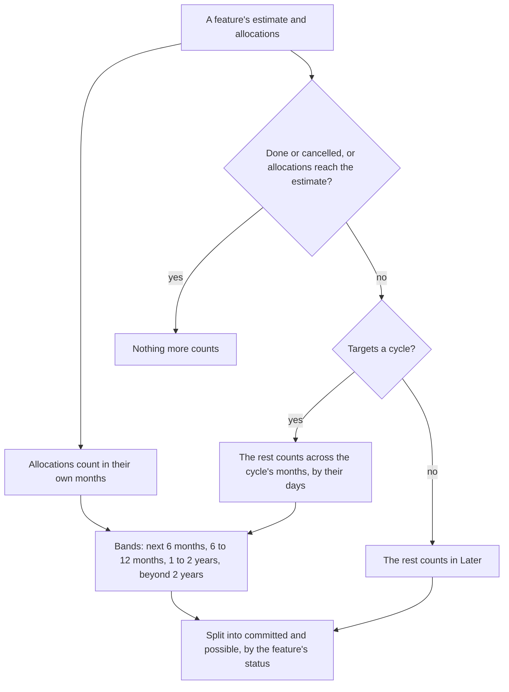

# Fathom: Implementation Plan

**Status:** Proposal for the owner's review
**Last updated:** 2026-11-04

A proposed way to build the first stage of the [Roadmap](../product/roadmap.md): groundwork first, then a sequence of thin vertical slices. Each slice goes through every layer (browser, server, database, deployment), follows the roadmap's [Guiding Principles](../product/roadmap.md#guiding-principles), the [Agent Workflow](../standards/shared/agent-workflow.md), and the [Data](../../AGENTS.md#data) rules.

## Groundwork

These come before the first line of application code:

- **Library choices:** Recorded in [ADR 0002](../adr/0002-libraries.md).
- **Testing standard:** Recorded in the [Testing Standards](../standards/testing.md).
- **Code review standard for source code:** Recorded in the [Code Review Standards](../standards/code-review.md).
- **Build process:** Where builds and scans run, answering the open question in the [Security Plan](../security/security-plan.md). Until it is answered, builds and scans run locally.
- **Development setup:** The repository layout, local development, and fictional seed data, as described in [Development Setup](development-setup.md).
- **Remote repository:** Once the repository has a remote, the branching rules in [agent-workflow.md](../standards/shared/agent-workflow.md) and the repository proposals in the Security Plan apply.

## Definition of Done for Each Slice

Beyond the workflow, each slice:

- Adds the [access control tests](../standards/testing.md#access-control-tests) for the data it introduces.
- Records access history for any Restricted or Confidential data it introduces.
- Makes changes to the data it introduces drafts that need approval, once Draft and Approval is built.
- Updates the threat model as the [Code Review Standards](../standards/code-review.md) require.

## Slices

The slices are built in this order, which may change as work progresses. The table shows the slices that are done or next; the rest are still to come.

| Slice | Progress |
| --- | --- |
| Hello Fathom | Done, on macOS; server platforms are tested as in [Deployment Testing](#deployment-testing) |
| Component Evaluation | Done, in [ADR 0004](../adr/0004-ui-components.md) |
| Accounts and Access Control | Done |
| Visual Design | Done |
| People | Done: user-defined lists and people |
| Seed Accounts | Done |
| Change History | Done |
| Draft and Approval | Done |
| Web Link Columns | Done |
| Teams and Reporting Lines | In progress: schema, server, seed, Drafts and People's columns |
| Cycles and Releases | In progress: schema |
| Hiring Plan | In progress: schema and server |
| Editable Roles | In progress: schema |

### Hello Fathom

The smallest version of Fathom: a single page that proves the foundation works end to end.

- A React page served by the application server over HTTPS.
- The page calls the server, which reads from PostgreSQL through the migrations and data access chosen in the groundwork, and shows the result.
- The containers run with Docker Compose, as shown in the [Architecture](architecture.md). The database is reachable only from the application, and neither the application nor the database can reach the internet.
- Unit and integration tests, type checking, linting, and the build-time scans from the Security Plan all run with one command.
- Tests prove that outbound internet access from the application and database containers fails.

### Component Evaluation

The evaluation in the roadmap's [After Hello Fathom](../product/roadmap.md#after-hello-fathom) section. It is not a vertical slice, so the definition of done for slices does not apply to it.

### Accounts and Access Control

Local accounts, sign-in, sessions, and the proposed [Roles](../product/roles.md), enforced through the shared data access layer, with the access history. Every later slice builds on this. Roles are built so they are cheap to change, and are agreed before going live, as the roadmap requires.

### Visual Design

The visual design in the roadmap's [After Hello Fathom](../product/roadmap.md#after-hello-fathom) section, agreed with the owner and applied to the screens that exist: navigation and layout, type, colour, spacing, and how tables, forms, dialogs, and messages look, using the components chosen in ADR 0004. Every later slice is built in this design, as [Visual Design](visual-design.md) sets out. It is not a vertical slice, so the definition of done for slices does not apply to it.

### People

People with the employee details the roadmap's [first stage](../product/roadmap.md#stage-who-is-working-on-what) allows.

It is built in two steps: user-defined lists of choices, as set out in the [Decisions Log](../product/decisions.md#configuration), and people, with fictional seed data and commands to load and remove it, whose details such as site or position are columns drawing on lists. Teams with their managers and direct reports come in the Teams and Reporting Lines slice. The lists step adds the change history the Decisions Log requires, which every later slice records its changes in. The people step adds columns on People that draw on lists, held in the values table [ADR 0005](../adr/0005-flexible-data-model.md) proposes, and undo in one step for lists and people. The other field types, apart from Web link, and custom tables wait for the custom fields stage.

### Seed Accounts

Fictional accounts for development, one for each persona in the [Product Brief](../product/brief.md#users), with addresses on the reserved `fathom.test` domain, named after their persona, and that persona's default roles from [Roles](../product/roles.md#default-roles-by-persona), so each role can be tried by signing in as it.

- **Password:** They share a random password in the git-ignored `.dev/secrets/dev_account_password`, made if missing and printed when the accounts are seeded. `pnpm dev:reset` seeds them, replacing the single account it made before.
- **Adding and removing:** They are added and removed with the rest of the seed data. Accounts are never deleted, since the change history refers to them and can only be added to, so removing the seed data deactivates them, and seeding again reactivates them.
- **Development only:** They exist only in development databases, since the seed package is never part of the runtime image. The threat model gains a row for them, with the check that keeps them out of production.

### Change History

A page showing the change history the lists step built: who changed what, and when, limited to the changes each user may see, as set out in the [Decisions Log](../product/decisions.md#configuration). Draft and approval builds on it to show what a draft changes.

### Draft and Approval

Plan approval, built on lists and people first, as the owner intends approval to cover them too, so the pattern every later table follows is set once: each changed row is a draft, seen with the live data, until an Approver approves or rejects it, as set out in the [Decisions Log](../product/decisions.md#planning) and [ADR 0007](../adr/0007-draft-rows.md). The seed data gains drafts made by the personas who edit, covering each case: a row added, changed, and removed, a rejected draft with its reason, and a draft that uses another, such as a person given a choice that is itself a draft.

It is built in two steps. The first gives people drafts: shown in place on the People table, approved and rejected there and on a Drafts page, explained on Help's Drafts page, undone like other changes, and recorded in the change history, with seed drafts of people added, changed, and removed, and rejected. The second gives drafts to lists, choices, columns, and their order, with drafts that use other drafts approved together, which Help's Drafts page then explains, and adds the seed draft that uses another. A third makes drafts private until published, as [ADR 0008](../adr/0008-unpublished-drafts.md) sets out, with seed data holding unpublished changes and a record someone else holds.

### Web Link Columns

A second type of column on People, Web link: each person's value is one web address, http or https only, intranet hosts included, never a file or folder, with an optional name shown in its place. A Web link column sets its own visibility, since it has no list to take one from.

### Teams and Reporting Lines

People managers and their current direct reports: each person's reporting line, with the date it takes effect from, shown as Manager and Team columns on People, teams' optional names, and the rules, drafts, and warnings in the [Decisions Log](../product/decisions.md#workforce). The seed data gains managers, reports, named and unnamed teams, a person with no manager, and a manager whose end date has passed while people still report to them. Reporting lines set the pattern for records that link to other records, which features, feature teams, and planned hires reuse, and for records in force from a date until the next one starts, which feature team membership and allocations reuse. Future dates come with planned reporting changes and the org chart in [The Organization](../product/roadmap.md#stage-the-organization) stage.

### Hiring Plan

Planned hires, apart from People, in the states and with the details, columns shared with People, placeholders, and drafts set out in the [Decisions Log](../product/decisions.md#workforce), with the Workforce Administrator renaming the states. Filling a planned hire links it to an existing person or adds a new one, and new employees can be added before they start. Placeholders show with their manager's team, and count toward its reports once the Team Composition slice compares them with the range. The seed data gains planned hires in every state, one filled by a new employee who has not started, and one filled by an internal transfer. Allocating planned hires waits for the Allocations and Capacity slice.

### Editable Roles

Roles kept in the database as sets of permissions, as the [Decisions Log](../product/decisions.md#people-and-privacy) sets out, built in this order, each step its own pull request:

1. **Schema:** roles, and the permissions each grants. Accounts hold roles by reference, and the migration makes today's eight roles with exactly what they grant now, so nobody's access changes. Until the server reads what roles grant from the database, a starting role's key decides it, so the application cannot change a key, and a role it adds cannot take a starting role's.
2. **Server:** what a user may do is read from their roles in the database. Each permission gains its plain-English descriptions, and every page names the permission it needs from the same list.
3. **Roles page:** an Administrator who may edit roles sees each role's permissions as a grid of areas and actions, with the plain-English result beside it, copies and edits roles, and sees which accounts a change affects before saving it. The account dialog shows the result of the roles it gives. Roles' names and descriptions are then read from the database, replacing the copies in the web app and [Roles](../product/roles.md), which already differ slightly.
4. **Finer permissions:** split by area, one area at a time, starting with approving, so Approvers approve only the kinds of drafts their roles name.

Scope, such as one's own reporting line, follows later, as [Issues](../issues.md#roles) records.

### Importing People

Importing people from a CSV or TSV file, as the [Decisions Log](../product/decisions.md#people-and-privacy) sets out, after Teams and Reporting Lines and the People table shared with the Hiring Plan. The browser reads the file, with an open-source parser chosen as [ADR 0002](../adr/0002-libraries.md) sets out, which handles quoted cells, Excel's UTF-8 files, and either separator, and sends its rows as the edits pasting them would make, so the server's checks are those of any edit and it parses no files. The server checks the whole import in one request, so problems only it finds are listed with the others. The preview lists problems in a table that can be copied, for fixing the file. Other tables, such as the Hiring Plan, may take imports later in the same way.

### Cycles and Releases

Release streams, as many as an organization uses, each with a configurable cycle length and cycle names that can change from a chosen date, and releases with typed names that include consecutive cycles, as set out in the [Decisions Log](../product/decisions.md#planning). Each cycle knows its share of the months it spans, as the Decisions Log sets out, which capacity and the timeline use.

### Features and the Roadmap

The Product Manager's roadmap: features with the built-in columns in the Decisions Log, each targeting a cycle, shown as a table that can be grouped by cycle, with Later for features that target none. Products become a built-in table, and lists drawn from a table let a Product column on Features pick from it. Fathom offers to add suggested columns, such as kind, priority, and product, which the owner will judge once seen. Features have a built-in description, and their increments are not linked, as the [Decisions Log](../product/decisions.md#planning) sets out, which also says where a feature's effort falls in time, for the Demand Forecasting slice. The seed data gains fictional features across the cycles of a release stream, with some in Later, for the test page below.

A test page of the roadmap board proposed in [ADR 0009](../adr/0009-roadmap-and-timeline-views.md) comes with the slice, so the owner can judge the board before The Organization stage. It is labelled as a test and left off the main navigation:

- **Roadmap board:** The real features of one release stream, with a column for each cycle and Later, and cards moved by mouse, by Alt and the arrow keys, and from their menu. Moves are real drafts of the target cycle, marked as on tables.
- **Timeline sketch:** Read only, with rows for feature teams and bars across cycles drawn from fixed fictional data in the page, since feature teams and allocations do not exist yet, to judge lanes and row height.

### Projects and Feature Teams

Projects with their customers, from a built-in Customers table, the features they need, edited from either Projects or Features, and their general features. Milestones of projects and features, in a Milestones table of their own, and the release warnings, all as the [Decisions Log](../product/decisions.md#planning) sets out. Feature teams with their names, members and feature leads, owning features, with membership kept from a date as reporting lines are, as the [Decisions Log](../product/decisions.md#workforce) sets out. People Managers propose them as drafts, which an Approver approves, as set out in [Roles](../product/roles.md).

### Proposals

Proposals, which may become projects, with their statuses, the features they propose, and making a won proposal a project, as the [Decisions Log](../product/decisions.md#planning) sets out. They reuse the patterns Projects and Feature Teams sets, so they come straight after it.

### Allocations and Capacity

Allocations kept from a month, as reporting lines are, for people and planned hires; capacity by person, by manager, by feature team, and for the whole organization; and the warnings and rules in the [Decisions Log](../product/decisions.md#planning), including over- and under-allocation and allocations a date change leaves outside someone's employment. They are shown in the monthly resource grid, grouped by manager or feature team, with the cycle and release lines of one release stream at a time from the Cycles and Releases slice, as [Visual Design](visual-design.md#components) sets out. Filling a planned hire moves its allocations to the person who fills it, as the [Decisions Log](../product/decisions.md#workforce) sets out. The seed data gains fictional allocations for people and planned hires across several months, including an over-allocated person, an under-allocated one, a project's general feature, and a filled planned hire whose person starts after its target date. A manual test in [Manual Tests](../testing/) walks through the grid.

### Team Composition

Reports per manager, including planned hires, compared with a range, in a Teams table with a row for each manager, counted as at a month the reader picks, as the [Decisions Log](../product/decisions.md#workforce) sets out. It builds on the People table's [metrics](../product/decisions.md#configuration), which count people by a column's values: reports per manager groups the same counts by manager, with a target beside each, and later ratios, such as test to development, compare two of a column's counts.

### Demand Forecasting

One estimate per feature, entered in a unit of effort, with configurable conversions between units, and compared with the capacity from [Allocations and Capacity](#allocations-and-capacity) over the forecasting horizons in the [Product Brief](../product/brief.md), worked out from features' allocations and target cycles, as the [Decisions Log](../product/decisions.md#planning) sets out. A Demand page shows the forecast as a table and a simple bar chart, for the whole organization and for each feature team, and Features gain Allocated and Remaining columns beside the estimate. Each cycle's demand on the roadmap board waits for the visual roadmap.

Where a feature's effort counts in the forecast, as [Feature effort over time](../product/decisions.md#planning) and the Demand forecast set out:

### Project Manager Input

The input Project Managers give on whether teams are in place. Its form is an [open question in the Product Brief](../product/brief.md#open-questions), so this slice is scheduled once it is answered.

## Deployment Testing

Testing on the server platforms in [Supported Platforms](../operations/supported-platforms.md) may be some time away. Until then, slices are proven on development platforms. Each server platform is tested once its host setup below is written and a suitable machine is available. Deploying to company infrastructure, including for testing, first needs IT approval.

## Host Setup

The scripts that set up the production host are written once the first stage works on macOS, close to deployment. For the first deployment's Windows Server with WSL 2, they cover the [setup it needs](../operations/supported-platforms.md#windows-server-with-wsl-2), the host firewall, where possible blocking the proxy's outbound traffic, and creating the first administrator's account. They wait until then because they depend on IT's answers to the requests in the [IT Overview](../operations/it-overview.md) and [Deployment](../operations/deployment.md), and need a Windows machine to test on.

## Going Live

When the slices are complete, Fathom is deployed to the production host and the steps in the roadmap's [Before Going Live](../product/roadmap.md#before-going-live) section are completed.
