# How Fathom Fits Together

Fathom keeps track of three things: what's planned, when it ships, and who works on it. They're connected, so a change in one shows in the others. For example, a project needs a feature. That feature ships in a cycle of a release, and a feature team's people work on it.

## How They Connect

Each arrow runs from a thing to what it belongs to or serves.

Projects and proposals are for customers. A project is committed work, and a proposal is work offered to a customer that may or may not be won. Both name the features they need.

## Each Thing

### Customer

Whoever a project's or proposal's work is for. See [Projects](projects.md). In Fathom: **Projects**, the **Customers** tab.

### Project

Committed work for one or more customers. A project with no customers is an internal project. See [Projects](projects.md). In Fathom: **Projects**, the **Projects** tab.

### Proposal

Work offered or requested that may become a project, such as a bid or a customer's request. See [Projects](projects.md). In Fathom: **Projects**, the **Proposals** tab.

### Feature

A piece of work planned to ship, with a status, a priority and an estimate of the effort it needs. See [Features](features.md). In Fathom: **Features**, as a table or a board.

### Milestone

A dated point in a project, such as a delivery to the customer. See [Projects](projects.md#add-a-milestone-to-a-project). In Fathom: **Projects**, the **Milestones** tab.

### Schedule

A repeating set of cycles of a set length, such as one product line's quarters. See [Releases](releases.md#add-a-schedule). In Fathom: **Releases**, the **Schedules** tab.

### Cycle

A planning period in a schedule, such as a quarter. A feature targets the cycle it's planned to ship in. See [Releases](releases.md#read-a-schedules-cycles). In Fathom: **Releases**, the **Cycles** tab.

### Release

What ships the features that target its cycles. It covers one cycle, or several in a row, of one schedule. See [Releases](releases.md#make-a-release). In Fathom: **Releases**, the **Releases** tab.

### Person

Someone in the organization, with a position, a manager, a team and dates. See [People](people.md). In Fathom: **People**, and on the **Org chart**.

### Planned Hire

A job you plan to fill. It has a row like a person's, so the work planned for it shows too. Once filled, the person takes its place. See [People](people.md#fill-a-planned-hire). In Fathom: **People**.

### Feature Team

A group that works on features together, whoever its members report to. It may have a lead. See [Org chart](org-chart.md#change-a-feature-team). In Fathom: the **Org chart**, under **Feature teams**, and **Capacity**, the **Feature teams** tab.

### Allocation

The share of someone's month planned for one feature, such as 50%. See [Capacity](capacity.md). In Fathom: **Capacity**, the **Allocations** tab.

### Account

What someone signs in with. It holds one or more roles, one of them the default. See [Accounts](accounts.md). In Fathom: **Accounts**, under Administration.

### Role

What an account may see and do, including Personal and Confidential details. See [Roles](roles.md). In Fathom: **Roles**, under Administration.

### Draft

A change waiting for approval. Nobody else sees it until you publish it, and it goes live once someone allowed to decide approves it. See [Drafts](drafts.md). In Fathom: the **Drafts** page, and a dot before what a draft changes.

## Each Area

The arrows above hold for each area. These add to them.

### Planning

- A **milestone** marks a date in a **project**.

### Releases

- A **cycle** and a **release** are both in a **schedule**.

A schedule repeats cycles of a set length. A release gathers one or more cycles in a row, and a feature ships in the release that holds its cycle.

### Workforce

- A **person** reports to another **person**, their manager.
- A **feature team** may have a **person** who leads it.
- A **planned hire** reports to a **person**, or to another **planned hire**.
- A **planned hire** is filled by a **person**.

Reporting lines and team membership are dated, so past and planned changes are kept. People are allocated to features as a share of each month.

### Access and Drafts

- An **account** holds one or more **roles**.
- A **role** grants what its holders may see and do.
- A **change** that needs approval is saved as a **draft**.
- A **draft** is approved or rejected by an **account** allowed to decide.

Every change is kept in the change history. See [Change history](change-history.md).
