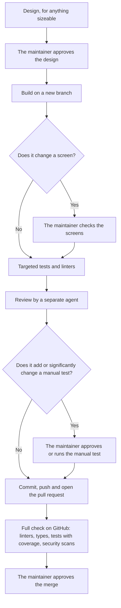

# How Fathom Is Built

AI agents write most of Fathom's code and documents, under a human's direction and review. This page says how that works, and how the quality of what they make is checked. It is for anyone evaluating Fathom: IT and security reviewers, developers, and people deciding whether to run it.

## Quality at a Glance

- **100% test coverage, enforced:** Every tested package fails its tests below 100% of branches, functions, lines and statements. What is left out, and why, is set out under [Coverage](#coverage).
- **Manual tests that act as requirements:** Each feature has a written manual test of numbered cases with exact expected results, from a person's side.
  - **Workflow and acceptance tests:** Each role has a workflow test that follows its daily work, and acceptance tests set Fathom up from nothing and work between roles.
  - **Run by the maintainer:** The maintainer has run them all, and runs them again as features change.
- **Every screen seen by a person:** The maintainer looks at every screen change before it is tested or reviewed.
- **Every change reviewed, every merge approved:** A separate agent reviews each change against written standards, and the maintainer approves every merge, after checking every screen change and every new or significantly changed manual test.
- **Security checked on every pull request:** Dependency, source code and secret scans run with the tests on every push to a pull request and every group in the merge queue, and the container images are scanned again whenever what they're built from changes.
  - **Failing findings:** The scans fail on a fix that is overdue or any other critical or high finding.
  - **CodeQL:** CodeQL also scans the code on GitHub for each pull request.

## The Maintainer

One maintainer directs Fathom: a software developer, architect and software development manager with decades of experience. The maintainer decides:

- every product decision, and every decision in each design
- what each screen looks like and how it reads
- what reaches `main`

No agent decides any of these.

## The Team of Agents

Each agent has one of these roles:

| Agent | Role |
| --- | --- |
| Architect | Writes detailed designs, and changes no code unless asked |
| Builder | Writes the code and its automated tests |
| Technical writer | Writes the documents, Help pages, manual and acceptance tests, and issues |
| Test helper | Supports the maintainer's manual and acceptance testing |
| Coordinator | Plans and assigns work, checks designs against the code, and keeps the record of the maintainer's decisions |

## How a Change Is Made

1. **Design:** Anything sizeable starts with a written design, checked against the real code. It lists every decision it needs, least certain first. The maintainer approves, changes or rejects each one, often from a mockup of the screen.
1. **Small pull requests:** Each pull request covers one task, usually in one reviewed commit. A batch of issue fixes in one area commits each fix on its own, has one review for the whole branch, and stays under about 1,500 added lines, as [Issues](standards/issues.md#issue-batches) sets out.
1. **The screen check:** The maintainer looks at every screen change, in a browser, before the tests and the review. Nothing goes further until the maintainer is satisfied with the screen.
1. **Tests while working:** The tests that import the changed code, and the linters, run while the change is made, and again, with `pnpm check:push`, before each push.
1. **A separate review:** Another agent, which did not write the change, reviews it against the [Code Review Standards](standards/code-review.md). It rates each focus area from 1 to 5, and the change is ready only when every area rates 5.
   - A faster model may review changes to documents, scripts, on-screen wording and ordinary tests.
   - Anything that touches security, and any change where the choice is in doubt, is reviewed with the full model, as the [Agent Workflow](standards/agent-workflow.md#rules-for-both-modes) sets out.
   - Every finding is fixed, or the maintainer agrees in writing to leave it.
1. **Manual tests:** The maintainer approves or runs a new manual test, or a significant change to one, before it is committed. Every other change is committed, pushed and opened as a pull request once it passes its review.
1. **The full check:** GitHub runs `pnpm check` on every push to a pull request and on each group in the merge queue: the linters, type checks, the unit, integration, access control, security and script tests with coverage, and the security scans.
   - A change to documentation alone leaves out the unit, integration, access control and security tests, and the container tests.
   - Every other change runs them.
1. **Merge:** Nothing is merged until the full check, the container tests included, passes on the code `main` will hold, which the merge queue and a rule on `main` enforce, and never without the maintainer's word.

Duplicated code isn't allowed: a new component, helper or rule first looks for one that already does the job, and the review searches for one too. The full check fails a change that copies a block of code. Only the maintainer can approve an exception.

Besides the full check and the container tests, GitHub runs:

- CodeQL's code scanning
- the daily scan of the container images
- a build and scan of each release tag's images, before its release is drafted
- the scan and publishing of a release's images, when the maintainer publishes it

[Checks and CI](design/checks-and-ci.md#from-a-change-to-a-merge) draws every step of these checks.

## The Standards

Every change follows written standards, kept in [docs/standards](standards/):

- Core principles, TypeScript, shell scripts, testing, documentation, Markdown style, Help pages, UI conventions, issues, code review, and how agents work.

A few things they demand:

- **SOLID:** a review rates each of the five SOLID principles on its own.
- **Strict TypeScript:** no `any`, no non-null assertions outside tests, and every union handled in full, so a new case fails to compile until each place that needs it does.
- **Validated input:** data from outside the program, such as a request, is checked against a schema before use.
- **Comments only for why:** names say what code does; a comment says only what the code can't.
- **A header on every file,** with its licence, checked by `pnpm check`.
- **Documents kept current:** a change updates every document it makes untrue, in the same change.

## Testing

### Automated Tests

Automated tests run at every level:

- **Unit tests** for rules, calculations and validation, which are most of the tests.
- **Integration tests** of the API and the data layer, against a real PostgreSQL database: each route, who may use it, the queries and the database's own rules, leaving each rule's variations to the unit tests.
- **Access control tests:** every API route is tested signed out, with every permission but those it needs, and with only those it needs. A new route fails the tests until it is listed. The [Testing Standards](standards/testing.md#access-control-tests) set out the rest.
- **Security tests** for injection, sessions, request forgery, rate limiting, the access history, and personal values kept out of logs.
- **Container tests** that check, from inside the application and database containers, that they can't reach the internet. These run with `pnpm test:containers`.
- **UI tests** in a real browser, with Playwright, for every change to a form's behaviour, such as its refusals and what it saves. These run with `pnpm test:ui`.
- **Script tests** for the automation scripts.

### Coverage

The test command fails below 100% of branches, functions, lines and statements in each of these:

- the server, `apps/server/vitest.config.ts`
- the web app, `apps/web/vite.config.ts`
- the shared package, `packages/shared/vitest.config.ts`
- the database package, `packages/db/vitest.config.ts`
- the seed data generator, `packages/seed/vitest.config.ts`
- the fictional records package, `packages/fixtures/vitest.config.ts`

What is left out, as [Testing Standards § Coverage Enforcement](standards/testing.md#coverage-enforcement) allows:

- **Files that only start a program or serve the tests,** such as the server's `main.ts` and the web app's `main.tsx`, named in each package's settings. The parts they put together are tested.
- **Lines marked `/* v8 ignore */`,** each with its reason written beside it. Each is the few lines that start a command when it runs as its own process, where the tests call the command's function instead.
- **Code outside the packages:** the automation scripts have their own tests, and the test helper package serves only tests.

Logic, validation, access checks and data handling are never left out, and the review judges each exclusion.

### Manual and Acceptance Tests

Automated tests can't judge how a screen looks and reads, a journey across pages and accounts, or the keyboard. Manual tests cover those, and only those:

- **Feature tests:** each feature has one in [docs/testing](testing/), written as numbered cases, each with one action per step and its exact expected result. Each doubles as the feature's requirements: what it must do, step by step, from a person's side.
- **Role workflow tests:** each role has one in [docs/testing](testing/), following the workflows of its role tutorial in [Help](help/index.md) as that person would do them, on the fictional seed data.
- **Acceptance tests:** in [docs/testing/acceptance](testing/acceptance/), they install Fathom, set it up from nothing, and follow work as it passes between roles, in the order [Acceptance Tests](testing/acceptance/README.md) gives.
- **Run by the maintainer:** the maintainer has run every one, and runs them again as features change.

They leave out what automated tests already prove, such as each validation message, so each runs in about 30 minutes.

## Data and Security

- **Data classes:** every list and column is General, Personal or Confidential, and the server never sends a value a role can't see, as [How Data Is Safeguarded](privacy/data-protection.md) sets out.
- **Two histories:**
  - **Access history:** records sign-ins, changes to accounts, roles and data classes, exports of Personal or Confidential data, and views of Personal and Confidential data, at most once a day for each person.
  - **Change history:** records every change to the plan, people and configuration, with who made it and when.
  - **Protection:** the database refuses Fathom any change to the access history, and the change history can only be added to, apart from marking a change published.
- **Fictional data only:** the seed data and test data are made up by a generator with a fixed seed. No real data is ever put in the repository, its issues or its pull requests.
- **Security plan:** the [Security Plan](security/security-plan.md) holds the threat model, the scans and their fix times, and how the source code is assured. A change that adds data, a way in, a role or a dependency updates it in the same change.
- **Your environment:** [Securing Your Environment](operations/securing-your-environment.md) says what whoever runs Fathom must secure.

## Decisions Are Written Down

Each kind of decision has one home, so nothing is decided twice or lost:

- [Product documents](product/): what Fathom is for, its terms, scenarios and roles
- [Domain Model](design/domain-model.md): the rules each record follows
- [Architecture Decision Records](adr/): technical decisions, each with the options considered
- [UI Conventions](standards/ui-conventions.md): what every screen shares
- [Visual Design](design/visual-design.md): how screens look and behave
- [Page designs](design/pages/): each page's purpose, layout and the decisions a builder needs

[Documentation Standards](standards/documentation.md#which-document-owns-what) lists which document owns which facts.

## What AI Does and Doesn't Do

- **It does:** draft designs, write code, tests and documents, and review each other's work.
- **It doesn't:** decide what Fathom is, approve its own work, or merge anything without the maintainer's word.

Commits, pull requests, code and other documents carry no AI attribution. How AI is used is stated here instead, once, for the whole project.

## Open Source and the Tools

Fathom is licensed under Apache 2.0, and the libraries it uses are open source, as [ADR 0001](adr/0001-tech-stack.md) and [ADR 0002](adr/0002-libraries.md) record.

### The Agents' Tools

The agents run in Claude Code, Anthropic's coding tool, with these models:

- **Claude Opus 5.5 for the agents' own work:** designs, code, tests, documents and coordination.
- **Claude Opus 5.5 for full reviews:** anything that touches security, and any change where the choice is in doubt.
- **Claude Sonnet 5.5 for faster reviews:** changes to documents, scripts, on-screen wording and ordinary tests.
