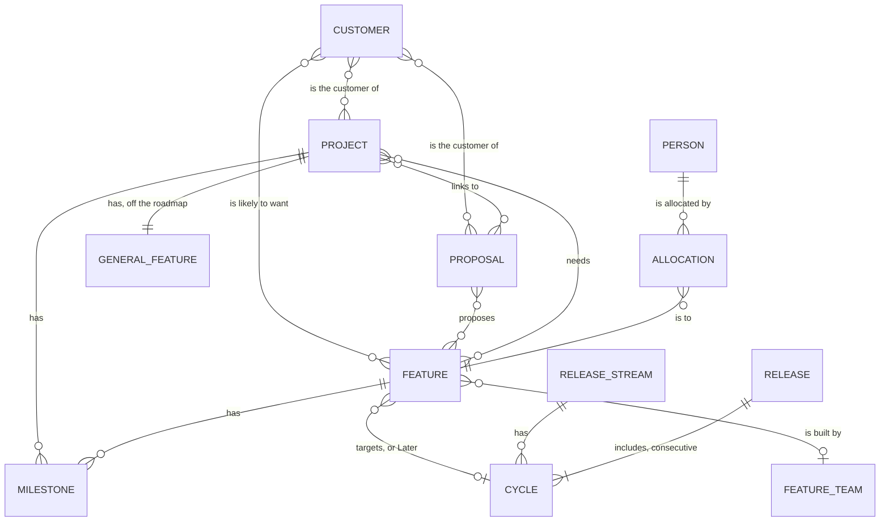
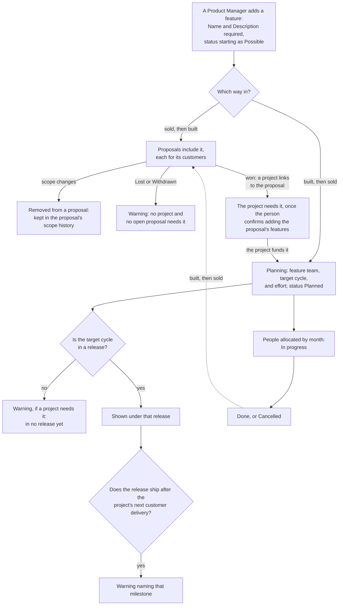

# Fathom: Decisions Log

**Last updated:** 2026-11-11

Detailed product decisions made so far. The [Product Brief](brief.md) holds the high-level picture. Domain terms are defined in [Domain Concepts](domain.md). Open questions at this level of detail are raised when the related feature is worked on.

## Planning

- **Planning level:** Fathom plans features, never their stories or tasks, which stay in tools such as Jira. Its model leaves room for finer levels, such as tasks or dependencies between features, to be added later without reworking features, allocations, or releases. Becoming a clone of a full project management application, such as MS Project, is never a goal.
- **Dependencies between features:** Not recorded for now. If they are added later, Fathom warns when a feature is planned before one it depends on, rather than moving dates.
- **Planning granularity:** Monthly, open to revisiting.
- **Allocation unit:** A percentage of a person's month, chosen from 10%, 25%, 50%, 75%, 90%, or 100%. The default is 100%.
- **Allocation records:** An allocation puts one person or planned hire on one feature at a percentage from a month, and stays in force until a later record for the same person and feature changes the percentage or stops it, as [reporting lines](#workforce) are kept from a date. An allocation may run with no end, such as ongoing work on a project's general feature. Entering a range, such as 50% from January to June, saves a record for January and one stopping it in July, and changing one month within a range saves up to two records, so the months around it keep their percentage. A record that stops an allocation holds no percentage. Decided by the owner on 2026-11-03, to be judged once seen. A person or planned hire has one allocation to each feature, and every change to it, of any of its records, makes one draft, approved or rejected whole, so an Approver never approves the start of a range without its stop, replacing a draft for each record, decided by the owner on 2026-11-09, to be judged once seen. A change that leaves an allocation with no months drafts its removal, and allocating again changes that draft. Drafts of allocations are approved with Approve allocations, an area of its own, which the Project Manager and Engineering Director hold, decided by the owner on 2026-11-09. A feature only drafted to be added cannot be allocated until it is approved, so a draft of an allocation never waits on a draft of the plan, decided by the owner on 2026-11-09.
- **Multiple assignments:** Fathom warns, but does not block, when a person has more than two assignments in a month.
- **Over- and under-allocation:** A person is over-allocated in a month when their allocations add up to more than 100%, counting every feature except Possible ones, done and cancelled ones included, since their allocations are time spent, so future allocations to a cancelled feature show as over-allocation until they are cleared, and under-allocated when they add up to less than 100% in a month they are employed, as a planned hire is from its first month that can be allocated. Over-allocation and more than two assignments are warnings; under-allocation is shown, not warned about. Both are marked from the current month on, and past months show their figures unmarked. Decided by the owner on 2026-11-03, to be judged once seen.
- **Project allocations:** People can be allocated to a project directly, through a general feature that Fathom makes with each project and keeps off the roadmap, so every allocation is to a feature. A general feature takes its project's name, and follows it when the project is renamed. It has the first status meaning In progress, so time assigned directly counts toward over-allocation, decided by the owner on 2026-11-08. It has no draft of its own: approving a project adds it and approving the project's removal removes it, so people can be assigned directly to a project once it is approved. Nobody chooses anything in it, so the change history records its project and leaves it out. Not yet decided: what happens when the status it holds is given another meaning, which could take its time out of over-allocation.
- **Project activities:** Work a project needs that is not a product feature, such as data migration, training, or go-live support, which Project Managers care about and Product Managers do not. A project activity is a kind of feature linked to exactly one project, never to a proposal or the roadmap, and generalizes the project's general feature, which becomes its first activity, named General. It has a name, a description, Total effort, allocations by month, drafts, and history, but no proposal, feature team, status list, or release, and no cycle for now, though one may be added later. Activities are shown on their project, in an Activities tab or a column beside Milestones and in its details panel, not on Features, and are approved like the project's other drafts. Shown on screen as Project activity. Decided by the owner on 2026-11-10, to be built once allocations can be entered in the [monthly resource grid](#planning), and not built yet.
- **Features on their own:** Features have one roadmap, and links to projects and proposals are optional: a feature with no links is an idea not yet committed to anything. Standing work, such as DevOps, has no record of its own; its features are features like any other, with milestones of their own, as [Milestones](#planning) sets out, or those of a project made for it. Workstreams, a kind of project with a roadmap of their own, were decided on 2026-11-08 and dropped by the owner on 2026-11-09 as too foreign a concept.
- **Project ownership:** A project may have an owner, a person such as a Project Manager, and so may a proposal. An owner may be someone not in Fathom, who will not be added, given as a name typed on the record beside the choice of people, decided by the owner on 2026-11-08 and not built yet, as [Issues](../issues.md#planning) records.
- **Internal projects:** A project with no customers counts as internal, so nothing marks it. An explicit mark would come only if internal projects need filtering or reporting, decided by the owner on 2026-11-08.
- **Project scope:** A project's scope is the features it needs, and a feature can be needed by several projects. Features show them in one Projects column, each project shown by its Project ID, dimmed, then its name, or its name alone when it has no ID, and Projects show them in a Features column. Either column can be edited, and each change is a draft of the project, since the link is the project's scope, as a release holds its cycles. Fathom warns when a feature a project needs is in no release yet, or in a release dated after the project's earliest customer delivery date still to come, naming that milestone. Decided by the owner on 2026-11-03; the ID's look decided by the owner on 2026-11-10. Linking a project to the features it needs is enough to show that it funds them; people are allocated to the features, decided by the owner on 2026-11-09.
- **Links between features and their projects and proposals:** Decided by the owner on 2026-11-09, and on 2026-11-10 where dated, and built in the order the [Implementation Plan](../design/implementation-plan.md) sets out:
  - **Following a link:** Each project or proposal named on Features is a link that opens its details beside the table, without leaving the roadmap, and each feature named in a project's or proposal's details is a link that opens it on Features.
  - **A project's features on the roadmap:** Show features, in a project's and a proposal's row menu, opens Features filtered to that project or proposal, as a project's menu opens its milestones.
  - **Filtering and grouping:** Features can be filtered by its Projects and Proposals columns, and the filters are kept in saved views. Grouping by project may come later, if wanted, since a feature can be in several groups.
  - **Long lists:** A cell naming several records lists them in one line, cut short where they do not fit, with every name in its tooltip, one to a line, decided by the owner on 2026-11-10. A record's details list its features one to a line.
  - **Removing a linked feature:** A feature cannot be drafted to be removed while a project or proposal names it, as for any record another links to, decided by the owner on 2026-11-10.
  - **Changing them from Features:** Only those who change the plan change a feature's Projects and Proposals, since each change is a draft of the project or proposal; those who only change features see them read only. New feature does not offer them: a feature is linked once it is added. The two columns come after Customers. Each project or proposal is offered, and filtered by, its ID then its name. Decided by the owner on 2026-11-10.
  - **Customers on a feature:** A feature keeps its own Customers column, of the customers likely to want it, listed one to a line in its details, as its projects and proposals are. Its details do not show the customers of its projects and proposals as well: those are reached through the links to the projects and proposals, and a proper Customers page is to come, as [Issues](../issues.md#planning) records. Decided by the owner on 2026-11-11, replacing the decision of 2026-11-09 that its details show them read only.
  - **A feature's details:** A feature's details panel keeps an order of its own, whatever order the table's columns are in, in headed sections as a person's details are: Details (Name, Status, Description, Notes), Customers and commitments (Customers, Projects, Proposals), Planning (Needed by, Effort, Release, Target cycle, Feature team), then Columns, the columns added to Features. A table starts its columns in the order its records' details show them, and the details follow that order, so the two read alike: on Features, Projects, and Proposals alike. Each value is changed in place by those who may, its note too, as a person's details are. Decided by the owner on 2026-11-11. Planning gains Priority, Size, Risk, and Allocated, as [Size, Priority, and Risk](#planning) sets out.
- **Proposals:** A proposal is work offered or requested that may become a project, such as a bid or a customer request, with the features it proposes, which count toward the forecast by their own status, as any feature does. Features show the proposals that propose them in a Proposals column, and either side can be edited, each change a draft of the proposal, as for projects. Those whose role edits the plan make proposals as drafts, approved like any other. Its status is one of the built-in Proposal statuses (Open, Won, Lost, and Withdrawn), whose choices can be changed, with no rules tied to them: any status may follow any other. A project links to one or more proposals, and nothing marks a proposal Won. Not built yet: linking a project to a proposal offers to add the proposal's features to the features the project needs, as one step the person confirms; no project is made from a proposal, decided by the owner on 2026-11-09, replacing the rule of 2026-11-08 that Fathom had no logic between proposals and projects. A proposal can have several customers. A project's and a proposal's details show its scope history, from the change history: a row for each feature it was given or had removed, Added or Removed with the day the change was drafted, kept once it is approved, newest first, a draft's rows at the top, after the draft's dot until approved. A row is never removed or struck through, since history is not undone, so a feature added and later removed has a row for each; a link added by mistake is listed too, since nothing is hidden. Removing a feature from a proposal, from either side, asks for an optional reason, one line of text, shown beside the removal, saved with Save even when left empty; while the removal is a draft, those who edit the plan can change it. Decided by the owner on 2026-11-09, with the reason's form, where it is asked, and how drafts show decided on 2026-11-11, when the history moved from a feature's details to its projects' and proposals'. When it is Lost or Withdrawn, Fathom warns about the features that no project and no open proposal needs, so someone decides whether to keep or cancel them, without changing them itself, decided by the owner on 2026-11-03.
- **Projects before features:** Projects, feature teams, and proposals are built before features, since a feature may belong to a project; what links them to features is built with features. Decided by the owner on 2026-11-07.
- **Feature scope:** Any planned work is a feature, including work such as a set of bug fixes, which a column users add can mark as a different kind. A feature's development may span several cycles: it targets the cycle it is delivered in, implemented and tested, and its earlier work shows through the months of its allocations. Fathom has no rule that large work is split into increments, decided by the owner on 2026-11-09, dropping the rule of 2026-11-03 that work too large for one cycle is split into a feature for each. An organization that splits a feature anyway, and groups the parts, adds a column, such as Initiative. A variation of a feature for another customer is a separate feature, made with a Duplicate feature action, not built yet, which keeps no link between the two, decided by the owner on 2026-11-09. A feature developed on a branch or behind a feature flag is still one feature, which ships in the release where it is turned on.
- **What a Product Manager enters first:** A feature usually starts with few details: a name, a short description, notes, a rough idea of when it is needed, its status, a rough size, and the customers likely to want it. Its feature team, target cycle, and finer estimate come later, in planning. Decided by the owner on 2026-11-08.
- **Needed by:** A feature may say the month and year it is needed by, the Product Manager's rough wish. It is apart from its target cycle, which is the commitment made in planning, so a rough idea of when does not read as one, and it does not depend on cycles. Decided by the owner on 2026-11-08.
- **Feature timing:** A feature targets a cycle. Its start and end are months, which follow from its allocations; a feature with no allocations has no months yet, and is placed only by its target cycle. Only milestones have dates to the day.
- **Features by cycle:** The Features table groups features by cycle across every release stream together, each group headed with its stream and cycle name, streams in their order and each stream's cycles by date, then one Later group for the features that target no cycle, decided by the owner on 2026-11-08. The table can instead be grouped by the month features are needed by, earliest first, with those that have none last, or shown as one list, decided by the owner on 2026-11-08.
- **Features by release:** Features can also be grouped by release: each release, its streams in their order and its releases by date, headed with the stream, the release, and its Ships on date, then each stream's cycles in no release as Not released yet, then Later. A release's features are those that target its cycles, so nobody picks them separately. Decided by the owner on 2026-11-09. A heading gives how many features it holds, not their total effort, which may come with total rows for every grouping; a release no feature targets has no heading; a feature whose draft moves its target cycle is grouped by the draft, and releases as their drafts make them, as on Releases. A read-only Release column, after Target cycle, names the release a feature's target cycle is in, or its stream's Not released yet, and is empty in Later; in a feature's details it is a link to the release's stream on Releases. Decided by the owner on 2026-11-10.
- **Size, Priority, and Risk:** Built-in columns on Features, each drawing on a built-in list, shown in the Planning section of a feature's details, which then reads Priority, Needed by, Effort, Size, Risk, Release, Target cycle, Feature team, and Allocated. They replace the decision of 2026-11-11 that made Complexity a built-in column. Decided by the owner on 2026-11-11, and not built yet:
  - **Size:** XS, S, M, L, or XL, each choice with a weight relative to S, set on the choice in Size's list, starting at 0.5, 1, 2, 3, and 4. It has no unit of its own for now, to be judged in use, and is not converted to effort. Shown after Effort.
  - **Priority:** How much the feature matters to the organization, not within a cycle, and apart from its status, so a Long shot can be Critical: Critical, High, Medium, or Low, an ordered list an organization renames. Shown before Needed by. MoSCoW was set aside, since Must and Won't read as commitment, which the status carries.
  - **Risk:** Low, Medium, or High, an ordered list an organization renames, shown after Size. It replaces the seed's Complexity column, and Complexity remains only as a column an organization may add.
- **Later belongs to a stream:** A feature with no target cycle yet still names its release stream, so each stream has its own Later. A small change to a feature's data. Decided by the owner on 2026-11-11, and not built yet.
- **The Roadmap and the Plan:** Fathom shows two things about the same features. The **Roadmap** is intent: what is wanted and roughly when, before anything is costed. The **Plan** is what is staffed: estimates, allocations, months, and capacity. A feature starts on the Roadmap and joins the Plan once it is staffed, and the Roadmap keeps showing it, with its staffed months. Neither holds tasks, sprints, story points, or workflow columns, as Planning level sets out. The capital P keeps the Plan apart from Approve Plan and "the plan". The Roadmap is the Features page's Board, and the Plan the Capacity page's Work mode, as [Visual Design](../design/visual-design.md#components) sets out, replacing the board [ADR 0009](../adr/0009-roadmap-and-timeline-views.md) proposed. Decided by the owner on 2026-11-11, and not built yet.

  ```mermaid
  flowchart LR
    R["Roadmap<br/>target cycle, Needed by,<br/>Size, Risk, Priority"] -->|estimated and allocated| P["Plan<br/>allocations, months,<br/>capacity"]
    P -->|staffed months shown| R
  ```

- **Confidence needs no field:** How likely a feature is comes from its status's Possible choices, such as Long shot, Maybe, and Likely, as Feature statuses sets out, and how firm its timing is from whether it rests on a Size, an estimate, or allocations. A feature whose status means Planned or In progress and that has no allocations is marked Not staffed. Decided by the owner on 2026-11-11, and not built yet.
- **Warnings on a feature:** Not built yet. Shown on the feature's row and in its details, each with its reason: a feature that no project and no open proposal needs, once a proposal is Lost or Withdrawn; a feature a project needs whose target cycle is in no release; and a feature in a release that ships after the next customer delivery of a project that needs it, naming that milestone. A list of every warning comes later. Decided by the owner on 2026-11-09.
- **The Overview page:** The page Fathom opens on becomes a page of links to what needs attention, showing only what the reader's role sees, each item a link to where it is dealt with. Waiting on the reader: drafts to approve, and the reader's own unpublished changes. Plan health: features [Late](../design/conventions.md#timelines) or [Not staffed](#planning), with the Critical ones among them, and people over-allocated this month. Coming up: the next releases and milestones, with their days. Capacity this quarter: how much of the whole organization's [capacity](#planning) is used. Decided by the owner on 2026-11-11, to be judged once seen, and not built yet.
- **Feature effort over time:** For demand, a feature's allocations count in the months they are in, wherever those fall, and the part of its estimate they do not yet cover counts in its target cycle, or toward Later if it targets none, so no effort is counted twice. Allocations are compared with the estimate through the conversions between units in Estimates below. Once its allocations reach its estimate, nothing more counts in its target cycle, and allocations beyond it still count in their months. A done or cancelled feature counts only its allocations, since it has no work left. The part counted in a target cycle is spread over the months the cycle spans, in proportion to the cycle's days in each, so it falls into the forecast's bands. Decided by the owner on 2026-11-03.
- **Demand forecast:** The Capacity page's Demand mode, as [The Capacity page](#planning) sets out, shows demand beside [capacity](#planning), as a table and a simple bar chart, in bands that do not overlap, starting with the current month: the next 6 months, 6 to 12 months, 1 to 2 years, beyond 2 years, and Later, for features that target no cycle. Figures are given for the whole organization, against everyone's capacity, and for each feature team, against its members' capacity, with features that have no feature team in a row of their own; by manager is left out, since managers own people, not features. Each figure shows committed demand, from features of every status but Possible, and possible demand, from Possible features, and their total, in the unit the reader picks. Not yet decided: how effort in past months is shown, and where the rest of a feature whose target cycle has ended counts. Decided by the owner on 2026-11-03, to be judged once seen in practice.
- **Feature statuses:** A built-in [list with meanings](#configuration), because Fathom acts on the meaning while organizations name and divide their statuses in their own ways. The meanings are Possible, Planned, In progress, Done, and Cancelled, and an organization may have several statuses of one meaning, such as Long shot, Maybe, and Likely, each meaning Possible, so how likely a feature is needs no field of its own. Decided by the owner on 2026-11-08, replacing a fixed set of the five. A feature starts in the first status meaning Possible. Possible features count toward the forecast but not toward over-allocation, and done or cancelled features raise no warnings. To be reviewed once seen in practice.
- **Features that may come:** The same records as planned features, with the status Possible. A feature starts on the roadmap and is planned, staffed, and released without being copied.
- **Milestones:** A milestone belongs to one project or one feature, has a name and a date, and says whether it is a customer delivery date, which the release warnings check. Other kinds of milestone are a column users add. Feature milestones are not linked to project milestones. Milestones have a table of their own, which a project's menu opens filtered to that project, and Projects show each project's first and last dates and its next customer delivery, decided by the owner on 2026-11-03. Proposals are to have milestones too, each a number of weeks after the proposal's contract award date, so they follow that date when it moves, decided by the owner on 2026-11-08 and not built yet, as [Issues](../issues.md#planning) records.
- **Estimates:** One per feature, shown as its total effort in the Effort column, entered as a number with a unit of effort: hours, the default, person-days, person-weeks, person-months, or person-quarters of three person-months. Fathom keeps one value and shows it in whichever unit the reader picks, so the unit is not part of the data. Person-cycles are not a unit, since cycle lengths differ between release streams and change over time, decided by the owner on 2026-11-03. The conversions between units, such as hours in a working day, are configurable for the whole of Fathom. Marking an estimate as a ROM or a SWAG is a column users add. A feature's early rough size is its Size, a built-in column, as [Size, Priority, and Risk](#planning) sets out, which is apart from the estimate and is not converted to effort. Decided by the owner on 2026-11-09:
  - **Effort, not duration:** Effort is pure effort, at full efficiency: a person-day of effort is the hours in the conversion, not a day on the calendar. Duration, which takes in loading, time off, and the like, is apart and is worked out later.
  - **The conversions:** Hours in a person-day, starting at 8, in whole or half hours; person-days in a person-week, starting at 5; and person-days in a person-month, starting at 20, both in whole days. A person-quarter is always three person-months.
  - **Who changes them:** The conversions are among the [planning settings](#planning), and changed with them.
  - **A changed conversion:** Estimates keep their hours, so what they show in other units changes.
- **Planning settings:** The settings for the whole of Fathom that capacity and forecasts are worked out with. Demand forecasting, as the owner agreed it on 2026-11-11, works out the feature work a person delivers in a month as working days × hours a day × availability × focus × allocation, with ramp-up for new starters, and gives advice only. Decided by the owner on 2026-11-11:
  - **What they are:** Hours a day, working days a week and working days a month, which are the conversions between units of effort above, starting at 8, 5 and 20; a default focus, the share of time that goes to feature work at all, starting at 80%, from 1% to 100%; a default buffer added to effort before forecasting, starting at 0%, from 0% to 100%, which leaves Total effort as entered; and ramp-up, a new starter's share of full output in each of their first months, starting at 50% then 75%, full from the month after the last, with up to 12 months, each from 1% to 100%. Percentages are whole. Nothing uses focus, buffer or ramp-up yet; a team's own focus and a feature's own buffer come with the forecasts.
  - **Where:** On the Capacity page's Settings tab, rather than a page of their own, since they don't justify one; Capacity is started early to hold them, and its capacity view joins as another tab.
  - **Who:** Those who see configuration see them, read only unless they change configuration. Everyone who sees the plan still reads the conversions, which estimates are shown with. Their changes show in the change history to those who see configuration. Manager roles are to see most configuration: Product Managers and Engineering Managers are to see it too, a change to the starting roles made apart from this.
  - **Saving:** Each setting is saved at once and recorded in the change history, where Undo puts it back. Changes are to become drafts approved with Approve Configuration, since a change alters every estimate's units and, once forecasting is built, every forecast; that comes before the forecasts use them, as [Issues](../issues.md#planning) records.
  - **Rounding up:** An estimate is kept to its unit's step and rounded up to it when entered: hours to the next whole hour, person-days to the next half day, and person-weeks, person-months, and person-quarters to the next whole person-day. Shown in a unit, an estimate rounds up to that unit's step, so an estimate always reads back as entered, and totals are added up before they are rounded.
  - **The reader's unit:** Picked under Show in in the Effort column's menu and kept in the view, in the address and saved views, as sorting and column widths are; changing it clears the column's filter, whose numbers were in the unit before. The column is headed Effort, to stay narrow, and each cell shows the amount with the unit's code, h, PD, PW, PM, or PQ, with a tooltip giving the hours the estimate is kept in, followed by rounded up when the amount shown was, such as 1 hour, rounded up. Amounts show at most two decimal places, or one or none as picked under Decimal places in the same menu and kept in the view, always rounded up. Features is not broken down by Effort in Metrics, which would count only whether features have an estimate. A feature's details panel spells the units out, giving the estimate in the unit the table shows, followed by its hours when that is another unit, such as 2.5 person-days (20 hours). Editing an estimate there, and entering one in a new feature's form, offers a menu of units beside the field, starting on the unit the table shows, without changing the table's, and saves the estimate in hours. An estimate in the table is typed in the unit the column shows, and a draft's details and the change history give it in hours, as kept.
  - **The largest estimate:** 999,999 hours, about 125,000 person-days, refused above that in whatever unit it is typed.
  - **Effort columns:** Effort is a type of column used only by a feature's estimate for now; adding Effort columns waits until a table needs one.
- **Capacity:** v1 assumes a full month for everyone, including the months a person starts and ends in; onboarding is a lower allocation percentage. A person has none before the month of their start date or after the month of their end date, and a planned hire has none before its first month that can be allocated, as [Placeholders](#workforce) sets out. Variable capacity, such as for part-time staff, can be added later, and is then clearly marked wherever the person appears, to discourage it. Capacity is shown both for a manager's reports and for a feature team's members, as separate views.
- **Capacity views:** Capacity is counted for each person and month, and summed in groups of the [monthly resource grid](#planning), each with a total row of the person-months allocated against those available: by manager, counting their direct reports through the reporting line in force each month, as reports per manager does; by feature team, counting its members through their membership each month, so a person on two teams counts in both, with all their allocations; and for the whole organization. The organization's total counts each person once. Planned hires, which belong to no feature team, count with their manager's team when grouped by manager, and with people on no feature team when grouped by feature team. Grouped by manager, a person has a row under each manager they report to in the months shown, holding only that line's months, as someone on two feature teams has a row under each, so each total row adds up what its group shows, decided by the owner on 2026-11-09. A group's total, and the organization's, count the rows shown, as People's metrics do, so a filter, such as one leaving out planned hires meaning Proposed, takes them out of capacity, decided by the owner on 2026-11-09. Totals and marks count drafts only when the grid shows Drafts applied, decided by the owner on 2026-11-09. Showing everyone under a manager, not only direct reports, may come later. Feature assignments, with its capacity, needs Personal data, as [Data classes](#people-and-privacy) sets out, so its readers see months outside employment and their warnings, and, only with Confidential data too, group by each month's manager, since later months' managers are future reorganizations, decided by the owner on 2026-11-11, replacing capacity counted from what readers without Personal data see. Grouped by feature team, someone's row under a team holds only the months they were on it, and a row under No feature team the months they were employed on none, decided by the owner on 2026-11-10. Decided by the owner on 2026-11-03, to be judged once seen.
- **The Capacity page:** Capacity is the whole organization on all active and planned work, project work included: project activities and each project's general feature are allocated as features are, so they are rows of the Plan and of the project timeline, and count in capacity. A Capacity page, in the sidebar's People section, has four modes: People, the allocations grid, moved from Feature assignments' Allocations mode; Work, the Plan; Demand, the [Demand forecast](#planning) against capacity; and Settings, the demand forecast's settings. Feature assignments keeps its Teams mode only. Decided by the owner on 2026-11-11, and not built yet. Not yet decided: which classes of data Work needs, since its capacity rows count months of employment, as People's do.
- **Employment dates:** A person cannot be allocated before their start date or after their end date, nor a planned hire before its first month that can be allocated. Reading, changing, and approving allocations needs Personal data, as [Data classes](#people-and-privacy) sets out, so whoever allocates is told of a start or end date still to come, decided by the owner on 2026-11-11. Allocations may be entered and changed in past months, as corrections, decided by the owner on 2026-11-09. When a date changes later, such as an end date being set, a start or target date moving, or a planned hire being filled by someone who starts later, allocations in force in months that fall outside are kept, not removed: Fathom warns about each such month, marks it in the grid, which can be filtered to the people with warnings, for a Resource Planner to change, and leaves it out of capacity and demand. Decided by the owner on 2026-11-03, to be judged once seen.
- **Plan approval:** Changes reach the live plan only once an Approver approves them, as draft rows, decided by the owner on 2026-10-31 to be judged once seen:
  - **One draft per row:** Changing a row, by adding it, changing any of its fields, or removing it, makes a draft of that row, and further changes update the same draft, so a row has at most one draft and drafts never compete. The live row changes only when its draft is approved.
  - **Private until published:** A user's changes are seen only by that user until they publish them. Publishing is one action that publishes every unpublished change the user has made, on any page, and discarding them is one action too. Until then, the record is held: others see it as it was before, marked as being changed by that user, and cannot change, approve, or reject it. This applies to every draft: of people, lists, choices, columns, and orders. The change history shows unpublished edits only to the user who made them until they are published. Decided by the owner on 2026-11-03.
  - **Shared once published:** A published draft is seen by everyone who may see the data it changes, apart from what [Roles](roles.md) proposes for the Executive, and tables show it in place of the live values, as [Visual Design](../design/visual-design.md#components) sets out, so nobody repeats an edit.
  - **Changing a published draft:** Anyone who may edit a published draft may change it. Their changes are theirs alone until they publish them, while others keep seeing the published draft, held, as above. Decided by the owner on 2026-11-03.
  - **Publishing submits:** A draft waits for approval once it is published, replacing the earlier rule that it waits as soon as it is saved.
  - **Approving:** Approvers see and decide only published drafts that nobody is changing. An Approver approves or rejects each draft row whole, one at a time or several at once, and may not approve a draft they changed since it was last approved or discarded, unless their role grants Approve their own drafts, held as [Roles](roles.md#what-each-role-can-do) sets out; they may still reject it (owner, 2026-11-07). Approving a draft that uses another draft, such as a person given a choice that is itself a draft, approves both. A draft that other drafts use is rejected only together with them, or once they no longer use it. A draft uses another only when the other adds a record: a choice added to a list drafted to be added, a column drawing on a list drafted to be added, or a person given a value in a column, or a choice, drafted to be added. The one exception is a stream's cycles, under [Cycle length changes](#planning). Such a draft cannot be discarded, nor its adding undone, while other drafts use it, except that discarding a list drafted to be added discards its choices' drafts too, decided by the owner on 2026-11-03, and discarding a release stream drafted to be added discards the drafts of its cycles and releases too, whoever made them, decided by the owner on 2026-11-04.
  - **Rejected drafts:** A rejected draft stays, after a red dot in a ring, with the Approver's reason, until someone who may edit it changes it and publishes the change, which makes it wait for approval again, resubmits it unchanged, or discards it. Until then it is back with its makers, so Approvers are not offered it to decide, and Fathom refuses approving it, or any draft that depends on it, such as a choice added to a list whose addition was rejected, and Drafts applied shows the record as it is live, since the draft is not on its way to approval, decided by the owner on 2026-11-02.
  - **Removals:** **Proposal:** A draft that removes a row cannot be changed, only discarded, so what is approved is the removal alone.
  - **Taken values:** **Proposal:** A value that must be unique, such as an Employee ID, a list's name, or a choice's name within its list, is taken while any live row or draft has it, and a live row's stays taken until a draft that changes it is approved.
  - **Where drafts are judged:** Approvers approve and reject drafts where they see them among the live data, such as people on the People table, lists and choices on the Lists page, and columns in their menus on the table they belong to, and on a Drafts page that lists them all, decided by the owner on 2026-11-01, as [Visual Design](../design/visual-design.md#components) sets out.
  - **Orders:** A change to the order of a list's choices is one draft holding the whole order, approved or rejected whole, decided by the owner on 2026-11-01.
  - **Drafts within lists:** **Proposal:** A choice added to a list that is itself drafted to be added uses the list's draft, and an order that places a choice drafted to be added uses the choice's draft, so approving them approves what they use. A list cannot be drafted to be removed while its choices or their order have drafts, and the choices of a list drafted to be removed cannot be changed. Discarding a list's draft that adds it discards the drafts of its choices too. A restored choice keeps its place in the order.
  - **Undo:** Undo takes back an edit to a draft, as [Undo](#configuration) sets out. Approving and rejecting are not undone: an approved change is changed by a new draft, and a rejected draft by changing it.
  - **What needs approval:** Everything users change, except saved views, and accounts, roles, and system settings, which an Administrator manages.
  - **Change history:** Records every edit to a draft, and every approval and rejection. It shows what happened but cannot stop a change, so it does not replace approval.
- **Editing model:** No live collaboration. Saving a change (subject to approval) and refreshing to see others' changes is acceptable.
- **Cycles:** Each release stream's cycle length, in weeks or months, is configurable, so each stream can have its own pace. A change to cycle length applies from a chosen date forward, so cycles already made keep their names and dates. Cycles are made ahead from their pattern up to each stream's Planned to date, so features expected far ahead can target a cycle, and a feature with no target cycle is shown as Later. A stream's cycles are those that start on or before its Planned to date, which is two years from the day the stream is added by default. The date can be moved later, so a stream is extended, not replaced, and earlier only if no release includes a cycle that would no longer be made, decided by the owner on 2026-11-04, and no feature targets one, decided by the owner on 2026-11-08. To be reviewed once seen in practice.
- **Cycle names:** Cycles are named by a configurable pattern, for example the last two digits of the year the cycle ends in and its number within that year, or its number in the stream counted from its first cycle, as in Sprint 1, 2, 3 and on without restarting each year, decided by the owner on 2026-11-04.
- **Cycle length changes:** One cycle's length can be changed on its own. The person changing it chooses whether the cycles after it move by the same amount or the next cycle keeps its end date and is shortened or lengthened to fit, and Fathom writes the cycle patterns that give that result, decided by the owner on 2026-11-04. Releases keep the cycles they include, so a release on cycles that move moves with them: the new patterns and the moved releases are drafts saved together, and, beyond the drafts that use others under Approving, they are approved, rejected and discarded only together. A release's Ships on date, if set, stays as it is, and a change that would put the release's first cycle after it is refused, decided by the owner on 2026-11-04. Whoever may change a stream's cycles may change one cycle's length, including moving the releases on cycles that move, without being able to change releases otherwise, decided by the owner on 2026-11-05. Since Fathom stores no group for a change, a stream's drafts of its cycles, and the drafts that move its releases to other cycles, are all approved, rejected and discarded only together, and only someone who may change cycles can discard them, decided by the owner on 2026-11-05. Features that target cycles that move follow them, as releases do: the drafts moving them are saved with the new patterns and approved, rejected and discarded only together with them, and whoever may change a stream's cycles may move those features too, decided by the owner on 2026-11-08.
- **Releases:** A release includes one or more cycles, and its date is its Ships on date, which is the end of its last cycle by default and can be set earlier or later, such as for a release that ships a month after its last cycle while the next cycle starts on time, decided by the owner on 2026-11-04. Its contents are the features that target them, rather than being chosen separately. A cycle that is in no release is simply not released yet; Fathom has no separate candidate state. A cycle is in at most one release, and a release's cycles are consecutive in its stream. Releases are named by those who make them, uniquely within their stream, decided by the owner on 2026-11-03. Each release can have a colour, chosen by whoever makes or changes it from a fixed palette of the theme's colours rather than given one automatically; it is a field of the release like its name, so it is drafted and approved with it, decided by the owner on 2026-11-04.
- **Release streams:** An organization adds the release streams it uses, each with its own cycles, and renames, orders, and retires them. Fathom starts with none. What a release is for, such as a patch, is up to the organization, decided by the owner on 2026-11-03.
- **Releases timeline:** The Releases page shows every release stream that is not retired on one timeline, each with its cycles drawn at their real lengths and its releases as spans across their cycles, each marked on its Ships on day, with today marked across them all, so streams with different cycles can be compared at a glance. It shows the streams as their drafts make them, leaving out releases drafted to be removed; a stream drafted to be retired or restored stays on it, or off it, as it is live until approved, as [Retiring](../design/conventions.md#drafts) sets out. It is read only at first: changes are made in each stream's side panel, decided by the owner on 2026-11-04. How it looks is in [Visual Design](../design/visual-design.md#components).
- **Months across cycles:** A month that falls in more than one cycle counts toward each in proportion to its days in it. This applies to counting allocations, capacity, and demand only: Fathom never schedules work, and never moves one date because another moved, decided by the owner on 2026-11-03.
- **Monthly resource grid:** Allocations are shown as a grid, with people and planned hires as rows and months as columns. Each cell shows what that person works on that month, the ends of cycles are marked as vertical lines, and each release as a line on its Ships on day, decided by the owner on 2026-11-04. The lines are those of one release stream at a time, chosen in a picker, the first stream in their order by default, with no lines while there are none, decided by the owner on 2026-11-03, to be judged once seen. The grid's page is called Feature assignments for now and is open to those who see feature teams; its Allocations mode is to move to the Capacity page's People mode, as [The Capacity page](#planning) sets out. Its first mode, Teams, shows who is on which feature team each month, and its second, Allocations, read only until allocating from a cell is built, each person's and planned hire's allocations. Decided by the owner on 2026-11-10: planned hires are rows in Allocations alone, since they are on no feature team; a cell gives each feature a line with its percentage, then a total line when there are two or more or the month is marked, and an empty month someone can be allocated in shows Under 0%; the mode is kept in the page address; and a role that does not see allocations sees Allocations greyed out, saying why. A month reads as of its first day, and the current month as of today. People are rows with no Manager or Feature teams column; grouped by feature team, someone on two teams has a row under each and still counts once. Decided by the owner on 2026-11-08. Those who see people see feature team drafts in it, as on People: a person whose months a draft changes is marked as a draft, each month it changes is marked from the month it takes effect, with the teams it adds and takes away marked, and the person as approved shows beside them; a Draft menu shows drafts beside live, drafts applied, or live only; drafts are approved as a team's drafts are, not from the grid. Its cells are edited one at a time by those who edit feature teams, each change joining or leaving teams from that month on, written as the teams' drafts; changing several people at once comes later. Decided by the owner on 2026-11-09. Earlier months are edited only by those who may change Personal details, as earlier days are on the org chart, and a change a team's draft cannot hold, such as a second dated change to the same person, is refused until drafts hold several; decided by the owner on 2026-11-10.

### A Feature's Path

How the plan's records link, as the owner agreed on 2026-11-09. A feature needs none of these links: one with no project or proposal is an idea not yet committed to anything.



A feature comes in two ways, both normal: sold, then built, through a proposal and usually a project, or built, then sold, planned on its own and included in proposals later. Every change along the way is a draft, approved with Approve Plan.



## Workforce

- **Removing what allocations name:** Allocations are time spent, so a feature with allocations cannot be removed, and is cancelled instead, nor can a project whose general feature has any. Removing a person removes their allocations in the same draft, as removing a planned hire does, refused while any of them has a draft. Decided by the owner on 2026-11-09.
- **Placeholder allocations:** Planned hires can be allocated to projects and features like current staff. When a role is filled, the new hire takes over its allocations: the fill's draft moves every allocation record of the hire to the person who fills it, approved or rejected with the rest of the fill. Readers who still see the hire's placeholder rather than the new employee, as [New employees](#workforce) sets out, see the allocations on the placeholder until the start date. Moving them is part of the fill, not an edit of allocations, so whoever fills it needs no right to edit allocations. Fathom refuses the fill while any of the hire's allocations has a draft, naming who holds it, until that draft is approved, rejected, or discarded. Allocations before the person's start month are kept and warned about, as [Employment dates](#planning) sets out, rather than refusing the fill. An internal transfer keeps their own allocations too, and the over-allocation warning shows where they clash; where they and the hire are allocated to the same feature, the fill adds the two percentages month by month, up to 100%, keeping a sum such as 35% even though it is not one of the percentages offered. Decided by the owner on 2026-11-03, to be judged once seen.
- **Hiring entries:** A planned hire is a record of its own, apart from people, shown as a row of the People table beside them until it is filled. The State column tells the rows apart: each person's is Hired, and a planned hire's is one of its hiring states, as [Hiring states](#workforce) sets out, so the table's filters and metrics tell them apart as for any other column; there is no Kind column, decided by the owner on 2026-11-06. Metrics count every row shown and name each kind, such as "150 people and 6 planned hires", decided by the owner on 2026-11-06. A planned hire is added on People with **New**, which adds people too: the State chosen decides which is added, Hired or Left a person and a hiring state a planned hire, offering only the kinds the reader may add, and the table's empty new row follows the same rule; decided by the owner on 2026-11-07, replacing a New planned hire button beside New person. Its name is optional, any label that identifies it, and General, like a person's preferred name. While it has none, its Name cell shows, in grey, its position and ID, such as "Software Engineer, TBD-7", or its ID alone to those who cannot see the Positions list's visibility, made afresh whenever either changes and never saved, and sorting, filtering, and searching take that as its name; decided by the owner on 2026-11-06, replacing a planned hire with no name. Its ID, in the ID column, is its requisition: the ID the organization's HR system gives the opening, free text up to 40 characters. Until it has one, Fathom gives it a temporary ID, TBD- followed by the next number, never reused, such as TBD-7; an ID typed in cannot start with TBD-, and clearing a requisition gives the hire a new temporary ID. No two rows in the ID column, people or planned hires, have the same ID, ignoring letter case. Its position is required, as a person's is. Its manager is optional, blank while not decided, and is someone flagged as a manager, or a planned hire flagged as one, a planned manager, as [Manager flag](#workforce) sets out, whose team it joins; its Team follows from its manager, and it has no Manager assigned or Team name. Its target date, in the Start column, is optional. A read-only Expected column shows the month a hire is expected, as [Placeholders](#workforce) sets out, and is empty for people. It also has values for People's added columns, every one offered on planned hires unless those who may edit People's columns switch it off for them, as a draft, all optional on a hire, even where People requires them; End and Gender are not offered. A column cannot be switched off for planned hires while any hire not yet filled, live or in a draft, has a value in it; those values are cleared first, decided by the owner on 2026-11-07. Menus, notices, and the change history name a planned hire by its name, or, while it has none, by its position and ID, as its Name cell shows them. There is no Hiring Plan page, and Fathom provides no saved view of the hiring plan: anyone who sees the State column can filter it to the states meaning Proposed or Open and save that as a view, decided by the owner on 2026-11-07, replacing a Hiring plan view Fathom would provide. Budget is not tracked. Decided by the owner on 2026-11-04, replacing a separate Hiring Plan table with a required title decided on 2026-11-03, to be judged once seen in practice.
- **Hiring target date:** The date the new hire starts work, in the Start column. Onboarding time is handled with a reduced allocation percentage.
- **Hiring states:** A planned hire's State is a [list with meanings](#configuration), so the organization keeps its own states, as many as it uses, each meaning Proposed, the headcount not yet approved, Open, approved, Hired, or Left. Hired and Left are people's states: a person's end date decides which, Hired until it has passed and Left from then, and their State can be set to any choice of that meaning, starting on the first, so a person never shows a choice of the other meaning; a choice they have that comes to have the other meaning, or their end date passing, shows them the first choice of the meaning their end date gives, decided by the owner on 2026-11-06. Neither is given to a planned hire, which is hired by being filled, and a choice cannot be given the meaning Hired or Left while a planned hire is in it. There is no state for someone who has not yet started, decided by the owner on 2026-11-06. Fathom starts the list with Request to hire, meaning Proposed, and Approved to hire, meaning Open, decided by the owner on 2026-11-05, Hired, meaning Hired, decided by the owner on 2026-11-06, and Left, meaning Left, decided by the owner on 2026-11-06. A hire moves between them in any order, and is added in the list's first state meaning Proposed unless another is given. Every planned hire on People counts with people, and a filter on State leaves those meaning Proposed out. A hire is cancelled by removing it, as [Changing planned hires](#workforce) sets out, and the change history keeps it. Decided by the owner on 2026-11-04, replacing six renamable states moved one at a time, decided on 2026-11-03.
- **Hiring workflow:** Moving a planned hire between states is controlled by role, from the [Snapshots, Exports, and Hiring](roadmap.md#stage-snapshots-exports-and-hiring) stage, through the planned hires permission area that [Changing planned hires](#workforce) sets out. Until then, whoever may change planned hires makes every move the states allow.
- **Changing planned hires:** Planned hires are added, changed, filled, and removed on the People table, as drafts approved like any other. Those who may edit people and the hiring plan change them, and an Approver who sees the hiring plan and every detail a draft holds, as [The hiring plan's permissions](#people-and-privacy) sets out, approves them. Removing a planned hire removes its allocations too, in the same draft, approved or rejected together. Decided by the owner on 2026-11-03; on the People table, and removing rather than cancelling, decided by the owner on 2026-11-04. Changing them needs the right to edit the hiring plan, not only to see it, decided by the owner on 2026-11-05, and on 2026-11-07 for Edit Hiring plan in place of changing Confidential data.
- **Filling a planned hire:** Filling links the hire to the person who fills it, either an existing person, such as an internal transfer, or a new one added in the same step. A new person takes the hire's position and its values for the shared columns, is asked for any value People requires that the hire has no value for, and has a start date that defaults to its target date. Someone already in Fathom takes the hire's position and moves to the manager under the rules for changing reporting lines. Once dated values are built, the hire's values become its person's from their start date, as [People over time](#workforce) sets out, decided by the owner on 2026-11-11. The manager begins as the hire's and can be changed while filling, and the one chosen becomes the hire's too when the fill is approved, decided by the owner on 2026-11-08. Once filled, the hire leaves People, and its person's row takes its place, as New employees sets out, while Fathom keeps which hire the person filled. The whole fill is one draft, approved or rejected together, like other drafts that use drafts. A person may fill several planned hires over time, such as an internal transfer who transfers again, but not a second while the hire they filled before has not started, decided by the owner on 2026-11-04. Filling a planned manager moves the planned hires that report to it to the person who fills it, in the same draft, and flags that person as a manager, decided by the owner on 2026-11-07. Only a hire in a state meaning Open, with no rejected draft, can be filled, decided by the owner on 2026-11-08. People report only to people, so a hire whose manager is still a planned hire needs a person chosen as manager, or, filled by someone already in Fathom, leaves them with the manager they have, decided by the owner on 2026-11-08; someone already in Fathom changes only their position, to the hire's, and their manager, from the day given, by default today, or their start date if they have not started, keeps their manager when no manager is chosen, and keeps their line when they already report to the one chosen, decided by the owner on 2026-11-08; and approving, rejecting, resending, or undoing any part of a fill does so for all of it, while discarding any part discards that record's draft and takes the fill out of the others, keeping their other changes, decided by the owner on 2026-11-07. A hire is filled only once these drafts are approved or discarded, so each draft a fill makes holds only the fill: its own draft adding it or changing its manager, for a planned manager the draft of any hire that reports to it, live or in a draft, and for someone already in Fathom their own draft, decided by the owner on 2026-11-07. While a fill waits for approval, what it sets is kept: the hire's State, Position, Manager, and Manager?, its person's Position, Manager, the date it starts from, and Manager?, and the Manager of each hire it moves; discarding the fill frees them, and a hire with a fill waiting cannot be named as another hire's manager, nor can a hire it moves be removed. Its person's end date stays open to change, and approving refuses a fill whose person has left by then, decided by the owner on 2026-11-07. A fill that changes a person needs an Approver who sees Personal details, since it names who fills the hire, decided by the owner on 2026-11-08. Before a filled hire's person starts, readers who do not see them see its placeholder unchanged, but for its Expected month, which follows the person's start date. A hire is filled from its details panel beside People, which a Fill button in the Name cell of each hire that can be filled opens, not from a dialog, decided by the owner on 2026-11-07, and the panel then shows the person who fills it, decided by the owner on 2026-11-08. Decided by the owner on 2026-11-03.
- **New employees:** A person may be added before their start date. Readers who see Personal data see them in People and with their manager's team, marked as not yet started. Everyone else keeps seeing the placeholder of the planned hire they filled until the start date, even if it moves, and a future starter who filled no planned hire is seen only by Personal readers until they start. Decided by the owner on 2026-11-03. The change history follows the same rule: until someone starts, readers who do not see Personal data see none of their changes and no change names them, such as a hire's manager, and who fills a hire is named only to readers who see Personal data, since it tells of a reporting line to come, decided by the owner on 2026-11-07.
- **Placeholders:** Each planned hire not yet filled, and each filled one whose person has not started, is shown as a placeholder to those who see people but not planned hires' other details, as [Roles](roles.md#planned-hires-in-the-plan) sets out. The first month it can be allocated, shown in the Expected column, is the month of its target date, or of its person's start date once filled, so the placeholder shows the month a hire is expected, never the day; a hire with no target date is expected from the current month, so it is counted from now. Counts, such as reports per manager, follow what each reader sees, so each hire or new employee counts once: as the person for readers who see them, and otherwise as the placeholder. Decided by the owner on 2026-11-03; as rows of People, decided by the owner on 2026-11-04.
- **Reporting lines:** Each person has at most one manager at a time. Who a person reports to is kept as a line with a from date, in force until their next line starts, so past managers are kept and capacity by manager can be counted for past months. Dotted-line relationships are out of scope for v1, as the [Product Brief](brief.md) records. Future-dated manager reassignments, for example for a reorg, can be planned from [The Organization](roadmap.md#stage-the-organization) stage; until then, a line's from date is today or earlier, except a new employee's first line, which starts on their start date, decided by the owner on 2026-11-03.
- **Reporting line rules:** A manager is optional, for the top of the organization and for anyone whose manager is not in Fathom. Fathom refuses a loop, so nobody reports to themselves or to anyone who reports to them, directly or through others. A line's from date is on or after the person's start date, and its manager is active on that date. When a manager's end date passes while people still report to them, Fathom warns rather than blocks, and their reports are moved by new changes. Decided by the owner on 2026-11-03.
- **Changing reporting lines:** Those who may edit people change reporting lines and team names, as drafts approved like any other, by an Approver who also sees people. A change gives the date it takes effect from, today unless an earlier date is given, such as for a change already made in the HR system, and approving it does not move that date. A change of manager is Personal in its draft and in the change history, since it names a past manager, so readers who see only General data see the current manager only once the change is approved. Decided by the owner on 2026-11-03. The date a line runs from is labelled Manager assigned, which cannot be read as the person being a manager since then, decided by the owner on 2026-11-10.
- **People over time:** People can be read as of a date, and some of its columns keep their history, built in the steps the [Roadmap](roadmap.md) places and not built yet. Decided by the owner on 2026-11-11:
  - **People on a date:** People has a date control like the Org chart's, today by default and kept in the page address. Today shows People as it is now, with every planned hire not yet filled beside today's people, whatever its target date. A future date shows those employed then and every planned hire not yet filled; a past date shows those employed then and no planned hires, since past plans are not kept. The date changes the rows and the dated values, such as manager, team, feature teams and dated columns, never the columns shown. Past and future dates need the data classes the Org chart's dates need, as [Feature teams over time](#workforce) sets out.
  - **Coming changes shown in place:** On today, a value with a change to come shows that change in grey after it, such as "Engineer, Senior Engineer from Mar 1, 2027", as a direct report who has not started shows "Starts Nov 20, 2026" in a person's details. Only readers who see future values see it.
  - **Columns that change over time:** Position always changes over time, with no setting to turn it off. Every added column except notes, text columns included, has a "Changes over time" setting, off unless set, set by those who edit People's columns. Name and ID never change over time. Changing a dated value asks when it takes effect, today by default, under the rules for [changing reporting lines](#workforce): an earlier date for those who may change Personal details, a later one for those who see Confidential data. A dated column's value today keeps its column's class, while its past values are Personal and its future ones Confidential. A person's details list each dated column's values with the dates they take effect from.
  - **Planned hires and import:** Planned hires hold plain values, since they are plans, and filling a hire gives its person the hire's values from their start date. Importing people sets a dated value from the day of the import.
  - **One store:** Every dated value is kept in one store, and reporting lines move onto it later, so nothing is built twice.
  - **The word:** On screen, "Changes over time"; in code and documents, "dated", as in a dated column or a dated value; never "temporal".
- **Teams:** A team is the people who report directly to one manager, so each manager has one team, and a person's team follows from their manager rather than being chosen separately. A team's name is optional, up to 60 characters, and unique ignoring letter case, and it stays with its manager when reports move. People shows each person's manager and team, the team shown by its name, or by its manager's name while it has none. Decided by the owner on 2026-11-03. Its columns are Manager, picked from the people flagged as managers and still employed; Manager?, a checkbox straight after Manager, checked for those flagged as managers; Manager assigned, the Personal date the line starts from, which moves the line when changed; Team, which follows from the manager and is not edited; and Team name, the name of the person's own team, edited on the manager's row. A manager whose end date has passed is marked Left beside their name, for readers who see Personal data. Decided by the owner on 2026-11-04.
- **Manager flag:** Each person has a Manager flag, General, which those who may edit people set and clear as a draft approved like any other. Only people flagged as managers can be named as a manager, of a person or of a planned hire, and a flag cannot be cleared while anyone reports to its person, in force now or from a later date, or while a planned hire not yet filled names them. Pasting and the CSV import follow the same rule. People already named as managers when the flag was added were flagged. It is not the Engineering Manager role, which grants access. Decided by the owner on 2026-11-04. A planned hire has a Manager flag too, General, set and cleared as part of the hire's draft by those who change planned hires, so other planned hires can report to it as a planned manager, and planned teams can sit under one another; Fathom refuses a loop. People keep reporting only to people until planned reporting changes come in [The Organization](roadmap.md#stage-the-organization) stage. A planned manager's flag cannot be cleared, and it cannot be removed, while a planned hire not yet filled, live or in a draft, reports to it. A planned team has no name until its planned manager is filled. Decided by the owner on 2026-11-07.
- **Reports per manager:** The first measure of team composition: each manager's direct reports, compared with one range for the whole organization, such as 4 to 8, which is set in planning configuration. Fathom marks each manager under or over the range. Only direct reports count, not people who report through other managers: people, and planned hires once they exist, as [Team composition](#workforce) sets out. Targets for individual managers may come later. It is shown in a Teams table, with a row for each manager who has direct reports in the month shown, since a manager is known only by their reports, so a manager with none has no row: their team and its name, their direct reports, and the mark. Reports are counted as at a month the reader picks, the current month by default, with each planned hire counted from its first allocatable month, as Placeholders above sets out; until planned reporting changes arrive, a future month shows today's reporting lines with the hires due by then. The table is seen by the roles that see people. Decided by the owner on 2026-11-03, to be judged once seen in practice.
- **Seeing your reports:** Until a user is linked to their own person record, as proposed in [Roles](roles.md#access-to-your-own-record-and-your-reports), a manager's access to their reports comes only from their role, and they find their reports by filtering People by manager. Decided by the owner on 2026-11-03.
- **People ownership:** Engineering Managers own their people, including when those people work on features led by someone else.
- **Feature ownership:** Features are owned and delivered by a feature team. A feature's owner is the feature lead of its feature team. A possible feature need not have a feature team yet, and Fathom warns about planned features that have none. A feature team's name is required, up to 60 characters, and unique ignoring letter case, since one person may lead several teams and leads change. Its feature lead is optional, and is one of its members on any given day, so their time counts in its capacity. When the lead leaves the team, the team has no lead until another member is chosen. Fathom marks a team with no lead, since its features then have no owner. Decided by the owner on 2026-11-03. A team's lead is kept from a date, as its members are, so past and planned leads are kept; its name and colour each keep one value, decided by the owner on 2026-11-08.
- **Feature team membership:** A person can be on more than one feature team at a time. Joining and leaving a feature team are kept as records with a from date, in force until the person's next record for that team, so past memberships are kept, as reporting lines are. Membership changes can be planned ahead, with a from date after today, in the first stage, decided by the owner on 2026-11-08, replacing a decision of 2026-11-03 that left this for [The Organization](roadmap.md#stage-the-organization) stage. Someone whose end date has passed is off every feature team from the next day: they no longer count or show as a member, a team they led has no lead until another is chosen, their past membership is kept, and no draft waits on them, decided by the owner on 2026-11-08.
- **Feature teams over time:** Feature teams can be read as of any past or future day. Everyone who sees feature teams sees them today; other dates, past or future, need Personal data, as [Data classes](#people-and-privacy) sets out. On Reporting teams, future dates need Confidential data too, since they are future reorganizations, while Feature teams on a future date draw people as they are today, decided by the owner on 2026-11-11. The Org chart has a date control for this, which moves both views, and where it would be, a line says why to a role without those classes. Members joining and leaving feature teams, and changes of lead, made while it shows another date take effect from that date, and renaming, colouring and removing a team, which take no date, are done on today's chart: a later date for anyone who proposes feature teams, an earlier one only for those who may change Personal details, and others see an earlier date read only, as approved. Where changes can be made, drafts are shown, laid over the teams as approved on that date, and each drafted change says the day it takes effect, when that is not the date shown. Decided by the owner on 2026-11-09, replacing a chart read only on every other date. Reporting lines changed while the chart shows an earlier date also take effect from it, for those who change people and may change Personal details, decided the same day. Only a person's manager changes there, since the date a line runs from, team names, colours, and other details take no date. A change takes the place of the person's current line, so their manager changes from an earlier date only while that line was already in force then, and a line between later approved ones is not changed, as [Issues](../issues.md#people) records. On an earlier date, drafted managers are drawn as they would be then, so a line drafted from a later date leaves the person where they were, and a drafted manager taking effect from another date says when. The change history and Drafts show the earlier date as the line's new date, as for any change of manager. Decided by the owner on 2026-11-10. Later dates stay read only for reporting lines, which wait for planned reporting changes in [The Organization](roadmap.md#stage-the-organization) stage, since future-dated reorganizations are Confidential, as the owner chose on 2026-11-10. Planned hires are not drawn on another date. Readers who do not see Personal details see on a team neither someone who has not started nor someone who has left. A team disbands when it has no members from a month on: the first month with none of them, then or later, counting planned changes. A team that has never had a member has not disbanded. The team comes back if someone joins it later. When a team disbands is told only to readers who see Personal details. Decided by the owner on 2026-11-08; dates by month for readers without Personal details replaced by the whole-page rule on 2026-11-11.
- **Feature team approval:** Feature teams are proposed and maintained by those whose role proposes them, and an Approver reviews and approves them, as [Roles](roles.md#what-each-role-can-do) sets out. Editing feature teams makes drafts too, as on People, rather than saving straight to live: proposing adds teams and changes their members and leads, and editing also removes them. A team's name, lead, and member changes make one draft, approved or rejected together, and shown beside live, decided by the owner on 2026-11-08. Proposing renames teams too, since it already names the teams it adds, decided by the owner on 2026-11-11, replacing renaming by editing alone.
- **Where feature teams are kept:** Feature teams are seen and changed on the Org chart page, not a page of their own or a column on People, so team upkeep stays in one place and People stays small. The page switches between reporting teams and feature teams. On feature teams, each team is drawn under its lead; the team list has New feature team, and a team opens in a side panel with its name, lead, colour, and members, where members are added and removed, each change a draft with Draft and Live marks. The panel is laid out as a person's details are, each value changed from its pencil, people chosen in a picker that gives each one's position and reporting team, and a new team is given its name, lead and members at once, decided by the owner on 2026-11-11. A person's details list their feature teams, read only: those they lead, then those they are a member of, each with who leads it, decided by the owner on 2026-11-11. Those who see feature teams but not people see them as approved, without their drafts, decided by the owner on 2026-11-08. Joining or leaving takes effect from the date the Org chart shows, today unless another is chosen, as [Feature teams over time](#workforce) sets out: a later date for anyone who proposes feature teams, an earlier one for someone who may change Personal details, as for reporting lines; those who do not see Personal details plan by month, from a month's first day, so that the exact days stay Personal, and are not told when that day falls outside someone's employment, which the Approver is told on approving, decided by the owner on 2026-11-08. The chart's date replaces the team panel's own date box, decided by the owner on 2026-11-09. A team's lead is chosen from anyone, and someone chosen who is not a member joins the team in the same draft, so the lead is always a member, decided by the owner on 2026-11-08. Month-by-month planning of who is on which team is kept on a page of its own, a monthly grid shared with allocations, while each team's chart and panel stay on the Org chart, decided by the owner on 2026-11-08. Feature teams work as managers' teams do on screen, with the same team list, panel, colours, and Draft and Live marks, but each keeps a required name, unique ignoring letter case, since one person may lead several. Decided by the owner on 2026-11-08, replacing a page of their own and a People column decided earlier the same day.
- **Team composition:** Balance is evaluated for both teams and feature teams. The measures, their targets, and how positions count toward them are configurable. Planned hires count toward a manager's reports, with a filter to exclude them in a later stage or release.
- **Reporting view:** Reporting lines appear both as an org chart and within the unified people view. People's metrics break people down by Manager, counting each manager's direct reports among the people shown; fuller manager metrics belong on the org chart, decided by the owner on 2026-11-04.
- **Org chart:** The Org chart page draws today's approved reporting lines, for everyone whose role lets them see the org chart, a permission of its own, apart from seeing people, which [Roles](roles.md#what-each-role-can-do) sets out, brought forward from The Organization stage. Readers who do not see people see each person's name, position, and team, and the cards open nothing; the chart keeps its place in the address by Fathom's own ID for each person, not their Employee ID, which is a detail of People. On the chart as on People, a position shows only to those who see the positions list's tier, except that a General one shows to every reader of the chart. Each card shows a person's name and position, and the name of the team they lead, if any, rather than the team they are on, so a team's name appears once. A manager's reports who manage nobody are stacked in a column under them, so a large organization grows down rather than across. The chart opens on the top two levels, shows a chosen number of levels, and shows one manager's team alone. For those who see people, a person's card shows their details beside the chart, as Person details sets out. A manager who has left, with people still reporting to them, is drawn in the chain as anyone is, marked as having left only for readers who see Personal data, decided by the owner on 2026-11-11. To come: cards showing fields chosen from People's columns, with filters that border the people who match in a colour and dim the rest, keeping the chart's shape, and a sort for each manager's reports, all saved as views as People's are. Planned hires are drawn as placeholders, to every reader of the chart: each hire not yet filled, and, to readers who do not see Personal details, each filled one whose person has not started, under its manager, after the people there, named as its People row is, with the month it is expected, never the day. A planned manager heads its planned team, which can be shown alone. A hire whose manager has not started is drawn at the top until they start, since the chart draws today. A placeholder opens nothing, decided by the owner on 2026-11-07. Decided by the owner on 2026-11-05; the org chart's own permission, and what readers who do not see people see, on 2026-11-07.
- **Team colours:** Each team with a colour has its cards on the org chart topped, and the lines to them drawn, in that colour, which reaches down through the teams below until one has its own, also when a team is shown alone, though the card at the top of a team shown alone has none, since the team above is not drawn; a square of the colour sits before the team's name on its manager's card. A team's colour, from the palette releases use, is chosen on the chart from that square, once the team's name is approved, by those whose roles let them colour teams, as [Roles](roles.md#what-each-role-can-do) sets out. Until accounts are linked to people, they colour every team; once they are, Engineering Managers colour only the teams below them. It is no draft: it is how the chart is drawn rather than a detail of anyone, like a saved view, so it changes at once, for everyone, can be undone from its notification, and is not recorded in the change history. A team renamed keeps its colour, and one whose name is removed loses it. Decided by the owner on 2026-11-06.
- **Teams on the org chart:** Those who change people name and rename teams, or remove their names, from the chart, as drafts, as on People, which the chart shows as drafts until approved, as Drafts on the org chart sets out. A Teams panel lists every team, to name it or choose its colour. The finder offers teams by name as well as people, and choosing a team finds its manager with their reports shown. Decided by the owner on 2026-11-06.
- **Drafts on the org chart:** The chart has the Draft menu tables have, so drafts show on it as they do everywhere else: Drafts beside live, the default, draws a person drafted to report to someone else under their new manager, marked as a draft, with a dimmed copy marked Live under their current one, as a moved card is on the Releases board, and a drafted team name in place of the live one, which is shown dimmed and marked Live; Drafts applied draws the chart as it will be once the drafts are approved; and Live only draws it as approved. A change of manager is Personal in its draft, so only readers who see Personal details see it, as on People. Decided by the owner on 2026-11-06. Drafts applied draws people drafted to be added and removed, and every detail drafted, as well as managers and team names, decided by the owner on 2026-11-07. Readers who see the chart but not people see only the approved chart, without the Draft menu, since drafts are details of people, decided by the owner on 2026-11-07. Planned hires' drafts are drawn the same way, only to readers who see the hiring plan; a drafted manager of a planned hire is part of the hiring plan, not Personal, decided by the owner on 2026-11-07. Drafts beside live also mark a drafted position, with the live one under it, dimmed and marked Live, as a drafted team name is, shown to readers who see the Positions list, decided by the owner on 2026-11-07.
- **Person details:** Those who see people see one person's details in a side panel beside People or the org chart, opened from their row or their card, with the person kept in the page's address: their name and position, their manager, team, the team they lead, and their direct reports, today's and those who have not started yet; their details; and every added column People shows them. It shows only what People shows the reader, so Personal details shown there are recorded in the access history, and it follows the Draft menu of the page beside it. Choosing a manager or report shows them instead. Those who may change people change every detail and column there that they may change on People, with the same rules, each change a draft with Undo, as on People, beside People and the org chart alike. Those who see the chart but not people have no details panel. A planned hire's details open beside People too, changed there only by those who may change planned hires. **New** on People opens the panel as a form to add a person or a planned hire, with Add and Cancel, checked as a new row is. Leaving a form with anything in it, or a note with changes, asks first rather than keeping it open for someone no longer shown or discarding it unasked. Decided by the owner on 2026-11-07, as a side panel rather than a page of its own; changing details there, on 2026-11-07; planned hires' details, adding from the panel, and asking before discarding, on 2026-11-07.
- **Feature team chart:** A second chart draws the feature teams: each feature team under its feature lead, coloured from the same palette as reporting teams but chosen for each feature team, and shown only on that chart, so the two kinds of colour never meet. A member who does not report to the feature lead has a dotted line to their manager, who is drawn as a faint card beside the feature team when not on it, one card for all the members they manage. Decided by the owner on 2026-11-06. Built with feature teams themselves, before features, on the Org chart page, with a switch between reporting teams and feature teams, decided by the owner on 2026-11-08.

## People and Privacy

- **Employee details:** Preferred name, Employee ID, gender, site, position (for example Software Engineer, Test Engineer, SDET, Manager), level (for example P1 to P5, M1 to M5, co-op), role on the team (for example Team Lead, Design Authority), start date, and end date.
- **Built-in details:** Every person has a preferred name, an ID, and a position, all required, and start and end dates, both optional; a person with no start date counts as current. The ID is the Employee ID the organization uses for them, in the ID column, free text of up to 40 characters, and no two rows of the ID column can have the same one, ignoring letter case; the same column holds planned hires' requisitions, as [Hiring entries](#workforce) sets out. Position is required for people and planned hires alike, picked from the Positions list, which is built in. The list cannot be removed or retired. It starts General, and, as for any list, its visibility sets who sees each person's and planned hire's position; those who cannot see it cannot add people, since each needs one, and removing a person, or a draft that changes their position, needs the right to change their position too, as for any of their details, decided by the owner on 2026-11-05. It starts with Employee and Manager, so it fits any organization, decided by the owner on 2026-11-05. As in any list, a position can be retired, or removed while no one has it, except the last one offered, so a person or planned hire can always be given a position. The owner decided this on 2026-11-05, replacing the 2026-11-04 decision to let the list be emptied. Site, level, role on the team, and other details are columns that draw on lists, as set out under [Configuration](#configuration). Position and the ID column decided by the owner on 2026-11-04.
- **Deleting people:** A person entered by mistake can be deleted while nothing uses them, and Undo brings them back. People who leave are given an end date instead.
- **Gender:** Recorded because the company works across several countries, and colleagues cannot always tell someone's gender from their name.
- **System of record:** Fathom holds a manually maintained copy of employee details from the company's HR system.
- **Importing people:** A user who may change people imports a CSV or TSV file of up to 2,000 people into People, decided by the owner on 2026-11-03 to be judged once seen:
  - **Columns:** The file's first row names its columns, each matched to the People column of the same name, ignoring letter case. The ID column, headed ID or Employee ID, is required, and a header named twice is a problem. A file whose first row holds tabs is read as TSV, and otherwise as CSV. Cells are read as pasting into People reads them, and blank rows are skipped. Headers that match no column are listed and ignored, so a file is fitted to People by renaming its headers, such as in Excel.
  - **Adding and updating:** Employee IDs are matched as text, ignoring letter case and spaces around them, and a file naming one twice is a problem. A row whose Employee ID is new adds a person. A row whose Employee ID is already in People changes only the cells that differ, updating the user's own draft of that person if they have one, and a blank cell leaves a value as it is, so an import never clears a value or removes anyone. Choices are matched by their label and are never added by an import. Once [reporting lines](#workforce) exist, a Manager column names each manager by their Employee ID, someone in People or added by the same file, under the reporting line rules; a change of manager takes effect from the day of the import, and an earlier date is entered by hand.
  - **Problems:** Before anything is saved, Fathom shows how many people the file adds and changes, and every problem by row and column, such as an unknown choice, a date it cannot read, a required value missing, a column the user may not change, a broken reporting line rule, or a person held by another user's unpublished change. A file with any problem is refused whole, to be fixed and chosen again.
  - **Drafts:** An import makes the user's own unpublished drafts, like any edit, approved as usual. It is one change, which [Undo](#configuration) takes back in one step, as for any change.
- **Use limits:** Fathom's data is used only for planning, not for performance evaluation or discipline.
- **Former employees:** People who leave are kept rather than deleted. A person is active from their start date until their end date passes; there is no separate flag.
- **Who is listed:** Users who cannot see Personal data see only people current today, judged by the live dates while a draft waits: neither someone who has not started, so the list does not reveal a start date before it arrives, nor someone who has left, since end dates are Personal. Decided by the owner on 2026-11-11, replacing showing those who have left with a State meaning Left, decided on 2026-11-06 and 2026-11-07. A future end date shows nothing until it passes.
- **Access control:** Access is role-based. Roles are sets of permissions kept in Fathom rather than fixed in its code: Fathom starts with the roles in [Roles](roles.md), which can be edited and copied to make new ones, within the safeguards for changes to roles below. Decided by the owner on 2026-11-04, since fixed roles do not scale as features are added.
- **Several roles for each account:** An account holds one or more roles, any roles, starting or made later, and one of them is its default. A session acts as one of its roles at a time, and only that role's permissions apply; the permissions of an account's roles never add up. Signing in acts as the role last chosen on that browser, kept in a cookie, or else as the default. A user switches role from their account's menu without signing in again; with one role, there is nothing to switch. Whoever may manage accounts gives accounts their roles and default role: any roles, their own account included, chosen on the Accounts page from every role. So any role that lets its holders manage accounts can reach every role's access, including editing roles and every tier of data; the access history, which marks each change to an account's roles as worth checking, is the safeguard, as [Roles](roles.md#safeguards-for-administrators) sets out. The access history also records the role each sign-in starts as and each switch of role. Changes, drafts, and approvals record the role they were made as, shown beside the person's name, such as "Feature Lead as Engineering Manager" for the development seed's Feature Lead account. A user's own drafts are those they changed under any of their roles, so switching role never lets them approve their own drafts. Decided by the owner on 2026-11-07, replacing each account holding exactly one role, decided on 2026-11-05 and 2026-11-06.
- **The first Administrator is an account made at install:** Installing Fathom creates the Fathom Administrator account, holding the Administrator starting role, with the email address the installer gives, by a command that does nothing once any account holds that role. It is the first Administrator: no person's account is. A person later given the Administrator role can take over from it. Decided by the owner on 2026-11-06, replacing the Engineering Director as the first Administrator.
- **A starting role for each persona:** Fathom starts with one role for each persona, granting exactly what that persona's roles granted together, in place of the eight building-block roles it started with: Team Member, Product Manager, Feature Lead, Project Manager, Engineering Manager, Engineering Director, Workforce Administrator for Engineering Operations Managers, Executive, Resource Planner, and Administrator, as [Roles](roles.md) sets out. The development seed data adds a Superuser role granting every permission, which is not a starting role. Decided by the owner on 2026-11-06; what each grants, and Planner becoming Product Manager and Feature Lead, are decided in [The starting roles](#people-and-privacy) below.
- **The starting roles, features, and viewing accounts, roles, and settings:** The starting roles are rewritten for the personas: the Planner role is replaced by a Product Manager role and a Feature Lead role, and the Engineering Director and the Executive gain viewing of accounts, roles, settings, and configuration, what each grants being set out in [Roles](roles.md#what-each-role-can-do). Edit Features is a permission of its own, apart from Edit Plan, which no longer covers features and estimates. Viewing accounts, roles, and settings are permissions of their own, apart from managing accounts, editing roles, and changing settings, which include them: the Accounts, Roles, and Settings pages open read only for those who can see them but not change them. A starting role's summary, the Roles page's What it is for, is emptied when what the role grants changes, with a note that the old one is gone, to be written again or left empty; Restore template brings it back with the rest of Fathom's version. Decided by the owner on 2026-11-07, replacing the Planner role and the starting roles' earlier grants.
- **Permissions:** Each permission is an action on an area: viewing, drafting, approving, or editing directly, on areas such as the plan, allocations, people, feature teams, planned hires, configuration, and accounts. Areas holding people's data also take a tier. Each feature adds its own areas to one list of permissions, so a role's settings grow by a row, not by a new role. A role that may edit an area also views that area at the same tier, so nobody changes what they cannot see; approving needs seeing what a draft holds, as [Approving by area](#people-and-privacy) sets out. Edit in [Roles](roles.md) covers both drafting and, where data has no drafts, editing directly, until the finer permissions separate them. Editing roles was a permission of its own, apart from managing accounts, until accounts, roles, settings and the access history became one Administration area with View and Edit, as [Data classes](#people-and-privacy) sets out. When a permission is split into finer ones, every role that held it gets all of them, so nobody's access changes with an upgrade. Decided by the owner on 2026-11-04.
- **Approving by area:** Each area whose data has drafts has an Approve permission of its own, on its row of the Roles grid: the plan, for projects, proposals, and the roadmap; features and releases, for features, releases, release streams, and cycle patterns, one area since the 29 permissions of [Data classes](#people-and-privacy); people, for their details, teams, and reporting lines; the hiring plan, for planned hires; configuration, for lists, their choices and order, and People's columns; feature teams; and allocations, decided by the owner on 2026-11-09. Rejecting a draft needs the same permission as approving it. Approving or rejecting still needs a role that sees every detail the drafts hold, and approving drafts that use drafts of other areas, which are approved with them, or rejecting drafts that other drafts use, which are rejected with them, needs Approve on every area involved. Approve their own drafts stays one permission across every area, and does nothing without Approve on some area. Every role that approved drafts of every kind is given Approve on the plan, releases, people, the hiring plan, and configuration, so the Project Manager and Engineering Director approve what they did before, and they approve allocations too. Decided by the owner on 2026-11-07, replacing one permission that approved drafts of every kind the role sees.
- **Consequences in plain English:** Every permission says what it allows and what a user without it cannot do, such as "The People page does not appear." Setting a role shows what it then allows and what it does not, and before a change is saved, which accounts' access it changes and how. The descriptions come from the same list the pages use to decide what they show, so they cannot drift apart. Decided by the owner on 2026-11-04.
- **Changes to roles:** Every change to a role is recorded in the access history, and no change may leave no active account with Edit Administration. Changes to roles are not drafts: they take effect at once, since drafts are for data and are approved by Approvers, who should not decide who sees what. Decided by the owner on 2026-11-04. A second person's confirmation of changes granting Confidential data is not built, since few applications have one; it is deferred in [Issues](../issues.md#roles) until HR asks for it. In its place, the access history marks every account created and every change to an account's role as worth checking, as it already marks every change to a role; reactivating an account is not marked, since deactivating it was. Both decided by the owner on 2026-11-05.
- **Sensitivity tiers:** Roles grant access to tiers of data, not to individual screens. Adding a field means assigning it to a tier. Within General, seeing people's details is granted apart from seeing the plan, so a role can see work assignments without the People table. Personal is private to a person and stays so; Confidential is not yet announced, and runs out: a future-dated reorganization becomes the org chart on its date, and a planned hire becomes a person once filled, much as a person's departure is shown once they have left, decided by the owner on 2026-11-07. The initial tiers, subject to the privacy review, are:
  - *General:* preferred name, Employee ID, team and its name, feature teams, feature leads, position, site, level, manager, and assignments. Level is General at the owner's direction, as it is commonly known across the company. Details held in columns that draw on lists take the visibility of their list, Position and a planned hire's state included, and a planned hire's name, from the built-in Positions and Hiring states lists, which start General.
  - *Personal:* gender, start and end dates, active status, and past managers and the dates reporting lines take effect from, since a person's first line usually starts on their start date, and the exact dates people join and leave feature teams and their leads change, for the same reason, decided by the owner on 2026-11-03. Which teams someone was on, month by month, is General, as [Feature teams over time](#workforce) sets out, decided by the owner on 2026-11-08. Counts of reports by manager for past months stay General, like capacity. Past values of dated columns are Personal too, as [People over time](#workforce) sets out, decided by the owner on 2026-11-11.
  - *Confidential:* future-dated reorgs, columns marked Confidential, future values of dated columns, as [People over time](#workforce) sets out, and the hiring plan, though planned hires apart from their placeholders are seen and changed through a permission area of their own, as [The hiring plan's permissions](#people-and-privacy) sets out.
- **Data classes:** Decided by the owner on 2026-11-10. Built so far: Restricted renamed Personal; the whole-page rule, with its line saying why, for the Org chart on other dates and its reporting view on future dates, Feature assignments and grouping it by manager, and Allocations, replacing the cut-down views for readers without Personal data; the classes stored and moved with Classify data, which the Engineering Director and the Workforce Administrator are given; and the screens for moving them, with the column marks; and the 29 permissions. Not built yet: the new starting roles and the Roles page, which replace [Sensitivity tiers](#people-and-privacy) above and the starting roles in [Roles](roles.md) once built. The owner decided on 2026-11-11 how it is built:
  - **Order:** the whole-page rule first, then the classes stored and Classify data with the column marks, then the Roles page and starting roles.
  - **Meanwhile:** until the starting roles change, Team Members, Product Managers, Feature Leads, Project Managers, and Resource Planners do not get Allocations, Feature assignments, or the Org chart on other dates, and Project Managers do not approve allocations; Engineering Managers do not get the Org chart's reporting view on future dates, nor group Feature assignments by manager. The hiring plan's class is stored with the others but takes effect with the new starting roles, so no role loses the hiring plan meanwhile.
  - **A page a role reaches without its classes** stays in its menu and opens to the line saying why.
  - **Two grids:** A role is set on two grids, each with the actions View, Edit and Approve: areas, which say what the role reaches, such as the plan, allocations or people; and data classes, which say which data it may see and change within them.
  - **Three classes:** Every piece of data belongs to one class. General: anyone whose role reaches the page sees it. Personal: people's private and HR details. Confidential: business data not yet announced, about the organization rather than one person.
  - **The organization classifies its data:** Fathom starts every built-in field, added column and list in a default class. A role with Classify data moves any of them to another class, built-in fields and the hiring plan included. Classify data is one permission across every class; moving a field needs View on both the class it leaves and the class it enters, and every move is recorded in the access history, marked worth checking.
  - **Marks:** A column in Personal or Confidential carries a small mark beside its heading, such as a lock with "Personal", for those who see it, so nobody shares it by mistake. The Lists and Columns pages show each one's class.
  - **Whole pages, views and columns:** A page or view shows only when the role sees every class of data it needs, and a column only when the role sees its class. Fathom never shows a page with some of its data blurred, rounded or replaced, so months-only dates, today's manager in every month, and who has left judged by today all go.
  - **Saying why:** Where a control would be, such as the Org chart's date control, a short line says why it is missing, such as "Other dates need Personal access." The Roles page lists, for each role, every page and view it does not get and why, such as "Org chart on other dates: needs Personal (Start date, End date)". Pages a role never reaches stay out of its menu.
  - **Pages follow the classes:** What a page needs follows the classes of its data, so moving Start date to General opens the pages that need it to everyone who reaches them, with no code change, and moving it back closes them.
  - **Viewing a class is apart from reaching a page:** A role views a class on the pages it reaches, without needing the People page, such as the Allocations grid with employment dates.
  - **Rows:** People not started yet are hidden from roles that do not see Start date's class, and people who have left from roles that do not see End date's class, decided by the owner on 2026-11-11.
  - **What moves:** Start date, End date, past managers with the dates reporting lines changed, the dates people join and leave feature teams, future-dated reorganizations, and the hiring plan are each kept in a class and moved. Name, ID, current manager, team, feature teams and assignments stay General, since every page finds its rows by them, and Position and Hiring state move with their lists. Decided by the owner on 2026-11-11.
  - **A move takes effect at once:** Like a change to a role, a move is not a draft. Every move is recorded in the access history, marked worth checking, and a list's or column's in the change history too; it is moved back rather than undone. Edit Configuration no longer changes a class, so a draft of a list or column already approved keeps its class. Decided by the owner on 2026-11-11.
  - **Where classes are moved:** A Data classes page under Administration, for roles with Classify data, shows the class of everything kept in one, in three sections: each built-in detail with the pages, views and columns that need it, People's added columns, and the lists, and changes any of them. An approved list is moved from its panel, and a column with a class of its own from its heading's menu, each through a dialog that turns off every class the role can't see, with why; a choice column takes its list's class. The list and column dialogs give a class only to one not yet approved, and name the classes General, Personal and Confidential, no longer Visible to Everyone. On screen, the controls read Change class…, since people change a class rather than move data. Decided by the owner on 2026-11-11.
  - **New lists and columns start General:** Giving one another class when it is made needs Classify data and sight of that class, and is recorded as a move. Decided by the owner on 2026-11-11.
  - **Default classes:** General for name, ID, today's position, site, level, current manager, team, feature teams and assignments. Personal for start and end dates, people not started yet and people who have left, past managers and the dates reporting lines changed, and gender. Confidential for future-dated reorganizations, and for the hiring plan, which stays an area of its own. Added columns and lists start General unless set otherwise.
  - **Permissions:** 29 in place of 36: seven areas (the plan; features and releases; allocations; people, teams and reporting lines; feature teams; the hiring plan; configuration) with View, Edit and Approve; Administration (accounts, roles, settings and the access history) with View and Edit; Personal and Confidential with View and Edit; Classify data; and Approve own drafts. The Org chart becomes part of People, team colours part of editing people and teams, change history is seen with each area, and Draft on Drafts, never built, goes. Edit means drafting; the few changes that skip drafts today stay so, marked on their page. Data classes have no Approve: approving needs Approve on the area and View on every class the draft holds.
  - **The 29 permissions as built:** Every role keeps what it had, with what the merged areas bring: Team Members and Product Managers see People, since the Org chart became part of it, decided by the owner on 2026-11-11; Engineering Managers no longer colour teams, since colours come with editing people, which they don't, as the agreed mockup shows; whoever approved the plan approves features and releases, so Product Managers approve releases; whoever edits features edits releases, so Feature Leads do; proposing feature teams becomes editing them, which also removes them; and the change history opens to every role that sees an area. Of the roles an organization makes, one that edited features but not the plan is given View Plan, which editing features no longer brings, and one that edited the plan but not features stops editing releases rather than starting to edit features, decided by the owner on 2026-11-11. Built in three changes, decided by the owner on 2026-11-11: the permissions, then the starting roles, then the Roles page.
  - **Starting roles:** Resource Planner is removed; Engineering Managers, Project Managers and the Engineering Director allocate. Project Managers view Personal data; Feature Leads, Product Managers, Team Members and Administrators view neither Personal nor Confidential data. Engineering Managers and Executives view Personal data, Executives Confidential data too. The Engineering Director and the Workforce Administrator view and edit both and may Classify data, and stay separate roles, so one person keeps the records and another approves them. The starting roles' descriptions stop naming team colours, decided by the owner on 2026-11-11.
  - **The Roles page:** The grid has no lines under it explaining greyed ticks or **Not built yet**, decided by the owner on 2026-11-11.
- **The hiring plan's permissions:** The hiring plan is a permission area of its own, apart from other Confidential data: View Hiring plan shows every planned hire, with its target date, its drafts, and its changes in the change history, and needs View People; Edit Hiring plan adds, changes, and removes planned hires, and needs Edit People. View Confidential data no longer shows the hiring plan. A hire's target date shows in the Start column to everyone who sees the hiring plan, since it is part of the plan, not a personal detail, while people's start dates stay Personal, decided by the owner on 2026-11-07. A hire's values in People's columns keep their column's visibility, so a Confidential column's still need View Confidential data, and its name, position, and state stay as [Roles](roles.md#planned-hires-in-the-plan) sets out. Every role that saw Confidential data is given View Hiring plan, and every role that changed it Edit Hiring plan, so nobody loses access; the Project Manager is also given View People and View Hiring plan, so it approves drafts of people's General details, People's columns, and planned hires, as [Roles](roles.md#what-each-role-can-do) records, and the Engineering Manager View Hiring plan. Decided by the owner on 2026-11-07, replacing planned hires being seen with Confidential data until they had a permission area of their own, decided on 2026-11-04.
- **Consistent enforcement:** Exports, snapshots, and search results follow the same access rules as screens.
- **Access history:** Fathom records who viewed or changed Personal or Confidential data, and every change to user accounts and their roles, every sign-in and the role it starts as, and every switch of role, including users changing their own name or password, without recording the values, and every change to Fathom's settings, such as its time zone, with the setting before and after. Entries are kept by account, not by name, and the access history shows each account's email address beside its name, since the email address is what tells accounts apart. A user viewing people's Personal or Confidential details is recorded at most once a day, so frequent use does not bury other entries. Changing planned hires is recorded without naming the planned hire, since readers of the access history may not see planned hires' details, and viewing planned hires' details beyond their placeholders is recorded at most once a day, apart from viewing people's details. Whose details changed is shown only to readers who may see people; others see that a change was made, and by whom.
- **Separation of duties:** Running the system, such as backups and updates, does not require access to people data in Fathom.
- **Data outside the app:** Backups are encrypted, server login is restricted, and backup files are kept only in approved locations.

## Privacy Law Context

The company is a private company in British Columbia, so BC PIPA is expected to govern employee personal information, unless the company is federally regulated. Employees in other countries may bring their own local laws. In particular, the company has employees and managers in India, whose personal data may be subject to Indian law, such as India's Digital Personal Data Protection Act, 2023. These notes are a general understanding, not legal advice, and are to be confirmed in the privacy review:

- Employers can generally collect and use employee information that is reasonably needed to manage employment without consent, if employees are told beforehand and given the purposes.
- Employees can ask to see or correct their information.
- Personal information used to make a decision that directly affects someone must be kept for at least one year after the decision, then destroyed or anonymized once no longer needed for legal or business purposes.

## Configuration

- **Flexible data model:** A fixed core of built-in tables, such as people, teams, projects, features, and allocations, with fixed key fields that Fathom's views and access rules rely on. Users extend it with custom fields on built-in tables and custom tables for reference lists, such as skills. How they are stored is proposed in [ADR 0005](../adr/0005-flexible-data-model.md).
- **Built-in columns:** A built-in table has only the columns Fathom itself acts on, and the fewest of them required. Everything else is a column users add.
- **Features' built-in columns:** A name, a status, and a short plain-text description of up to 200 characters, all required; the description is required on a new feature, decided by the owner on 2026-11-09 and not built yet, since requiring it only once drafts are published would be better but too complicated for now. A month and year it is needed by, a rich-text note, customers picked from the Customers table, a target cycle, an estimate, a feature team, the projects that need it, and the proposals that propose it are optional. The month it is needed by, the 200-character limit, the note, and customers were decided by the owner on 2026-11-08. Allocated, the total of a feature's allocations, and Remaining, the part of its estimate they do not yet cover, which is none for a done or cancelled feature or one without an estimate, as [Feature effort over time](#planning) counts it, are shown beside the estimate in the unit the reader picks, worked out rather than entered, decided by the owner on 2026-11-03, to be judged once seen in practice. The description is built in, though Fathom does not act on it, because text columns arrive only with custom fields, decided by the owner on 2026-11-03. Names are unique across all features, ignoring letter case, except each project's [general feature](#planning), which takes its project's name, decided by the owner on 2026-11-03. Kind, product, initiative, theme, and complexity are columns users add; Size, Priority, and Risk are built in, as [Size, Priority, and Risk](#planning) sets out.
- **Projects' built-in columns:** A name, required, and unique ignoring letter case, which identifies the project. A Project ID, an owner, customers, and the proposals it links to (one or more) are optional, and a Project ID is unique ignoring letter case when entered. A project's dates come from its milestones rather than being entered: its first and last milestone and its next customer delivery. Only project milestones are built for now. Removing a project removes its milestones in the same draft. Decided by the owner on 2026-11-03, 2026-11-07, and 2026-11-08.
- **Proposals' built-in columns:** A name, required, and unique ignoring letter case, and a status, required, starting as Open, picked from the built-in Proposal statuses list. A Proposal ID, unique ignoring letter case when entered, a web link, an owner, customers, and the features it proposes are optional, decided by the owner on 2026-11-03. Customers are picked directly from the Customers table, decided by the owner on 2026-11-07.
- **Products and customers:** Built-in tables, each with a name, required and unique. Customers is built: projects, proposals, and features pick customers from it directly, it is edited with Edit Plan, and its drafts are approved with Approve Plan, as drafts of projects and proposals are, decided by the owner on 2026-11-07. Columns elsewhere pick from them through lists drawn from a table, as the [Roadmap](roadmap.md) sets out.
- **Plain language:** Fields and tables are set up in everyday terms, such as "Must be filled in" and "Link to another table", never database terms.
- **Columns on Features:** Columns can be added to Features as they can to People, drawing on a list or holding a web link or a note, and can be required. They are changed with Edit Configuration and approved with Approve Configuration, and their values are part of a feature's draft, approved with Approve Plan. Their values are General, since everyone who sees the plan sees them, so a column on Features takes only a General list or visibility. Removing one also needs Edit Features, since it removes features' values. A value can be given only in a column already approved. Everyone who sees the plan is sent the General lists those columns draw on, so they can read the values without seeing Lists, and sees drafts of those columns and who made them, as they do drafts of features; drafts of the lists themselves, and who made those, are only for those who see Lists or People. Until columns can be moved on Features, they keep the order they were first added in. Complexity is one such column in the fictional seed data only, with no conversion to effort, decided by the owner on 2026-11-08, until the seed's Complexity becomes Risk, as [Size, Priority, and Risk](#planning) sets out.
- **Sensitivity of custom fields:** Every custom field and table is assigned a sensitivity tier when it is created. Custom fields that hold personal information need HR's approval before use.
- **Change history:** Every change to plan, people, and configuration data is recorded with its old and new values, who made it, and when, in a history that can only be added to. Changes saved together are grouped into a change set. Undoing a change makes a new change that puts back the old values, so the history is never rewritten.
- **Who changed what:** Kept in the change history rather than shown on every record, since it is audit detail. Where it is shown, a user sees only changes to data their role lets them see, so a change to a Personal detail, such as an end date, is not revealed to others by its timing: changes to configuration, such as lists and columns, are seen by those who may open its pages, and changes to people and saved views by those who see people, except changes to a personal saved view, as Saved views below sets out, at each change's tier or its tier now, whichever is more sensitive. Something saved holding no change a user may see is left out for them altogether.
- **Lists:** People define their own lists of choices, such as locations or skills. A fresh Fathom starts with only the lists its built-in columns draw on, such as Positions and the lists with meanings below. A list has a name of up to 40 characters, which must be unique, an optional description, and a visibility: the tier of the values chosen from it, General unless set otherwise. Its choices have names of up to 60 characters, unique within the list, an optional description, and an order the Workforce Administrator sets. Several choices can be added at once by pasting lines.
- **Using lists:** A list is used by adding a column that draws on it, such as a Location column on resources. The column, not the list, decides whether one choice or several can be picked, whether a value is required, and what the column is called, so one list can feed several columns.
- **Lowering a list's visibility:** Allowed while columns draw on the list, which shows the values already chosen to more people. It is a move to another class, recorded and moved back rather than undone, as [Data classes](#people-and-privacy) sets out.
- **Who may give a list or column its visibility:** Making a list or a column, or changing its name or description, needs Edit Configuration and sight of its tier: View People for General, since General values are people's details, View Personal details for Personal, and View Confidential for Confidential. So a role holding Edit Configuration alone cannot make a General list or column. Decided by the owner on 2026-11-05. Giving one a class other than General, or moving it to another, needs Classify data, as [Data classes](#people-and-privacy) sets out, decided by the owner on 2026-11-11.
- **Lists with meanings:** Some columns hold choices Fathom acts on, such as a planned hire's state, while organizations name and divide them in their own ways. For these, Fathom fixes a set of meanings, and the column draws on a built-in list whose choices are the organization's own, each tied to one meaning; other lists' choices have no meanings. Fathom acts on the meaning and shows the choice's name. The list starts with one choice for each meaning and is edited like any other list, as drafts: choices are added, renamed, reordered, retired, and given another meaning, but the last choice offered for a meaning cannot be retired, removed, or given another meaning. The list cannot be removed or retired, and, as for any list, its visibility sets who sees its column's values. The Lists page marks built-in lists and does not offer removing or retiring them, decided by the owner on 2026-11-04, and shows under their choices a line from Fathom saying what each meaning is and that each keeps at least one choice, apart from the description the organization gives, decided by the owner on 2026-11-05. To those who may change lists, that line starts by saying the choices are theirs to rename, add to, and retire, since Fathom filled them in, and a switch beside the search shows all lists, only the built-in ones, or only the organization's own, decided by the owner on 2026-11-05. Hiring states are the first; feature statuses are the second, decided by the owner on 2026-11-08, and other fixed sets may follow once seen in practice. Proposal statuses are a built-in list without meanings, since no rules are tied to them. Decided by the owner on 2026-11-04.
- **Columns on People:** Those who may edit People's columns add them, each drawing on a list or holding a web link, a note, or a number, ahead of the rest of custom fields. A column's type is chosen when it is added and cannot change. A column can be required only once everyone has a value, and can take only one choice only once no one has several. Its list cannot change while it has values.
- **Web link columns:** A column called a "Web link", so it is not confused with "Link to another table", holds one link for each person: an address of up to 2,000 characters and, optionally, up to 200 characters of text shown in its place. Only http and https addresses are accepted, never file or folder paths, so following a link can never run anything or open a file. Hosts may be names on the company's own network, such as `http://wiki/`, or IP addresses, as well as names on the internet. An address typed without http:// or https:// is taken as https://, but only when its host has a dot in it, so a word typed by mistake is refused rather than taken for a host. Addresses with sign-in details in them are refused, and so is link text holding control characters or marks that change which way text runs, since either could make a link seem to lead somewhere it does not. A web link column draws on no list, so it has a visibility of its own, chosen when it is added, which can be changed like a list's. A link without text shows only its address's host, without `www.`, such as `example.com`, however long the address; the whole address shows on hover. A link opens in a new tab, without telling the linked site which Fathom page it was opened from.
- **Note columns:** A Note column holds one rich-text note for each person, and notes are built once, to be shared with releases and later tables, decided by the owner on 2026-11-06. Each release holds one note as well, built into the release rather than added as columns, and release streams hold none, decided by the owner on 2026-11-07. Whoever sees releases sees their notes, and whoever changes releases writes them, in a side panel above the stream's panel, opened from the release's name, which is a link once the release has a note. A note is kept as GitHub-flavoured Markdown, so it can be exported as it is, holding only paragraphs, headings three levels deep, line breaks, bold, italic, strikethrough, inline code, bullet lists, checkbox lists, and links to web addresses under the rules for web links above. A list's items all have checkboxes or none, and lists hold no headings; a deeper heading typed or pasted becomes the third level. Text colour, which Markdown cannot say, is the one HTML a note may hold: `<span data-colour="teal">…</span>`, naming a colour from the palette releases and teams share, readable in light and dark mode. Quotes, highlighting, images, code blocks, tables, other HTML, and other link schemes are not allowed. Numbered lists and links between Help pages are to be allowed, as [Help pages](#configuration) sets out. A note is at most 10,000 characters of Markdown. People write a note in a side panel beside the table, in an editor with a toolbar for each format or as Markdown, switching freely between the two and to the note as it reads, where its links can be followed and its checkboxes ticked; a link is set with the same address and text to show as a web link, and a link whose text only repeats its address, as a typed or pasted address does, shows its host; colour is set from the toolbar, and a palette colour's tag written in Markdown or pasted is kept. Text typed or pasted is cleaned to what notes allow, the server refuses a note holding anything else rather than removing it, so what is kept is exactly what was checked, and a note is shown through a sanitiser that lets through only the same. All three steps use open-source libraries rather than parsers of Fathom's own. A Note column has a visibility of its own, as a Web link column does. Its cells show the note's words as a short preview, and a click opens its panel, read-only for those who may not change the note. While a note is being changed, only Save, or Cancel or the close button, which cancel, close its panel, and Esc does not, so nothing written is lost by mistake; Clear empties it. A note read unchanged closes as one only shown does. Changes to a note are drafts, and drafts and the change history show a note's words without their formatting, decided by the owner on 2026-11-06; headings and checkboxes were added the same day.
- **Number columns:** A Number column holds one number for each person or planned hire, whole or decimal, positive or negative, up to 15 digits with at most 6 after the point, and 0 is a value like any other. It has a visibility of its own, as a web link or note column does. A number is typed in one form everywhere, such as 1234.5, as a date is typed as 2026-10-31, whatever the reader's language, since a comma or a point between digits means different things in different places and a wrong guess would keep a value a thousand times off. It is shown in its cell as the reader's language writes it, and as typed in a draft's details and the change history, which show values as they were entered. Numbers sort lowest or highest first, filter by at least, at most, or having none, and count as Populated or Empty in Metrics, as other columns without choices do. Decided by the owner on 2026-11-08.
- **Checkbox columns:** People will also take Checkbox columns added in the same way, each holding yes or no for each person, shown, edited, filtered, and counted as Manager? is, decided by the owner on 2026-11-04.
- **Column order:** Anyone who sees People can move any column, built-in or added, by dragging its header, with Alt and the arrow keys, or from its menu. Moving a column changes the view, like sorting and filtering: it is kept in the address and saved views and cleared by Clear all and Clear view, so each user can have their own column order and no move is a draft, decided by the owner on 2026-11-07. Every view starts from the table's own order, which stays as it is.
- **Frozen columns:** Any number of a table's first columns can be frozen, so they stay in view while the rest scroll sideways, up to about half the table's width. Which columns are frozen is part of each view, kept in the address and saved views as sorting and filters are; a table starts with its first column frozen. Decided by the owner on 2026-11-07.
- **Column widths:** Anyone can set the width of a table's columns, so a column such as a Note column shows as much as they need, or as little: narrower than the width it starts at, as well as wider, with Reset width bringing back its starting width. Like the frozen columns, widths are part of each view, kept in the address and saved views. [Visual Design](../design/visual-design.md#components) sets out the starting widths, the limits, and how widths are set and cleared. Decided by the owner on 2026-11-07.
- **Retiring and deleting:** Choices and lists can be [retired](domain.md#table-terms) and restored. Deleting is only for choices and lists nothing uses; a list cannot be retired or deleted while a column uses it. Every change to lists offers Undo.
- **Searching, filtering, and sorting:** Every table can be searched, and filtered and sorted by any column the user sees, with the same controls on every table. A table can be sorted by several columns in turn: each sort chosen is added after those already there, a column already sorted changes direction in place, and any level, the first included, can be removed on its own. People has them first, and other tables take them as they need them.
- **Rows stay put while edited:** A row keeps its place while it is edited, even once it no longer matches the filter or would sort elsewhere, and moves or drops out when the search, filters, or sort next change. People a user adds stay at the end of the table until then, whether or not they match; people added by someone else appear, also at the end, only if they match.
- **Views kept in the address:** A table's search, filters, sort, and metrics are kept in the page address, so they survive reloading, Back undoes them, and they can be shared as a link. How this is built is decided in [ADR 0006](../adr/0006-table-views-in-the-browser.md).
- **Saved views:** A table's search, filters, sort, and metrics can be saved as a view under a name and applied again from the Views menu after the search. Each view is personal or shared, as the owner decided on 2026-11-07. A personal view is seen and changed only by the user who saved it, whatever their role, and its changes appear in the change history only to them; sharing a view shows others only what changes after it is shared, and taking it back hides all its changes from them again. Everyone who sees a table may save personal views; those who may change planning configuration may also save shared views, and share a personal view of their own or take it back. Taking back is for the view's maker alone, and only while they may still change planning configuration. Everyone who sees a table sees its shared views, except a view that filters, sorts, or breaks down by a column they may not see, which is kept from them, since its filters and metrics could reveal values they may not see. Only a shared view's maker, or someone who may change planning configuration, may update, rename, or delete it. A name is unique, ignoring letter case, among a table's shared views and among each user's personal views, so a personal view's name tells no one else it exists. The address names the saved view the view started from, so the menu shows its name, marked once the view has changed since, until the view is cleared. With no saved view applied, the menu is marked once the view differs from the table's default view, since there is something to save. Pinning a view means applying it, for now.
- **Metrics:** The People table's rows can be broken down by a column the user sees, or by two crossed, counting how many of the rows shown hold each choice, or, for a column without choices, any value, and what share of those rows that is, such as the share of people who are P4, or who are P4 test engineers. A narrower share comes from filtering first: filtered to test engineers, the breakdown by level gives the share of test engineers who are P4. Metrics follow the search, the filters, and the Draft menu: with drafts beside live, each figure counts people as their drafts show them, leaving out those drafted to be removed, with the live figure beside where it differs. They are counted from the data each user is sent, so they reveal nothing the table does not. Sums wait for number columns, as the [Roadmap](roadmap.md) sets out, and [team composition](#workforce) builds on these counts, grouping them by manager or team and comparing them with targets.
- **Undo:** Undoing a change undoes everything saved with it in one step, which either all happens or none of it does. Only the person who made a change can undo it, and only while nothing it changed has been changed again since.
- **Help pages:** Help has a page for each page of Fathom, written for the people who use it as a Markdown file in `docs/help/`, listed in `docs/help/index.md`, and shown in Fathom in the note format, from the sidebar's Help section and from a **?** button in each page's header, which opens that page's help in a side panel. Every change to a page updates its Help page. Decided by the owner on 2026-11-10 and 2026-11-11; the pages come first, and showing them is built later. The note format grows to allow numbered lists and links between Help pages in every note, Help pages and every rich note alike, all drawn by one shared Markdown rendering, with no second renderer, decided by the owner on 2026-11-11, and not built yet.

## Platform and Operations

- **Tech stack:** Recorded in [ADR 0001](../adr/0001-tech-stack.md).
- **Authentication:** Local accounts managed in Fathom for v1.
- **Fathom generates first passwords, changed at first sign-in:** Whoever creates an account, on the Accounts page or with the account command, does not choose its password: Fathom generates one, following the recipe for its passwords set in [Settings](../design/visual-design.md#layout), and shows it once, with a Copy button on the Accounts page, for the creator to pass on. An Administrator's reset of another account's password works the same way. Until its user changes a generated password, Fathom shows them only the page that changes it, with Sign out, and the server refuses every other request; the new password must differ from the generated one. The access history records the creation or reset, and the user's change, as for any. The development seed accounts keep the password they share, and need not change it. Decided by the owner on 2026-11-06.
- **Password settings:** Fathom does not decide what a password holds; those who may edit settings set it on the [Settings](../design/visual-design.md#layout) page, and the access history records each change, marked as worth checking. The rules for passwords people choose set a minimum length, from 8 to 128 characters, 12 until changed, and whether a password needs an uppercase letter, a lowercase letter, a digit, or a symbol, each off until changed; a symbol is any character but a letter, a digit, or a space. The server checks every password a person sets against them, the first change of a generated one included, and the form for a new password lists them from the start as a checklist that marks each one met as the password is typed, as [Visual Design](../design/visual-design.md#layout) describes. A tighter rule applies from each person's next change; nobody is made to change a password that met the old rules. The recipe for passwords Fathom makes sets their length, from 12 to 128 characters, 20 until changed; which kinds of character they use, uppercase letters, lowercase letters, and digits until changed, with symbols from `! # $ % & * + - = ? @ ^ _ ~`; and whether they leave out characters that look alike, I, L, O, i, l, o, 0, and 1, as they do until changed. Each password Fathom makes has at least one character of every kind its recipe uses, at a random place. A recipe that uses no kind of character, is shorter than the rules' minimum, or leaves out a kind the rules need is refused, so every password Fathom makes meets the rules. Decided by the owner on 2026-11-06.
- **Common and easily guessed passwords are always refused:** Every password a person sets, the first change of a generated one included, must not be common or easy to guess, whatever the password settings say; this is not a setting. Fathom estimates how easily a password is guessed with zxcvbn-ts, which checks it against lists of common passwords, words, and names, keyboard patterns, and the person's own name and email address, and refuses one that scores below 3 on its scale of 0 to 4, so a password built from the person's name or email address is refused too. The server checks it with the password rules, and the checklist under the new password ends with it. Passwords Fathom generates are not checked, since they are random; one made by the default recipe scores at least 3. Decided by the owner on 2026-11-06.
- **Your own account:** Every user changes their own name and password from their account's menu, whatever their role. Their email address and roles stay with Administrators, since the email address signs them in. So nobody can act under a colleague's name, a user cannot take a name another account has, ignoring letter case, and the access history marks their change of name as worth checking. Every account's name is plain text of up to 100 characters. Decided by the owner on 2026-11-03.
- **Snapshots:** Taken both manually and on a schedule, and contain projects, features, and allocations only, with their custom field values. The schedule is to be decided.
- **Exports:** PDF, and CSV or TSV for use in Excel.
- **Backup operations:** Run and monitored by the owner's department, since IT is too busy to support custom applications.
- **Version:** Fathom's version is the nearest release tag, such as `v0.3.0`, in the history of the commit it is built from, with semantic versioning, decided by the owner on 2026-11-02, so a release is made by tagging it and no file keeps a copy that could fall out of step. Only a tag that semantic versioning allows, with or without a pre-release such as `-rc.1` and without build metadata, is a release tag; when several mark one commit, the highest version is used. A build after a release names how many commits it is past it, and a build before the first release is Unreleased. Every package keeps the version 0.0.0. Help's [About box](../design/visual-design.md#layout) shows it with the commit, marked as modified for a build from files that differ from it, and the commit's date as its committer's clock gave it, rather than the day of the build, so building one commit always gives the same image, decided by the owner on 2026-11-02.
- **Releases:** A release is made by hand with project scripts, so releasing works wherever the code is hosted, rather than through a hosting service's release tool, and its container images are published to a registry, as [ADR 0011](../adr/0011-releases-and-images.md) sets out. Decided by the owner on 2026-11-07.
- **Time zone:** Fathom has one time zone, America/Vancouver until it is changed, which decides which day is today for everyone, on every screen and in the server's checks: today's line on the Releases timeline, the date a change takes effect when none is given, who still works here, and the access history's once-a-day entries. Those who may edit settings, a permission of its own that the Administrator holds, change it on the [Settings](../design/visual-design.md#layout) page; the change takes effect at once, without a draft, and is recorded in the access history. Dates and times that are shown, such as in the history pages, still follow each person's own settings. Decided by the owner on 2026-11-05.
- **Data before the first deployment:** Fathom holds no real data yet, so development and test databases are reset, such as with `pnpm dev:reset`, rather than carried across. Migrations change the schema and add the starting data a new database needs; none converts existing data, and none has an upgrade test. A merged migration may be edited in place, such as to change a starting value, and every development database is then reset, since a database that applied the earlier version stops at its next migration with an error; the steps in earlier migrations that converted data are kept, without tests. This holds until Fathom is first deployed with real data. Decided by the owner on 2026-11-05.
