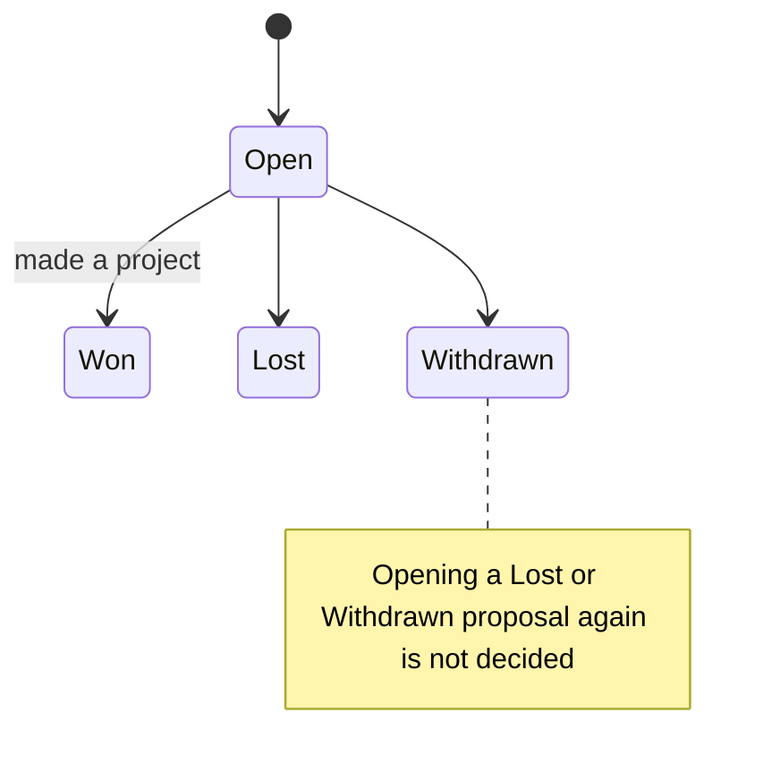
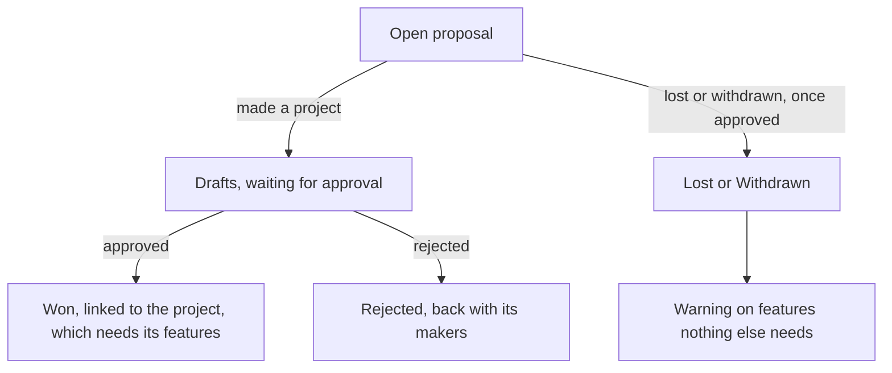

# Fathom — Use Cases

**Status:** Draft
**Last updated:** 2026-11-03

The core scenarios Fathom must support in v1, derived from the [Product Brief](brief.md) and the [Decisions Log](decisions.md). Each use case names the main actor, their goal, and the outcome. Steps and detail are added when each feature is designed.

## Planning Work

### Plan a Project

- **Actor:** Project Manager
- **Goal:** Put a new project on the plan, with its owner, the features it needs, and its milestones, such as customer delivery dates.
- **Outcome:** Once approved, the project appears on the timeline and the roadmap.

### Track a Proposal

- **Actor:** Project Manager
- **Goal:** Record a bid or customer request with the features it proposes, and make it a project once it is won.
- **Outcome:** Its features count toward the forecast while it is open. Once won, the project it becomes needs them; once lost or withdrawn, Fathom warns about features nothing else needs.

A proposal starts Open, and becomes Won when it is made a project, or Lost or Withdrawn, as the [Decisions Log](decisions.md#planning) sets out, each change a draft that needs [approval](decisions.md#planning). Whether a Lost or Withdrawn proposal can be opened again is not decided.

Once approved, making it a project links the project to it and makes its features needed by the project; ending it any other way leaves its features as they are, with a warning for those nothing else needs.

### Shape the Roadmap

- **Actor:** Product Manager
- **Goal:** Add the features that may come, with rough estimates, prioritize them, and target them at cycles.
- **Outcome:** Once approved, the roadmap shows what may come in each cycle, and whether it fits the capacity available.

### Assign People to Work

- **Actor:** Engineering Manager
- **Goal:** Staff a project or feature for the coming months, using current staff or planned hires and a monthly allocation percentage.
- **Outcome:** The assignments are saved as draft rows. Fathom warns when someone has more than two assignments in a month, and does not allow allocations outside a person's employment dates.

### Resolve Over-Allocation

- **Actor:** Engineering Manager
- **Goal:** Find people who are over- or under-allocated, and adjust allocations or timing.
- **Outcome:** The team's plan is realistic.

### Reschedule Work

- **Actor:** Project Manager
- **Goal:** Move a feature to another cycle, or a milestone to a new date.
- **Outcome:** The new timing is saved as a draft row.

### Approve Plan Changes

- **Actors:** An editor, and a user with the approver role
- **Goal:** Make sure changes are approved before they reach the live plan.
- **Outcome:** Approved draft rows become part of the live plan, and rejected ones stay as drafts with the reason, as the [Decisions Log](decisions.md#planning) sets out.

## Planning the Workforce

### Maintain Employee Records

- **Actor:** Engineering Operations Manager
- **Goal:** Keep Fathom's copy of employee details from the HR system current, including teams, managers, and end dates.
- **Outcome:** People can be planned for. People who leave are kept, with their end date, rather than deleted.

### Plan a Hire

- **Actor:** Engineering Operations Manager
- **Goal:** Plan a role that needs to be filled, with its target date, and track it through the hiring states.
- **Outcome:** The planned hire appears in the plan and can be allocated to work. When the role is filled, the new hire takes over its allocations.

### Maintain Feature Teams

- **Actors:** Engineering Managers, with an Approver, such as the Engineering Director, approving
- **Goal:** Keep feature teams, their members, and their feature leads current.
- **Outcome:** Once approved, each feature has a feature team that owns and delivers it.

### Evaluate Team Composition

- **Actor:** To be confirmed
- **Goal:** Check teams and feature teams for balance, such as test-to-development ratios and reports per manager compared with a target.
- **Outcome:** Imbalances are visible and can be addressed in the plan.

### Plan a Reporting Change

- **Actor:** Engineering Operations Manager
- **Goal:** Plan a future change in who reports to whom, such as a reorg.
- **Outcome:** The change takes effect on its planned date.

## Viewing the Plan

### See the Organization

- **Actors:** Users, according to their roles
- **Goal:** Understand who works for the organization, who is planned to be hired, who reports to whom, and what everyone is working on.
- **Outcome:** The user sees current staff and planned hires in the people view and the org chart, limited to what their roles allow.

### Review the Roadmap

- **Actor:** Executive
- **Goal:** See where the roadmap stands without asking for a status deck.
- **Outcome:** The Executive has a current view of the roadmap by cycle and release.

### Export the Plan

- **Actors:** Users, according to their roles
- **Goal:** Share the plan or roadmap outside Fathom.
- **Outcome:** The export contains only what the user's roles allow, in one of the formats in the Decisions Log.

### View an Earlier Snapshot

- **Actors:** Users, according to their roles (to be confirmed)
- **Goal:** See what the plan looked like at an earlier point in time, from a snapshot taken manually or on a schedule.
- **Outcome:** The user can view the plan as it was when the snapshot was taken.

## Running Fathom

### Manage Users and Roles

- **Actor:** Fathom Administrator, a persona in the [Product Brief](brief.md#users), with the Administrator role in [Roles](roles.md)
- **Goal:** Create local accounts and assign each user one or more roles.
- **Outcome:** Each user sees and changes only what their roles allow.

### Back Up and Restore

- **Actor:** The owner's department
- **Goal:** Make sure Fathom's data can be recovered from automated, encrypted backups.
- **Outcome:** Fathom's data can be recovered after a failure.

## Not Yet Covered

- **What-if scenarios:** Comparing alternative plans with the approved plan and with each other depends on an open question in the brief.
- **Configuring cycles and releases:** Setting up release streams, with their cycle lengths and cycle names, and choosing which cycles each release includes, have no use case yet.
- **Custom fields and tables:** Defining custom fields and tables comes in a later stage of the [Roadmap](roadmap.md), and has no use case yet.
