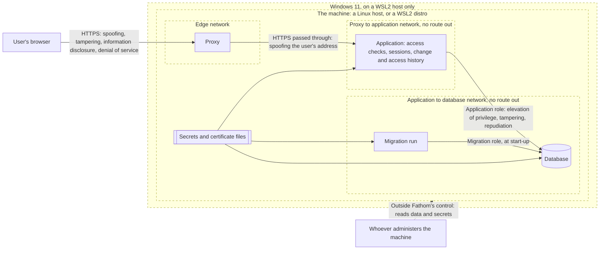

# Fathom: Security Plan

**Last updated:** 2026-11-25

How Fathom guards against threats as it ships: its code, its container images and its Compose configuration. The machine, network, certificates, secrets and backups around it come from whoever runs it, as [Securing Your Environment](../operations/securing-your-environment.md) sets out. [How Data Is Safeguarded](../privacy/data-protection.md) covers who sees which data, and the [Security Policy](../../SECURITY.md) how to report a vulnerability.

## Threats and Mitigations

The threat model groups threats by STRIDE: spoofing, tampering, repudiation, information disclosure, denial of service and elevation of privilege. It covers Fathom as it ships. Threats to the machine and network around it are for whoever runs Fathom.

### Trust Boundaries

The diagram shows where data crosses a trust boundary, each dashed box a boundary, and which groups of threats apply at each crossing.

- **Browser to proxy:** HTTPS, over a network Fathom doesn't control. In Fathom's Compose configuration, only the proxy publishes a port.
- **Proxy to application:** The proxy passes HTTPS traffic on without decrypting it, and holds no certificate.
- **Application to database:** An internal network with no route out, which the proxy isn't on.
- **The machine:** Anyone with administrator access to the machine Fathom runs on can reach its data and secrets. Fathom can't prevent that.
- **Windows 11 with WSL2:** The distro runs in a virtual machine on Windows, which adds a boundary between Windows and the distro:
  - **Who can reach the data:** anyone who can sign in as the Windows user that owns the distro can open it as root with `wsl`, and Windows administrators can mount its virtual disk, which holds the database and secrets.
  - **How the port is reached:** WSL2's mirrored networking shares Windows' interfaces, so the proxy sees each user's own address, and the Hyper-V firewall decides which connections reach the distro. WSL2's NAT networking, whose port proxy would give every user Windows' address, isn't supported for running Fathom.
  - [Securing Your Environment](../operations/securing-your-environment.md#on-windows-11-with-wsl2) sets out what whoever runs Fathom must do about each.

### Spoofing

- **Signing in as someone else:** Passwords must meet the rules set in Settings, and are hashed with scrypt, Better Auth's default. Each client address may try to sign in 5 times a minute, and every refused sign-in gets the same answer. Accepted: there is no lockout for an account, and failed sign-ins aren't recorded.
- **Stolen or forged sessions:** Session cookies are Secure, HttpOnly and SameSite, and requests are checked against cross-site forgery.
  - **Session life:** each sign-in gets a new session, and a session ends after 30 minutes without use. A password change, an administrator's reset or a deactivation ends the account's other sessions.
  - **Accepted:** a session in use has no absolute end.
- **Guessable passwords:** Every password a person sets is refused if it is common or easy to guess, whatever Settings say; this is not a setting.
  - **How it is checked:** zxcvbn-ts checks it against common passwords, words, names, keyboard patterns, and the person's own name and email address, and one scoring below 3, on its scale of 0 to 4, is refused.
  - **Generated passwords:** passwords Fathom generates aren't checked, since they're random; one from the default recipe scores at least 3.
- **First passwords and resets:** Whoever creates an account, or resets another's password, never chooses it: Fathom generates one from the recipe in Settings and shows it once, so nobody knows another's working password. Until its user changes it, the server refuses every request but that change and signing out, and the new password must differ from the generated one.
- **Resetting a password:** There is no self-service reset; only administrators reset passwords, and each reset is recorded in the access history.
- **Posing as the proxy:** The application accepts connections, and the user addresses they name, only from the proxy.
- **Taking a colleague's name:** A user renaming themselves can't take a name another account has, ignoring letter case, and some invisible characters are refused. The access history shows each account's email address beside its name.

### Tampering

- **Injection:** Database queries are parameterized, output is encoded, and input is checked by shared schemas, which drop fields they don't name. A content security policy allows scripts only from Fathom's own files.
- **Stored content:** Web links accept only http and https addresses, never file or folder paths, and notes only an allowlist of formats, whose links lead only to such addresses or, by file name alone, to Help pages, which open inside Fathom.
- **Help's diagrams:** They are the one markup Fathom draws without sanitising it. They come only from SVG files in the repository, reviewed like any change, never from a user, and a test refuses a drawing holding a script, embedded HTML or an event attribute.
- **Misleading links:** Web link addresses holding sign-in details are refused, and so is link text holding control characters or marks that change which way text runs, since either could make a link seem to lead somewhere it doesn't. A link opens in a new tab without telling the linked site which Fathom page it came from.
- **Formulas in exported files:** A value starting with =, +, -, @, a tab or a carriage return, other than a number, gets an apostrophe before it, so a spreadsheet shows it rather than running it as a formula, as [UI Conventions § Exporting](../standards/ui-conventions/tables.md#exporting) sets out for the file.
- **Framing and redirects:** Other sites can't frame Fathom's pages, and sign-in takes no address to send the user on to.
- **The audit log:** The database refuses the application's role any change to or deletion of the access history. The change history can only be added to, apart from marking a change published. The migration role, used only for upgrades, owns both.
- **The schema:** The application's database role can only read and write data, and a separate role changes the schema.
- **Record keys:** The database numbers each record itself, as it's added or drafted, and the application's role can only read key numbers, so a key is never changed or given again.
- **Undoing:** Only the user who made a change can undo it, and not once anything it would change has changed again.
- **Dependencies:** Packages are installed from the lockfile exactly, and base images are pinned by digest and GitHub Actions by commit.
  - **Security fixes in images:** image builds also install the operating system's security fixes released by `FATHOM_SECURITY_FIXES_DATE`.
  - **Renovate:** Renovate, as a GitHub App, may only open pull requests on branches of its own, which are reviewed and merged like any change.
  - **Accepted:** release images aren't signed and come with no list of their components.
- **The UI tests' browser:** `pnpm test:ui` downloads Chromium from Playwright's servers, at the version its pinned package names, outside the lockfile and the scans. Accepted: it runs only on a contributor's computer, against fictional data, and never reaches an image.
- **Workflows:** The Check workflow runs every pull request's code, including a fork's, with a read-only token and no secrets, on the `pull_request` event, never `pull_request_target`.
  - **Least access:** each job is given the least it needs, and values a person can choose, such as a tag's name, reach a command only as quoted settings.
  - **Release tags:** only the maintainer may push or change release tags, as a tag ruleset on the repository sets out, since a published release runs its workflow from its tag.
  - **The merge queue:** a queued pull request's code runs again on the `merge_group` event, in the repository's own context, with the same read-only token and no secrets, once the maintainer queues it.
- **The default branch:** Changes reach `main` only through a pull request that passes the check, as a ruleset on the repository enforces, set out with the repository's other settings in [Development Setup](../design/development-setup.md#the-repository-on-github). Accepted: commits aren't signed.

### Repudiation

- **Changes:** The change history records every change, with who made it, the role they acted as, and when.
- **Access:** The access history records:
  - each sign-in and the role it starts as, and each switch of role;
  - every change to accounts, roles and classifications, and users' changes to their own name or password, without the values;
  - every change to Fathom's settings, with the setting before and after;
  - views of Personal and Confidential data, at most once a day for each user, without what was seen, so frequent use doesn't bury other entries;
  - changes to Personal and Confidential data, without the values;
  - changes to the hiring plan without naming the planned hire, and views of planned hires' details at most once a day, apart from views of people's;
  - exports holding Personal or Confidential data, naming the table and its classified columns.
- **Telling accounts apart:** Entries are kept by account, not by name, and show each account's email address beside its name. Whose details changed is shown only to readers who may see people; others see that a change was made, and by whom.
- **Worth checking:** Accounts created, changes to an account's roles, changes to a role, deactivations, password resets, users' changes to their own name, changes to the password settings and moves between classes are marked worth checking. Reactivating an account isn't, since deactivating it was, nor is an export, as viewing Personal details isn't.
- **Requests:** Requests are logged by method, path and network address.

### Information Disclosure

- **Before sign-in:** Only the front end's files, sign-in, sign-out, changing a password and the session checks are served without a signed-in account. The front end's script names Fathom's release, and holds every Help page.
  - **Accepted:** anyone who reaches it can look up the release's known weaknesses, which are fixed by updating, not hidden, and the Help pages are public with Fathom's source, holding no organization's data.
- **Data beyond a role:** One shared data access layer checks permissions and classifications for every page, export and search.
  - **A change's answer:** a change answers with the records as the role's read would show them, never more; the plan's records pass through one filter on every read and every answer, which tests check for each way a role may hold only part of the plan.
  - **A record named with another:** a record named with one it belongs to, such as an allocation by its feature or activity, or an activity by its project or release, names that one only to a role that reads its kind, and to any other only by its kind, as "a feature", "an activity" or "a project", in reads, drafts, unpublished changes, the change history and refusals. An activity is read with View Features, and its project named only with View Plan. Accepted: a feature or activity hidden so still sends its status's meaning, which Capacity's totals need, and its identifier, so the role sees which people share one it can't read; its team's colour is withheld.
  - **Pages, views and columns:** a page, view or column is shown only to roles that see every classification it needs, and a column that needs a permission as well, such as People's Feature teams, which needs View on Feature teams, only to roles that hold it.
- **Drafts and history:** Drafts, unpublished changes and the change history go through the same checks.
  - **A change's class:** a change is shown only to readers who see its data, at its class then or now, whichever is more sensitive, so its timing doesn't reveal a Personal change.
    - **Accepted:** a role that approves people's drafts is told when one holds details it can't see, so it leaves the draft to another approver. Trying to decide the draft would tell it as much.
  - **Records a change links to:** named only to a role that reads their kind, as [Roles](../product/roles.md#what-each-role-can-do) sets out; a scope history, which lists only features, is empty to a role that doesn't see features.
  - **Who sees which changes:** changes to configuration are seen by those who may open its pages, changes to people by those who see people, a shared view's by those who open its table's page, and a personal saved view's by its maker alone. Something saved with no change a reader may see is left out for them.
  - **Unpublished changes:** seen only by their maker, who alone publishes or discards them.
    - **Others' changes:** asking to publish or discard someone else's is answered as if the change doesn't exist, and a change is linked only to its maker's other changes.
    - **Publishing:** publishing applies the role in use alone, as [Roles](../product/roles.md#accounts-and-the-acting-role) sets out, so a change made under another role waits until a role that may make its kind of change publishes it.
- **Shared views of Drafts:** Drafts shows each role the drafts of the areas it sees, but its shared views open to every role that opens Drafts.
  - **Sharing:** only roles with Edit Configuration can share a Drafts view.
  - **Accepted:** a shared view's filters show what its maker typed or chose, such as a person's name in a Record filter, to readers who don't see that area, though never a row they may not see.
- **Last views:** Each account's last view of each page is read and written only by that account.
  - **Saving:** saving one refuses what the role couldn't save as a view.
  - **Reading:** reading it leaves out the filters, sorts, breakdowns, groupings and columns on what the role can no longer see, the whole view once the role no longer opens its page, and a saved view the account may no longer apply.
  - **History:** neither history records it.
  - **Accepted:** its search is kept as typed, so it may name something the role no longer sees, though only to the account that typed it.
- **Links to records:** A link by a record's key finds the record only through the read of the page that shows it, for a role that opens that page, and says it was removed only to a role whose History shows the removal.
  - **Otherwise:** it answers "Nothing found", the same whether no record has the key or the role may not see it.
  - **Accepted:** key numbers count up, so their gaps show that records exist that a role doesn't see, such as drafts and removed records, though nothing about them.
- **Exports:** An exported file holds only what the role was sent.
  - **Recording:** the browser asks the server to record an export of Personal or Confidential data once it is confirmed and a place to save it chosen, then writes the file.
  - **Checked by the server:** it finds each column's class and name itself, and refuses an export naming a column the role can't see.
  - **Classified rows:** rows hold classified data apart from their columns: planned hires are recorded as the Hiring plan, and a drafted change of manager as Past managers.
  - **Accepted:** a changed browser or a script can save the data without the record, as it could copy it from the screen.
- **Logs and errors:** Logs leave out database error messages and known sensitive fields, though a path can name a record's ID. Server errors shown to users are generic.
- **Outside services:** Fathom calls no outside service and loads nothing from the internet, such as fonts or scripts, so it needs no internet access to run. The application and database containers have no route out.
- **At rest:** The database isn't encrypted at rest; [ADR 0012](../adr/0012-encryption-at-rest.md) leaves that to the disk. Accepted: traffic between the application and the database isn't encrypted, since it stays on an internal network, and session tokens are stored as they are, along with each session's address and browser.
- **Secrets:** Secrets are kept out of the repository and container images.
- **Development:** Development uses fictional data only. Its accounts are on the reserved `fathom.test` domain, and the release images don't hold them. Nor does the application image hold the tests or the files only they use, which a container test checks.

### Denial of Service

- **Too many requests:** The proxy limits connections in total, and the server limits each client's requests and how long a request may take.
- **Resource exhaustion:** Every container has memory and process limits. Accepted: there are no processor limits.
- **Locking out administrators:** At least one active account can always administer accounts.

### Elevation of Privilege

- **Granting oneself access:** Anyone who manages accounts could give themselves any role, or reset a user's password and sign in as them. Every change to accounts and roles is recorded in the access history, and accounts created, changes to roles, and changes to which roles an account holds are marked for review.
- **Acting with several roles:** A session acts as one role at a time, with only that role's permissions.
- **Approving one's own change:** Nobody approves their own change, made under any of their roles, unless the role they act as is given that permission.
- **Approving under either of two areas:** Drafts of schedules and their cycles are changed with Edit on the plan or on configuration, and approved with Approve on either one, so a role granted either reaches them.
  - **One shared rule:** one shared rule on the server checks either permission, together with seeing schedules, for every change and decision on them, and tests cover each role allowed and denied.
- **Lists made with a column:** Whoever sets up Features' columns drafts a new list with a column, without Edit Configuration, so a list could be made, or one changed or removed, by someone who doesn't change configuration.
  - **Only a new General list:** the server makes the list General itself, only with a column on Features, in the column's own change, and refuses a new list for People's columns.
  - **Only with a column:** the list and its choices are undone without Edit Configuration only with the change that added them with the column, and discarded only with the last Features column drawing on them, never with a People column, and never when anything changed the list since it was made, another column still draws on it, or someone else is changing it. Approving it still takes Approve Configuration.
  - **Tests:** every starting role allowed and denied, and each case the list stays, in `apps/server/src/feature-column-new-list.test.ts`.
- **Escaping a container:** Every container runs as a user other than root, with a read-only filesystem, all Linux capabilities dropped and no privilege escalation. The application's runtime image is distroless.
- **The database:** Passwords are stored with SCRAM-SHA-256, and the database refuses superuser logins over the network.

## Vulnerability Scanning

- **The security report:** `pnpm security` scans dependencies (pnpm audit and Trivy), source code (Semgrep), secrets in the repository and its history (Gitleaks), Dockerfiles (Trivy), and the container images (Trivy) whenever anything they're built from has changed. `pnpm check` runs it, along with tests of the Compose settings.
- **Secrets on GitHub:** GitHub's secret scanning, with push protection, refuses a push holding a known kind of secret, beside Gitleaks in the security report.
- **Code scanning on GitHub:** CodeQL's default setup scans the JavaScript and TypeScript code and the GitHub Actions workflows on pull requests, pushes to `main`, and weekly, as [ADR 0002](../adr/0002-libraries.md) sets out. Its results show on each pull request but don't block a merge. Semgrep stays in the security report.
- **Every change:** The Check workflow runs the security report on every pull request and every group in the merge queue.
- **Releases:** A release tag pushed is built and scanned before its release is drafted, and its images are scanned again when the release is published, before any is pushed to the registry.
- **Offline:** `pnpm check --offline` and `pnpm security --offline` skip the dependency audit and the image scans, which need the internet, and run the other scans without network access. The Check workflow, which refuses `--offline`, runs every scan on the pull request, and only its result counts toward a merge.
- **Security fixes first:** Renovate opens a pull request for each security fix in a dependency the `package.json` files name as soon as it finds one, before any other update and whatever else is waiting, without the seven-day wait the others have.
  - **PostgreSQL:** PostgreSQL's minor, patch and image updates, which carry its security fixes, come straight after them in the same way.
- **Fix times:** Counted from when a fix is released: critical within 14 days, high within 60, and medium within 180. Low findings have no deadline.
- **Failing:** The security report fails on an overdue fix, any other critical or high finding, or a scan that doesn't finish. A release isn't drafted, and its images aren't published, while any fix in them is overdue.
- **Indirect dependencies:** Renovate updates only the dependencies the `package.json` files name. A security fix in a package one of them brings in is made by updating the package that brings it in, or, where no release of it takes the fix, by an override in `pnpm-workspace.yaml`, removed once one does.
- **Exceptions:** An overdue finding that can't be fixed yet may be excepted, with a reason, an expiry date and the maintainer's approval, in `.trivyignore.yaml`.

## Source Code Assurance

- **Open source:** Fathom is licensed under Apache 2.0.
- **Standards:** Code is written to the [core principles](../standards/core-principles.md) and the [TypeScript](../standards/typescript.md) and [shell](../standards/shell.md) standards, and reviewed against the [Code Review Standards](../standards/code-review.md#security-and-data).
- **Tests:** [Access control tests](../standards/testing.md#access-control-tests) cover every role and classification, alongside [security tests](../standards/testing.md#security-tests) and static analysis, as the [Testing Standards](../standards/testing.md) set out.
- **Releases:** Each release is tagged, and its images are built from that tag and labelled with its source and commit, as [ADR 0011](../adr/0011-releases-and-images.md) sets out.
