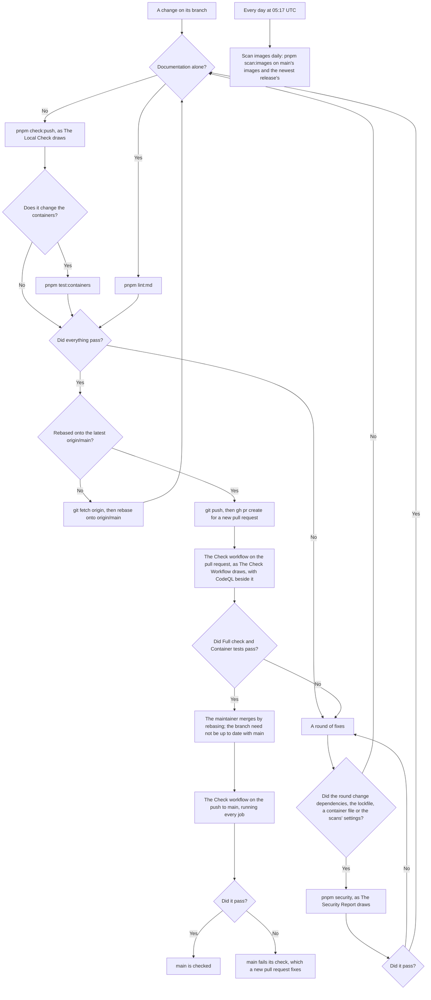
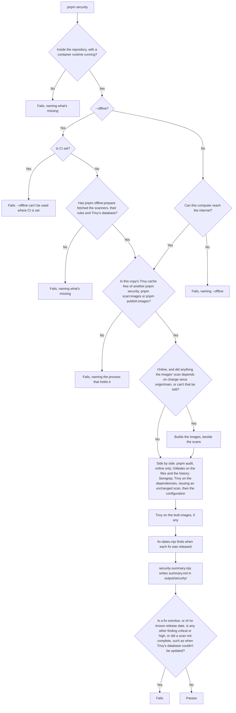
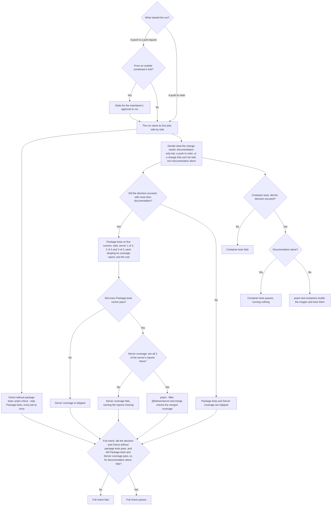

# Testing Standards

How Fathom's changes are tested. Every change that adds or changes behaviour includes its tests in the same change, and tests run as part of the [Agent Workflow](agent-workflow.md). Test locations for TypeScript are in [TypeScript Standards](typescript.md#tests), and test tools are chosen in the architecture decision records in `docs/adr/`.

## Principles

- **Behaviour, not implementation:** tests describe what the code does for its users and callers, so they survive refactoring.
- **Deterministic:** a test gives the same result on every run and every machine. Time, randomness and IDs are injected or controlled by the test, and tests do not depend on test order or on the network.
- **Isolated:** each test sets up and cleans up its own data, with no shared mutable state between tests.
- **Fictional data:** test data is invented, never copied or derived from real data, including anonymized copies.
- **Minimal:** use the fewest tests that cover the required behaviour and its edge cases. Do not test the same path in several suites.
- **Fast feedback:** most tests are unit tests that run in seconds; slower tests are kept to what needs them.

## Test Types

| Type | What it covers | Runs |
| --- | --- | --- |
| Unit | Domain rules, calculations, validation, and other logic without I/O | Every change |
| Integration | The API and data access working together against a real database of the same kind as production | Every change |
| Access control | Every role's access to every protected operation and every level of protected data, allowed and denied | Every change |
| Security | Input handling, sessions, request forgery protection, rate limiting, audit records, and log contents | Every change |
| Container | Behaviour that needs the built containers, such as network isolation | On every pull request but documentation alone, and every push to `main`; locally, every change that affects the containers, and before a stage is complete |
| UI | Key user journeys in a real browser | Not required for each change and not run in the workflow's test step; run when the user asks, and passing before a stage is complete |
| Manual | What a person sees and does in a feature, by hand in a real browser, as [Manual Tests](#manual-tests) describes | Before a stage that changes the feature is complete, and when the owner asks |

Every new or changed API operation has integration tests, as well as unit tests for its rules.

Until Fathom's first release, migrations have no upgrade tests, since databases are reset instead of upgraded.

## The Testing Pyramid

Most tests are unit tests, and integration tests check only what needs the server and the database.

- **Must** write domain rules, calculations and validation as pure functions, with no I/O, in `packages/shared` or a server module, and unit-test each variation of a rule there: each role, edge, state and refusal.
- **Must** keep integration tests to the wiring: each route, its permission check for every role as [Access Control Tests](#access-control-tests) requires, the queries, and the database's own constraints. One integration test shows that a route applies a rule, such as one refusal with its message; the rule's other variations are unit tests.
- **Must Not** add an integration test that only re-checks a variation of a rule.
- **Must** move an area's rules into pure functions when a change next works in it, if they are tested only through the database, and replace the matching integration tests with unit tests. The pull request lists what now covers each integration test it removes. Access control tests keep every role, allowed and denied.

The password settings show the split: `packages/shared/src/passwords.test.ts` unit-tests each rule for a password and a recipe, and the order in which a chosen password's problems are named, while `apps/server/src/password-settings.test.ts` checks the routes, the roles, the access history, and one refusal of each kind.

## What Every Change Must Test

- **New behaviour:** unit tests for its rules, and integration tests for each new or changed operation that crosses a boundary (persistence, an API, a device or service).
- **Bug fixes:** a test that fails without the fix, written before the fix.
- **Edge cases and errors:** boundaries, empty and missing values, invalid input, and each error path, not only the successful path.
- **Validation:** every validator is tested with valid input and with each kind of invalid input it rejects.
- **Configuration:** invalid or missing configuration stops start-up with a clear error, and a test proves it.

## Access Control Tests

Access control is tested as thoroughly as the features it protects:

- **Every role, allowed and denied:** For each protected operation, a test for every role that should be allowed and every role that should be denied. Denials matter as much as allowed access.
- **Signed out:** Every protected operation rejects requests without a valid session.
- **Data, not just screens:** Responses are checked to contain no fields above the caller's access, rather than relying on the user interface to hide them.
- **Every path to the data:** Lists, single records, search, exports, and every other way the project reads data are each tested.
- **Changes to access:** Role changes and account deactivation take effect on the next request.
- **No self-escalation:** No user can grant themselves more access, except Administrators managing their own account as [Roles](../product/roles.md#safeguards-for-administrators) decides. Tests cover both guards (the last active Administrator keeps the role and stays active, and nobody resets their own password from Accounts) and that every change Administrators make to their own account is recorded in the access history.

## Security Tests

- **Injection:** Inputs that try SQL injection or script injection are rejected or made harmless.
- **Sessions:** Cookies have the required security attributes, sessions expire, and signing out ends the session.
- **Request forgery:** Requests that change data from another origin are rejected.
- **Rate limiting:** Repeated sign-in attempts are slowed or blocked.
- **Audit records:** Viewing or changing sensitive data creates the expected audit record, without the sensitive values, and no role can edit or delete audit records.
- **Logs:** Tests put known marker values in personal fields and check that they never appear in captured logs or audit records.
- **Network isolation:** Where the project requires it, a container test confirms from inside each container that it cannot reach the internet.

## Coverage

- **Required:** 100% branch coverage of domain logic, validation, service workflows and the data access layer.
- **Everything else:** measured and reported; significant untested code is explained in the code review.
- **Does not count:** UI layout and animation, previews, fixtures, generated code, and passthrough wrappers with no logic.

Coverage numbers support review; they do not replace judgment about whether the right behaviour is tested.

### Coverage Enforcement

The coverage tool is configured so the test command fails below the 100% threshold [Coverage](#coverage) requires for the code it covers. `pnpm test:changed`, and so `pnpm check:push`, holds each changed source file to that threshold on its own, so a gap fails locally before GitHub's check finds it, as [Coverage of a Change](#coverage-of-a-change) describes.

Whole files that only start a program or serve the tests, such as the server's `main.ts`, are left out in the coverage settings, with a comment saying why. Other code may be left untested only with a `/* v8 ignore */` comment that says why, and only in two cases:

- **Command-line entry points:** In any package, the lines that start a command when it runs as its own process, where the tests call the command's function instead.
- **Screen layout:** In the web app, a branch that only arranges the screen or animates it, with no logic, as [Coverage](#coverage)'s "Does not count" allows.

Logic, validation, access checks and data handling are never excluded. The code review judges each exclusion.

## What Not to Test

- UI layout in unit tests; use UI tests when a journey needs it.
- Framework or third-party library internals.
- Constants files and one-line getters that encode no rule.

## Writing Tests

- **Names describe behaviour:** for example, "rejects an expired session", never "test session 3". Be consistent within a file.
- **One behaviour per test:** arrange the data, act once, assert the outcome. Mark the phases with `Given`, `When` and `Then` comments in non-trivial tests.
- **Drive through the public surface:** set up and mutate state through the same APIs callers use, not by poking storage directly.
- **No sleeping:** tests wait for conditions or advance a controlled clock, never wait for fixed amounts of time.
- **Flaky tests:** a test that fails intermittently is fixed, or reported to the owner. Tests are never removed, skipped or weakened without the owner's approval.

## Web App Tests

- **Checking that nothing opened:** Mantine shows a menu, popover or dialog a frame after it opens. So a check that none opened, straight after an action, proves nothing: it usually passes even when one opens, and fails now and then. Before checking that one is absent, a test **Must** do one of these:
  - Wait for something the action does show.
  - Check that the control that opens it is absent, when that control is shown exactly when the menu or dialog can open in any way, such as from a key.

## Test Data

- **Factories:** tests build data with factories that produce realistic, fictional records with sensible defaults, overriding only what each test needs.
- **Seed data:** development and demonstration data comes from a generator with a fixed seed, so it is the same every time.
- **Schema from migrations:** integration tests build any database schema by applying Fathom's migrations, never another way.
- **Clean state:** each integration test starts from a known state, such as an in-memory store, a rolled-back transaction or a fresh schema.

## UI Tests

UI tests are not required on every change. A new user flow lists a short UI test roadmap (happy path first, then the main variations) in the pull request or feature document, and interactive elements carry accessibility identifiers.

## Running Tests

Run tests only through Fathom's own commands, never the underlying tools directly. If any category of tests can't run, for example because no container runtime is available, stop and tell the user; never report the tests as passing.

### The Commands

- **`pnpm check`:** the full suite, side by side, then each one's result and time. It runs ESLint, the Prettier formatting check, type checking, and Markdown, shell and licence linting. It also runs Renovate's validation of `renovate.json` when it has changed, the script tests, the unit, integration, access control and security tests, and the build-time security scans.
- **`pnpm check:push`:** the tests a change can affect, with every linter but the licence and Renovate checks, side by side.
- **`pnpm test:changed`:** the tests a change can affect, committed or not, as [What a Change Runs](#what-a-change-runs) sets out. With `--uncommitted`, it counts only the work not yet committed, for small rounds of fixes after a commit on a long branch.
- **`pnpm test:containers`:** the container tests. UI tests get their own command once they are added.
- **Taking turns:** the checks run in two copies of the repository at a time on one computer, in the order they asked. A copy that starts alone has every core, and one that starts beside another has half. A copy that has to wait says so, as [Development Setup](../design/development-setup.md#how-the-checks-run) describes.

### What a Change Runs

`pnpm test:changed` runs the script tests, then the package tests below, unless the change is to documentation other than Help pages, or to the web app's stylesheets alone. [The Changed Tests](#the-changed-tests) draws each choice.

| A change to | Runs |
| --- | --- |
| A source file in a package's `src` folder | The tests that import it, directly or through other files, in that package and every package that depends on it |
| A test, changed or removed | As a change to the source file of the same name beside it, whose importing tests then run too; for a widely imported file, that can be most of a package's tests |
| Anything else in a package, such as its settings, stylesheets or migrations | Every test of that package and of every package that depends on it |
| The web app's stylesheets alone | The web app's tests, ESLint and the formatting check |
| A Help page in `docs/help/` | The web app's tests that import the Help pages, since they're built into it |
| Anything outside the packages, other than documentation | Every test |
| Other documentation alone | Nothing |

Tests that reach code other than by importing it, such as building the web app, run in `pnpm check`.

### Coverage of a Change

`pnpm test:changed` fails where GitHub's check would on coverage, without running every test:

- **A package whose every test runs** has all its coverage measured, since settings, dependencies and files outside the source can change any file's coverage.
- **Any other package** has only the source files the change touches in its `src` folder measured, against its threshold, apart from those its coverage settings leave out.
- **A changed or removed test** counts as a change to the source file of the same name beside it, so that file's coverage is measured.
- **The cost:** measuring coverage adds about a quarter to the time of the tests it measures.
- **The limits:** it can't tell which source a test of another name covers, nor see code a test reaches other than by importing it. So `pnpm check` and GitHub's check still enforce coverage in full.

### The Test Step

While working, run `pnpm check:push`, as [Development Setup](../design/development-setup.md#checks-and-tests) describes, or any one of its parts on its own for a quick answer. The workflow's test step, which [agent-workflow.md](agent-workflow.md#autonomous-mode) repeats after each round of fixes, and the steps after it:

1. **Before the code review:** the checks run while working, with `pnpm test:containers` when the change affects the containers. The full `pnpm check` waits for the last step.
1. **After each round of fixes,** whether from a review, UI feedback or owner feedback: `pnpm check:push`.
   - `pnpm security` too, if the round changed dependencies, the lockfile, a container file or the security scans' settings.
   - `pnpm test:containers` again, if the round changed the containers.
1. **Before the push:** once the review's findings are fixed and those checks pass, the code is rebased onto `main` and `pnpm check:push` runs on the rebased code. It's then pushed without waiting for the owner's approval, as the [Agent Workflow](agent-workflow.md#workflow) sets out.
1. **On the pull request:** the Check workflow, as [The Check on GitHub](#the-check-on-github) sets out.

A change to documentation alone may skip the test step, as [agent-workflow.md](agent-workflow.md#autonomous-mode) allows, except a change to a Help page, which is built into Fathom.

### The Check on GitHub

- **Every push** to a pull request or to `main` runs the full `pnpm check`, its package tests on runners of their own, as [The Check Workflow](#the-check-workflow) draws.
- **Documentation alone** means Markdown files, and files under `docs/` other than Help pages, which are built into Fathom. A pull request of documentation alone leaves out the package tests, the server's merged coverage and the container tests; every push to `main` runs them.
- **The security report** runs on every pull request, documentation alone included. It scans the container images whenever anything they're built from has changed, as the [Security Plan](../security/security-plan.md#vulnerability-scanning) sets out.
- **The full suite step:** the pull request's green check is the [Agent Workflow](agent-workflow.md#workflow)'s full suite step, for a pull request's commit, or once for the whole branch of an [issue batch](issues.md#issue-batches).
- **Merging:** the owner merges only on green. **Full check** and **Container tests** must pass, as [Development Setup](../design/development-setup.md#rulesets) sets out.
- **Failures:** follow the run with `gh pr checks --watch`, and read a failure or warning with `gh run view --log` (or `--log-failed`). Every warning it reports is fixed, as locally.
- **Locally:** running the full `pnpm check` is optional, for when the workflow can't run.

### Offline

`pnpm check:push --offline` runs once `pnpm offline:prepare` has run while connected, as [Development Setup](../design/development-setup.md#working-offline) describes. A branch checked offline still needs the Check workflow's full check to pass on its pull request.

## From a Change to a Merge

The charts below draw every step the checks take, from a change on its branch to its merge and the runs on `main` after it, as the scripts and workflows run them. Diamonds are decisions, and each failure is an end of its own.

Other documents own what the charts only name:

- **The people's steps,** such as the screen check and the review: [How Fathom Is Built](../how-fathom-is-built.md#how-a-change-is-made)
- **The slots, cores and time limit:** [Development Setup § How the Checks Run](../design/development-setup.md#how-the-checks-run)
- **The rules on `main`:** [Development Setup § Rulesets](../design/development-setup.md#rulesets)

### The Whole Path

"Documentation alone" is as [The Check on GitHub](#the-check-on-github) defines it. No Git hook runs anything: each check runs when its command is run.



- **A new push to a pull request** starts a new run of the Check workflow, which cancels the pull request's older run. A run cancelled before it ends fails Full check rather than passing unchecked.
- **A rebase** onto `main` changes the code, so the local check runs again before the push, and the push runs the Check workflow again.
- **A merge** runs nothing on the pull request again, since [Rulesets](../design/development-setup.md#rulesets) don't require the branch to be up to date with `main`, so the push to `main` that the merge makes is the first run of the merged code.
- **On `main`,** every job runs, but nothing has changed since `origin/main`, so the Renovate settings aren't validated and the security report doesn't build or scan the images; the daily image scan covers `main`'s images.
- **Releases** start from `main` and build and scan their own images, as [Development Setup § Releases](../design/development-setup.md#releases) sets out.

### The Local Check

`pnpm check` and `pnpm check:push` run `scripts/check-turn.mjs`, which waits for a turn, then `scripts/check.sh`, which runs the jobs.

```mermaid
flowchart TD
    Start["pnpm check or pnpm check:push"] --> Holds{"Started by a check that already holds a turn?"}
    Holds -- Yes --> Jobs
    Holds -- No --> Ticket["check-turn.mjs leaves a ticket in the checks' slot folder"]
    Ticket --> Free{"Is a slot free for this ticket, in the order the copies asked?"}
    Free -- No --> Wait["Waiting to run a check, naming the slots' holders; it looks again each second"]
    Wait --> Free
    Free -- Yes --> OnGitHub{"Is CI true, as on GitHub, or FATHOM_CHECK_SHARES already set?"}
    OnGitHub -- Yes --> WholeComputer["Its environment is kept: on GitHub, every job runs at once"]
    OnGitHub -- No --> Alone{"Did any other copy hold or wait for a turn as this one took its own?"}
    Alone -- Yes --> HalfComputer["Half the computer: FATHOM_CHECK_SHARES is 2"]
    Alone -- No --> EveryCore["Every core, kept while it runs, even once another copy starts: FATHOM_CHECK_SHARES is 1"]
    WholeComputer --> Jobs{"--before-push?"}
    HalfComputer --> Jobs
    EveryCore --> Jobs
    Jobs -- Yes --> BeforePush["pnpm test:changed, and the linters: pnpm lint --no-cache, pnpm format:check, pnpm typecheck, pnpm lint:md and pnpm lint:shell"]
    Jobs -- No --> FullCheck["pnpm test:packages, pnpm security, pnpm test:scripts, the same linters, pnpm lint:licences and pnpm lint:renovate"]
    BeforePush --> Skip{"Are the arguments known, and does each --skip name a job, leaving at least one?"}
    FullCheck --> Skip
    Skip -- No --> SkipFailed["Fails, giving the usage or naming the jobs left"]
    Skip -- Yes --> Offline{"--offline?"}
    Offline -- Yes --> OfflineInCi{"Is CI set?"}
    OfflineInCi -- Yes --> OfflineRefused["Fails: --offline can't be used where CI is set"]
    OfflineInCi -- No --> Prepared{"Has pnpm offline:prepare finished in this copy?"}
    Prepared -- No --> NotPrepared["Fails: not ready to work offline"]
    Prepared -- Yes --> OfflineJobs["Security report runs pnpm security --offline, and Renovate settings is left out"]
    OfflineJobs --> AnyLeft{"Is any job left?"}
    AnyLeft -- No --> NothingLeft["Fails: every job left needs the internet"]
    Offline -- No --> NeedsInternet{"Does a job left need the internet: Security report or Renovate settings?"}
    NeedsInternet -- No --> Run
    NeedsInternet -- Yes --> Connected{"Can this computer reach the internet?"}
    Connected -- No --> NoConnection["Fails, naming --offline"]
    Connected -- Yes --> Run
    AnyLeft -- Yes --> Run["Runs the jobs side by side, the longest first, no more at once than the cores divided by FATHOM_CHECK_SHARES, or all at once when it isn't set"]
    Run --> Limit{"Did each job end within FATHOM_CHECK_JOB_SECONDS, 900 seconds unless set?"}
    Limit -- No --> Stopped["The job's process group is stopped, its output shown, and it counts as Stopped"]
    Limit -- Yes --> Results["Each job's output, then a table of each one's result and seconds"]
    Stopped --> Results
    Results --> AllPassed{"Did every job pass?"}
    AllPassed -- No --> ChecksFailed["Fails: these checks failed, naming them"]
    AllPassed -- Yes --> Passed["Passes; the turn's slot is freed either way"]
```



- **Package tests:** each package runs `vitest run --coverage`, which fails below the thresholds [Coverage Enforcement](#coverage-enforcement) sets; how many workers and test databases they use is in [How the Checks Run](../design/development-setup.md#how-the-checks-run).
- **Renovate settings:** passes at once unless `renovate.json` changed, as [Checks and Tests](../design/development-setup.md#checks-and-tests) sets out.
- **A container runtime:** Package tests, Security report, Licences and Renovate settings each fail, naming it, when no container runtime is running.
- **Licences:** checks that every file states its copyright and licence, with the REUSE tool. The script tests check each header's layout.

### The Changed Tests

`pnpm test:changed`, run by `pnpm check:push` or on its own, chooses the tests in `scripts/test-changed.mjs`, and checks the coverage of what the change touches, as [Coverage of a Change](#coverage-of-a-change) sets out.

```mermaid
flowchart TD
    Start["pnpm test:changed"]
    Uncommitted{"--uncommitted?"}
    Uncommitted -- Yes --> SinceHead["The paths changed since HEAD, and new files git doesn't ignore"]
    Uncommitted -- No --> SinceBase["The paths changed since the branch left origin/main, committed or not, and new files git doesn't ignore"]
    Start --> Arguments{"Is every argument known?"}
    Arguments -- No --> UnknownArgument["Fails with exit status 2"]
    Arguments -- Yes --> Uncommitted
    SinceHead --> Listed{"Could git list the changes?"}
    SinceBase --> Listed
    Listed -- No --> NotListed["Fails, naming the git command"]
    Listed -- Yes --> AnyCode{"Is any path other than documentation alone?"}
    AnyCode -- No --> NoTests["No tests run, and it passes"]
    AnyCode -- Yes --> Turn["Takes a check's turn, unless the check that started it holds one"]
    Turn --> Stylesheets{"Only the web app's stylesheets?"}
    Stylesheets -- Yes --> StylesheetTests["pnpm lint, pnpm format:check and every web app test"]
    Stylesheets -- No --> Outside{"Is any path outside a package's folder in apps/ or packages/, other than a Help page?"}
    Outside -- Yes --> Everything["pnpm test:scripts, then every test of every package, with all their coverage"]
    Outside -- No --> Scripts["pnpm test:scripts"]
    Scripts --> Whole{"Is any path in a package but not a script in its src folder, such as its settings, stylesheets or migrations?"}
    Whole -- Yes --> WholePackages["Every test of those packages and of every package that depends on them, with all their coverage"]
    Whole -- No --> Imported
    WholePackages --> Imported{"Is any path a script in a package's src folder, or a Help page?"}
    Imported -- Yes --> Related["vitest related: the tests importing those files, in the packages that hold or depend on them and haven't run whole, measuring the coverage of the changed source files alone"]
    Imported -- No --> InTime
    StylesheetTests --> InTime{"Did each pnpm step end within FATHOM_CHECK_JOB_SECONDS, 900 seconds unless set?"}
    Everything --> InTime
    Related --> InTime
    InTime -- No --> TooLong["The step and every process it started are stopped, naming it, and it fails"]
    TooLong --> Outcome
    InTime -- Yes --> Outcome{"Did every run pass, coverage included?"}
    Outcome -- No --> TestsFailed["Fails"]
    Outcome -- Yes --> TestsPassed["Passes"]
```



- **A Help page** stands for `apps/web/src/help-pages.ts`, which gathers them, and a removed file runs nothing of its own, since whatever imported it changed too.

### The Security Report

`pnpm security` runs `scripts/security-report.sh`: the Security report job of `pnpm check`, and the scans the [Security Plan](../security/security-plan.md#vulnerability-scanning) requires.



### The Check Workflow

`.github/workflows/check.yml` runs on each pull request's pushes and on every push to `main`. **Full check** and **Container tests** are the checks a merge needs; the rest feed Full check. CodeQL's code scanning runs beside it, its results shown but never blocking a merge.



- **Time limits:** Check without package tests, each Package tests runner and Container tests stop after 60 minutes, Server coverage after 15, Decide what the change needs after 10 and Full check after 5, and each job of `pnpm check` after its own limit, as [The Local Check](#the-local-check) draws.
- **A failure in one part** fails Full check, though the other parts still run to the end, so a run reports every failure at once.

## Problems Found

A problem a test finds that the change does not fix, whether a failing manual test step, a test that fails now and then, or a gap in coverage, is proposed to the owner as a GitHub issue and filed through its form once approved, as [Issues](issues.md) sets out, never left in a document or a test's notes.

## Manual Tests

A manual test is a test specification a test engineer, including one new to Fathom, runs by hand in a browser. Each is kept in `docs/testing/`, named in one of two ways:

- `<feature>-manual-test.md` for a feature, such as [Drafts](../testing/drafts-manual-test.md)
- `<role>-workflows-manual-test.md` for a role's workflow test

The acceptance tests are kept in `docs/testing/acceptance/` instead, as the last rule below sets out. Each manual test has these sections:

- **Scope:** one or two sentences on what the test verifies.
- **Test Environment:** what must be running and set up, linking to [Manual Test Basics](../testing/manual-test-basics.md#test-environment) for what every test needs, and adding only what this test needs besides.
- **Test Accounts:** each account the test uses, named by its role in Fathom, with its email address, and its name as Fathom shows it where that differs from the role. [Manual Test Basics](../testing/manual-test-basics.md#test-accounts) says where the accounts come from, links to the roles they hold, and where their password comes from.
- **Common Procedures:** the procedures the test cases refer to.
  - Those [Manual Test Basics](../testing/manual-test-basics.md#common-procedures) holds, such as starting Fathom and restoring or resetting the data, by link.
  - Any of this test's own, each with the exact commands, which terminal runs them, how to confirm they worked, and what each deletes.
  - A procedure is named for what it does, such as Restore the Seed Data. Steps refer to it by that name, never by a code such as R1 or P1.
  - Signing in and out are not procedures: steps just say which account to sign in as.
- **Terms:** where on screen any menu or control the steps name is found, when its label alone does not say. Link to [Manual Test Basics](../testing/manual-test-basics.md#terms) for the terms every test uses, and add only this test's own.
  - Steps name a page as the left-hand menu shows it, such as "Select the **Drafts** page in the left-hand menu". Never name it by its position or the item next to it, since the menu's order changes as pages are added.
  - A step that leaves a page and comes back says again what to choose there, such as the grouping, since a page opened from the menu opens on the view it last showed. An earlier step may have changed that view.
- **Test Cases:** each with these, in order:
  - An ID, such as `DRAFT-01`, and a title saying what it verifies.
  - An **Account:** line naming the account it starts with.
  - Its preconditions: the page and view, and any procedure to run first.
  - Its steps, then any procedure to run afterwards.

Each step is an unticked checkbox with the step's ID and one action, followed by an **Expected:** line and an empty **Notes:** line for the tester. Steps are never laid out as tables. A step in this form:

```markdown
- [ ] `7C2E` Select **Approve**.
  - **Expected:**
    - A notification says "Approved 1 draft."
    - In the table, 'Patches' is no longer listed.
  - **Notes:**
```

Rules:

- **Must** give each step an ID of 4 upper-case hexadecimal characters in backticks, such as `A3F9`, chosen at random when the step is written and unique within its file.
  - An ID is never reused or changed; a removed step's ID goes with it.
  - Steps are never numbered. A step is referred to by its test case and ID, such as REL-11 `7C2E`.
- **Must** mark text this way in manual tests and [Manual Test Basics](../testing/manual-test-basics.md), with no italics or underlines.
  - **Bold** for what to select or read on screen: buttons, menus, pages, fields and columns.
  - `Backticks` for what to type, exact values, and step IDs.
  - "Double quotes" for exact text on screen to check, such as a notification or a refusal.
  - 'Single quotes' for seed data, such as people, teams, schedules and releases.
  - **Bold** labels for **Account:**, **Preconditions:**, **Expected:**, **Notes:** and **Afterwards:**.
- **Must** give every action and expected result precisely enough for a junior test engineer to run and judge without knowing Fathom: what to select, where, and the exact text shown, marked as the rule above sets out.
  - Every fact a step relies on, such as a URL or a supported browser, comes from the document that owns it, never from assumption.
- **Must** keep each test case to one behaviour, and make its preconditions enough to start it.
- **Must** give each step one action: one interaction with one control, such as choosing in a list by opening it, typing and pressing Enter, or a path through menus to one place, when only its end result is checked.
  - These also count as one action each: switching to another account (signing out and in), clearing a box and typing in it, choosing in a cell's list (selecting the cell, pressing Enter, choosing and pressing Enter), and pressing and holding.
  - Anything whose result is checked on its way is a step of its own.
  - Writing down a value seen, such as a name to use later, is not an action.
- **Must** name, in every test case's **Account:** line, the account by its role and email address, and say whether it is the account the previous test case ended with or a change from it, such as "Feature Lead, `feature.lead@fathom.test`, changed from HIRE-06". A step that signs in as another account says so, naming the account the same way.
- **Must** say exactly where to act and what to look for: which row when a record shows a draft row and a live row, which heading a button sits beside, what to type in a search box to find an entry on a long page, and each column of a table to check, in order.
- **Must** put an **Expected:** result that names more than one thing to check in nested bullets under it, one thing per line, such as each row or column to read in order, each control's state, and each message, never in one long sentence or paragraph. A single short fact may stay on the **Expected:** line.
- **Must** describe what is on screen as the tester sees it, such as "a yellow dot and **Draft**", not by the names the code or design documents use.
- **Must Not** describe what to do or see by comparison with another screen, page or record, such as "laid out as a person's details are" or "as on People": the tester cannot judge it without leaving the step, and the step changes meaning when the other screen does. Say what is on this screen.
- **Must** say only what to do and what to see: no explanations of why, design rationale, or history of fixes.
- **Must Not** repeat facts other documents own, such as the contents of the seed data, or what [Manual Test Basics](../testing/manual-test-basics.md) holds for every test; link to them.
- **Must** save a run's marked copy outside the repository before clearing its marks and notes, as [Recording Results](../testing/manual-test-basics.md#recording-results) sets out.
- **Must** be updated in the same change as the behaviour or the seed data it tests, together with [Visual Design](../design/visual-design.md) or the page's document in `docs/design/pages/` where that changes too. When a step fails because the behaviour is wrong, the behaviour is fixed, not the step.
- **Must Not** depend on data a tester adds by hand, other than through the steps themselves, or on real data.
- **Must Not** repeat a check another test case makes. A test case removed because another covers it keeps its heading, with one line under it linking to the case that covers it, so the other cases keep their numbers and links to them still lead somewhere.
- **Must Not** re-check what automated tests prove: each validation message, each refusal of a rule, API responses, permissions by typing addresses, each access-history sentence, or each combination of settings. One case for a rule is enough to confirm the screen shows it.
- **Must** check only what Fathom shows, on screen or in the output of its own commands.
- **Must Not** check the address bar's web address, the browser's storage or other internals: how Fathom keeps a view in its web address is proved by automated tests. A step may still use the address bar as a field outside Fathom, such as to paste into.
- **Must** cover what only a person can judge: how screens look and read, journeys across pages, accounts and browsers, keyboard and focus, and what tests stub out, such as the clipboard.
- **Must Not** check dark or light mode in a feature's manual test. The [Dark Mode](../testing/dark-mode-manual-test.md) manual test checks every page, with its main panels, dialogs and menus, in dark mode in one pass, and a new page, panel or dialog adds its check there in the same change.
- **Must** keep a feature's manual test short enough to run in about 30 minutes, and each workflow test and acceptance test too.
  - **Workflow tests:** each starting role has one, `docs/testing/<role>-workflows-manual-test.md`. It follows the workflows of its role tutorial in [Help](../help/index.md) on the seed data, so running it checks the page still holds.
  - **Acceptance tests:** kept in `docs/testing/acceptance/`, they use none of the seed data. [Installing Fathom](../testing/acceptance/acceptance-installing-fathom-manual-test.md) runs first. Every later one runs on the installation it makes, straight after the one before, using only what the run has made, with no development accounts.
  - **Their order:** [Acceptance Tests](../testing/acceptance/README.md) gives the order of a whole run, what each test starts from and how long each takes. It's updated in the same change as an acceptance test's cases, time or starting point.

## Checklist

- [ ] New behaviour, bug fixes and error paths are covered.
- [ ] Tests are deterministic: no real time, randomness, network or test order.
- [ ] Test data is fictional.
- [ ] Required coverage holds.
- [ ] Names describe the behaviour under test.
- [ ] New UI flows list their UI test roadmap.
